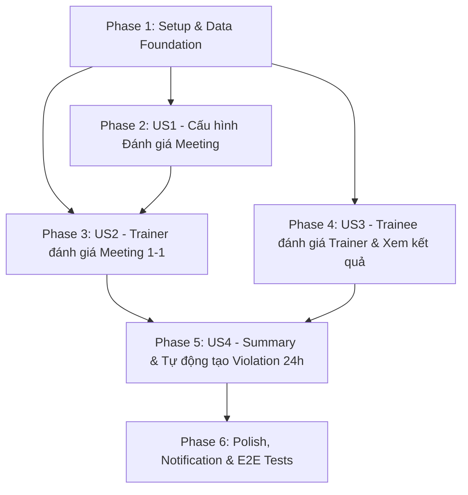

# Tasks: Đánh Giá Buổi Học (Trainer Đánh Giá Meeting 1-1 & Trainee Đánh Giá Trainer)

**Input**: Design documents from `specs/004-meeting-evaluation/`
**Prerequisites**: [plan.md](file:///Users/nguyenhuynh/Documents/dut-ai-manager/specs/004-meeting-evaluation/plan.md), [spec.md](file:///Users/nguyenhuynh/Documents/dut-ai-manager/specs/004-meeting-evaluation/spec.md), [data-model.md](file:///Users/nguyenhuynh/Documents/dut-ai-manager/specs/004-meeting-evaluation/data-model.md), [contracts/evaluation-api.json](file:///Users/nguyenhuynh/Documents/dut-ai-manager/specs/004-meeting-evaluation/contracts/evaluation-api.json)

---

## Phase 1: Setup & Data Foundation

**Purpose**: Thiết lập schema cơ sở dữ liệu, Alembic migration và Domain Entities nền tảng cho bảng riêng `meeting_overall_evaluations` (quan hệ 1 - 1 với meeting) và `meeting_evaluations`.

- [x] T001 Tạo Alembic migration thêm bảng riêng biệt `meeting_overall_evaluations` với các cột (`id` PK, `meeting_id` FK UNIQUE, `trainer_id` FK, `scores` JSONB, `average_score` Float, `general_feedback` Text, `created_at`, `updated_at`) và duy trì bảng `meeting_evaluations` cho Trainee trong `backend/alembic/versions/`
- [x] T002 [P] Định nghĩa Domain Entity `MeetingOverallEvaluation` và cập nhật `MeetingEvaluation` trong `backend/app/meeting/domain/entity.py`
- [x] T003 [P] Cập nhật ORM Models `MeetingOverallEvaluationModel` và `MeetingEvaluationModel` trong `backend/app/meeting/infrastructure/model.py`
- [x] T004 Xây dựng `MeetingOverallEvaluationRepository` và cập nhật `MeetingEvaluationRepository` (CRUD, ràng buộc duy nhất, tính điểm trung bình) trong `backend/app/meeting/infrastructure/repository.py`
- [x] T005 Đăng ký các Repositories mới vào Dishka container trong `backend/app/meeting/providers.py`

**Checkpoint**: Nền tảng dữ liệu và Repository sẵn sàng cho việc Trainer đánh giá buổi học 1-1 và Trainee đánh giá Trainer.

---

## Phase 2: User Story 1 - Trainer tạo buổi học có cấu hình Đánh giá 2 chiều (Priority: P1)

**Goal**: Cho phép Trainer bật cờ `enable_evaluation` khi tạo/cập nhật buổi học, tự động tính mốc `evaluation_deadline` (24h sau `end_time`).

**Independent Test**: Tạo một Meeting với `enable_evaluation: true`, kiểm tra kết quả trả về có `enable_evaluation: true` và `evaluation_deadline = end_time + 24h`.

- [x] T006 [P] [US1] Cập nhật Pydantic DTOs `MeetingCreateRequest`, `MeetingUpdateRequest`, `MeetingResponse` xác nhận cấu hình `enable_evaluation` và `evaluation_deadline` trong `backend/app/meeting/schemas.py`
- [x] T007 [US1] Đảm bảo `CreateMeetingUseCase` và `UpdateMeetingUseCase` thiết lập chính xác `enable_evaluation` và tính deadline 24h trong `backend/app/meeting/application/create_meeting_use_case.py`
- [x] T008 [P] [US1] Đảm bảo giao diện tạo/sửa Meeting trên Frontend có toggle bật "Đánh giá buổi học (24h)" trong `frontend/src/features/meeting/components/`

**Checkpoint**: Trainer có thể tạo và cấu hình các buổi học có bật tính năng đánh giá.

---

## Phase 3: User Story 2 - Trainer đánh giá tổng thể Buổi học (Quan hệ 1 - 1) sau buổi học (Priority: P1) 🎯 MVP Core

**Goal**: Thay vì chấm từng Trainee ($1 - n$), Trainer chỉ cần gửi 01 phiếu đánh giá tổng thể cho cả buổi học ($1 - 1$) theo 4 tiêu chí chuẩn hóa giữ nguyên (Chuyên cần & Tác phong, Mức độ Tương tác & Đóng góp, Mức độ Tiếp thu & Hiểu bài, Mức độ Chuẩn bị bài trước buổi học) kèm nhận xét chung.

**Independent Test**: Trainer gửi request đánh giá tổng thể meeting, kiểm tra bản ghi được lưu vào bảng `meeting_overall_evaluations`, tính đúng `average_score`, và chặn gửi lần 2 (quan hệ 1 - 1).

- [x] T009 [P] [US2] Định nghĩa Pydantic Schemas `SubmitMeetingOverallEvaluationRequest`, `MeetingOverallEvaluationResponse` trong `backend/app/meeting/schemas.py`
- [x] T010 [US2] Xây dựng `SubmitMeetingOverallEvaluationUseCase` (kiểm tra quyền Trainer, kiểm tra meeting đã kết thúc, tính `average_score`, lưu vào `meeting_overall_evaluations`, ngăn chặn gửi trùng) trong `backend/app/meeting/application/submit_meeting_overall_evaluation_use_case.py`
- [x] T011 [US2] Xây dựng `GetMeetingOverallEvaluationUseCase` (lấy chi tiết đánh giá tổng thể của buổi học, công khai cho mọi Trainee tham gia xem) trong `backend/app/meeting/application/get_meeting_overall_evaluation_use_case.py`
- [x] T012 [US2] Đăng ký use cases mới vào Dishka container trong `backend/app/meeting/providers.py` và export qua `backend/app/meeting/application/__init__.py`
- [x] T013 [US2] Thêm REST endpoints `POST /api/v1/meetings/{meeting_id}/evaluations/overall` và `GET /api/v1/meetings/{meeting_id}/evaluations/overall` trong `backend/app/meeting/controller.py`
- [x] T014 [P] [US2] Xây dựng component `MeetingOverallEvaluationModal.tsx` trên Frontend cho phép Trainer chấm điểm 4 tiêu chí và viết nhận xét chung trong `frontend/src/features/meeting/components/`
- [x] T015 [P] [US2] Tích hợp nút mở form đánh giá meeting 1-1 trên giao diện chi tiết Meeting cho Trainer trong `frontend/src/features/meeting/`

**Checkpoint**: Trainer đánh giá nhanh gọn toàn bộ buổi học chỉ với 01 form và 01 click.

---

## Phase 4: User Story 3 - Trainee đánh giá Trainer với tùy chọn Ẩn danh & Xem kết quả Buổi học (Priority: P1)

**Goal**: Trainee đã tham gia (`JOINED`/`COMPLETED`) gửi đánh giá cho Trainer theo 4 tiêu chí giảng dạy; hỗ trợ tùy chọn "Gửi ẩn danh" (vẫn lưu ID trong DB nhưng mask ở tầng hiển thị). Trainee được xem ngay kết quả đánh giá tổng thể meeting do Trainer gửi.

**Independent Test**: Trainee xem được đánh giá overall của buổi học; Trainee gửi đánh giá Trainer với `is_anonymous: true`, kiểm tra DB có lưu `reviewer_id` nhưng API summary mask danh tính học viên.

- [x] T016 [P] [US3] Định nghĩa Schemas `TraineeSubmitEvaluationRequest` trong `backend/app/meeting/schemas.py`
- [x] T017 [US3] Xây dựng/cập nhật `SubmitTraineeEvaluationUseCase` (kiểm tra Trainee có tham gia buổi học, chặn gửi trùng lặp, lưu `reviewer_id` và cờ `is_anonymous` vào bảng `meeting_evaluations`) trong `backend/app/meeting/application/submit_trainee_evaluation_use_case.py`
- [x] T018 [US3] Đăng ký use case vào `backend/app/meeting/providers.py` và export qua `backend/app/meeting/application/__init__.py`
- [x] T019 [US3] Thêm/cập nhật REST endpoint `POST /api/v1/meetings/{meeting_id}/evaluations/trainee` trong `backend/app/meeting/controller.py`
- [x] T020 [P] [US3] Xây dựng UI Form `TraineeEvaluationModal.tsx` có checkbox "Gửi ẩn danh" và tích hợp API `meetingEvaluationApi.ts` trong `frontend/src/features/meeting/components/`
- [x] T021 [P] [US3] Cập nhật giao diện chi tiết Buổi học cho Trainee: Hiển thị ngay kết quả đánh giá tổng thể của buổi học từ Trainer mà không đòi hỏi điều kiện ràng buộc trong `frontend/src/features/meeting/components/`

**Checkpoint**: Trainee đánh giá Trainer (ẩn danh/công khai) và xem được ngay đánh giá tổng thể lớp học từ Trainer.

---

## Phase 5: User Story 4 - Báo cáo tổng hợp, Chế tài 24h & Tự động tạo Vi phạm (Priority: P2)

**Goal**: Tổng hợp điểm số meeting overall và phản hồi của Trainee; Tác vụ tự động quét sau 24h: tạo `Violation` cho Trainer nếu chưa gửi `MeetingOverallEvaluation`, và tạo `Violation` cho Trainee nếu chưa gửi đánh giá Trainer.

**Independent Test**: Kích hoạt cron job quét hạn chót với meeting quá 24h, kiểm tra bản ghi `Violation` được tạo chính xác cho Trainer (nếu chưa có overall evaluation) hoặc Trainee (nếu chưa gửi đánh giá Trainer).

- [x] T022 [P] [US4] Xây dựng `GetMeetingEvaluationSummaryUseCase` (lấy điểm overall của meeting và tổng hợp điểm trung bình 4 tiêu chí giảng dạy từ Trainee có mask ẩn danh) trong `backend/app/meeting/application/get_meeting_evaluation_summary_use_case.py`
- [x] T023 [US4] Cập nhật `CheckEvaluationDeadlineJobUseCase` để quét hạn 24h: kiểm tra Trainer đã có `MeetingOverallEvaluation` chưa $\rightarrow$ tạo `Violation` nếu thiếu; kiểm tra Trainee đã tham gia nhưng chưa gửi đánh giá $\rightarrow$ tạo `Violation` trong `backend/app/meeting/application/check_evaluation_deadline_job_use_case.py`
- [x] T024 [US4] Đăng ký use cases và cấu hình cron job định kỳ trong `backend/app/jobs/meeting_evaluation_checker_job.py` và `backend/app/meeting/providers.py`
- [x] T025 [US4] Thêm REST endpoint `GET /api/v1/meetings/{meeting_id}/evaluations/summary` trong `backend/app/meeting/controller.py`
- [x] T026 [P] [US4] Xây dựng UI Component `MeetingEvaluationSummaryCard.tsx` hiển thị điểm overall của buổi học và các ý kiến đóng góp của học viên trong `frontend/src/features/meeting/components/`

**Checkpoint**: Báo cáo tổng hợp trực quan và cơ chế kỷ luật tự động 24h hoạt động trơn tru theo mô hình 1 - 1.

---

## Phase 6: Polish & Cross-Cutting Concerns

**Purpose**: Hoàn thiện thông báo nhắc nhở, kiểm thử tự động và kiểm thử End-to-End.

- [x] T027 [P] Tích hợp gửi thông báo nhắc nhở đánh giá qua EventBus / Bot khi meeting kết thúc và khi sắp hết hạn 24h trong `backend/app/meeting/application/event_handlers.py`
- [x] T028 Viết Unit Tests cho các Use Cases đánh giá mới (`SubmitMeetingOverallEvaluationUseCase`, `SubmitTraineeEvaluationUseCase`, `CheckEvaluationDeadlineJobUseCase`) trong `backend/tests/unit/meeting/`
- [x] T029 Chạy kịch bản kiểm thử End-to-End theo `specs/004-meeting-evaluation/quickstart.md` trên cả Backend và Frontend

---

## Dependencies & Execution Order

---

## Implementation Strategy (MVP Incremental Delivery)

1. **Bước 1 (MVP)**: Hoàn thành Phase 1 + Phase 2 + Phase 3 $\rightarrow$ Trainer có thể tạo meeting và gửi 01 phiếu đánh giá tổng thể cho meeting ($1 - 1$).
2. **Bước 2**: Hoàn thành Phase 4 $\rightarrow$ Trainee gửi phản hồi trực tiếp cho Trainer (hỗ trợ ẩn danh) và xem ngay kết quả đánh giá meeting của Trainer.
3. **Bước 3**: Hoàn thành Phase 5 $\rightarrow$ Báo cáo tổng hợp và tự động phạt `Violation` cho Trainer hoặc Trainee quá hạn 24h.
4. **Bước 4**: Hoàn thành Phase 6 $\rightarrow$ Kiểm thử tự động và thông báo nhắc nhở.
