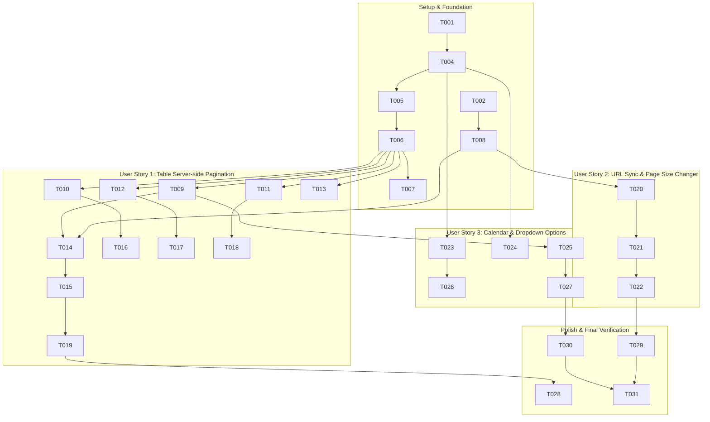

# Tasks: Đồng Nhất Kiến Trúc Phân Trang Giữa Frontend và Backend (Unified FE-BE Pagination)

**Input**: Design documents from `specs/009-unified-fe-be-pagination/`  
**Prerequisites**: `plan.md`, `spec.md`, `research.md`, `data-model.md`, `contracts/pagination-api-contract.md`  
**Organization**: Tasks are grouped by user story to enable independent implementation and testing of each story.

---

## Format: `[ID] [P?] [Story] Description`

- **[P]**: Can run in parallel (different files, no dependencies)
- **[Story]**: Which user story this task belongs to (e.g., US1, US2, US3)
- Includes exact file paths in every task description

---

## Phase 1: Setup (Shared Infrastructure & Types)

**Purpose**: Định nghĩa các data structures, envelope DTO và interface nền tảng cho cả Backend, Frontend và Zalo Mini App.

- [X] T001 [P] Mở rộng DTO `ApiResponse` và định nghĩa `PaginationMeta` (`page`, `page_size`, `total`, `total_pages`, `has_next`) trong `backend/app/shared/application/response.py`
- [X] T002 [P] Định nghĩa interface `PaginationMeta` và cập nhật `ApiResponse<T>` trong `frontend/src/types/api.types.ts`
- [X] T003 [P] Cập nhật interface `PaginationMeta` và `ApiResponse<T>` trong `zalo-mini-app/dut-manager/src/types/api.types.ts`

---

## Phase 2: Foundational (Core Infrastructure & Base Repository)

**Purpose**: Xây dựng hạ tầng xử lý phân trang cốt lõi tại Backend và Hook chuẩn tại Frontend mà mọi User Story đều phụ thuộc.

**⚠️ CRITICAL**: Các User Story không thể triển khai cho đến khi pha này hoàn tất.

- [X] T004 Xây dựng FastAPI dependency `PaginationParams` (`page: int = 1, page_size: int = 20, max=100`) và `PagedResult[TEntity]` trong `backend/app/shared/application/pagination.py`
- [X] T005 Cập nhật `build_query_support` và `OffsetPaginationParams` để hỗ trợ chuyển đổi từ `(page, page_size)` sang offset/limit trong `backend/app/shared/application/query_support_utils.py` và `backend/app/shared/domain/query_support.py`
- [X] T006 Triển khai phương thức dùng chung `get_paged(query_support, deleted)` trong `backend/app/shared/infrastructure/base_repository.py` với câu lệnh `COUNT` tối ưu độc lập (loại bỏ `ORDER BY` và eager joins)
- [X] T007 [P] Viết unit test xác nhận tính toán `PaginationMeta` và câu lệnh `BaseRepository.get_paged` trong `backend/tests/unit/test_pagination_core.py`
- [X] T008 [P] Xây dựng Custom Hook `useTablePagination` tích hợp `useSearchParams` và tự động sinh cấu hình Ant Design Table chuẩn hóa theo Constitution Điều VIII tại `frontend/src/hooks/useTablePagination.ts`

**Checkpoint**: Hạ tầng dùng chung đã sẵn sàng - việc áp dụng phân trang vào từng module có thể bắt đầu.

---

## Phase 3: User Story 1 - Phân trang Server-side chính xác cho Bảng Quản trị (Priority: P1) 🎯 MVP

**Goal**: Thay thế toàn bộ các tham số `skip`/`limit` bằng `page`/`page_size` trên các API danh sách quản trị chính và chuyển đổi các bảng Ant Design sang phân trang Server-side thực thụ.

**Independent Test**: Gọi API và truy cập giao diện bảng Cuộc họp, Vi phạm, Người dùng, Bài tập; xác nhận hiển thị chính xác 20 dòng trên mỗi trang cùng dòng tổng số bản ghi và phân trang server-side không bị cắt cụt.

### Implementation for User Story 1

- [X] T009 [P] [US1] Chuyển đổi endpoint `get_meetings` và `GetMeetingsUseCase` sang `PaginationParams`, gọi `repo.get_paged` trong `backend/app/meeting/controller.py` và `backend/app/meeting/application/get_meetings_use_case.py`
- [X] T010 [P] [US1] Chuyển đổi endpoint `get_violations` và `GetViolationsUseCase` sang `PaginationParams`, gọi `repo.get_paged` trong `backend/app/violation/controller.py` và `backend/app/violation/application/get_violations_use_case.py`
- [X] T011 [P] [US1] Chuyển đổi endpoint `get_homeworks` và `GetHomeworksUseCase` sang `PaginationParams`, gọi `repo.get_paged` trong `backend/app/homework/controller.py` và `backend/app/homework/application/get_homeworks_use_case.py`
- [X] T012 [P] [US1] Cập nhật endpoint `list_users` và `GetUserUseCase` nhận `PaginationParams`, gọi `repo.get_paged` trong `backend/app/user/controller.py` và `backend/app/user/application/get_user_use_case.py`
- [X] T013 [P] [US1] Chuyển đổi endpoints danh sách trong `backend/app/billing/controller.py` và `backend/app/team/controller.py` sang `PaginationParams`, gọi `repo.get_paged`
- [X] T014 [US1] Cập nhật API service và hook danh sách cuộc họp nhận `page` & `page_size` trong `frontend/src/features/meeting/services/meeting.service.ts` và `frontend/src/features/meeting/hooks/useMeetings.ts`
- [X] T015 [US1] Áp dụng `useTablePagination` vào component bảng cuộc họp trong `frontend/src/features/meeting/components/MeetingTable.tsx`
- [X] T016 [P] [US1] Cập nhật service và áp dụng `useTablePagination` vào bảng vi phạm trong `frontend/src/features/violations/services/violation.service.ts` và `frontend/src/features/violations/components/ViolationTable.tsx`
- [X] T017 [P] [US1] Cập nhật service và áp dụng `useTablePagination` vào bảng người dùng trong `frontend/src/features/users/services/user.service.ts` và `frontend/src/features/users/components/UserTable.tsx`
- [X] T018 [P] [US1] Cập nhật service và áp dụng `useTablePagination` vào bảng bài tập trong `frontend/src/features/homework/services/homework.service.ts` và `frontend/src/features/homework/components/HomeworkTable.tsx`
- [X] T019 [US1] Viết Integration tests xác nhận phân trang Meeting, Violation và User API tại `backend/tests/api/test_pagination_endpoints.py`

**Checkpoint**: User Story 1 hoàn thành - Toàn bộ các bảng danh sách quản trị chính đã phân trang Server-side chuẩn xác.

---

## Phase 4: User Story 2 - Đổi kích thước trang (Page Size Changer) và URL Sync 2 chiều (Priority: P1)

**Goal**: Đảm bảo trạng thái phân trang (`page`, `pageSize`) được đồng bộ 2 chiều lên URL Search Params (`?page=...&pageSize=...`), bảo toàn trạng thái khi F5 reload hoặc chia sẻ link, và tự động reset về trang 1 khi thay đổi điều kiện lọc.

**Independent Test**: Thay đổi kích thước trang từ 20 sang 50 bản ghi, kiểm tra URL cập nhật `?page=1&pageSize=50`; chuyển sang trang 2 và nhấn F5, kiểm tra trang vẫn giữ nguyên ở trang 2 với đúng dữ liệu.

### Implementation for User Story 2

- [X] T020 [US2] Hoàn thiện cấu hình `pageSizeOptions: ['10', '20', '50', '100']`, `showSizeChanger: true`, và cơ chế reset về trang 1 khi đổi bộ lọc trong `frontend/src/hooks/useTablePagination.ts`
- [X] T021 [US2] Tích hợp hàm `resetPage` của `useTablePagination` vào các thanh lọc tìm kiếm của `MeetingPage.tsx`, `ViolationPage.tsx`, và `UserPage.tsx`
- [X] T022 [P] [US2] Viết frontend unit test cho hook `useTablePagination` kiểm tra logic đồng bộ URL và chuyển trang tại `frontend/src/hooks/__tests__/useTablePagination.test.ts`

**Checkpoint**: User Story 2 hoàn thành - Trải nghiệm phân trang có thể bookmark, chia sẻ và giữ nguyên vị trí khi tải lại trang.

---

## Phase 5: User Story 3 - Bảo toàn hiển thị cho Lịch và Dropdown (Priority: P1)

**Goal**: Cung cấp các endpoint chuyên biệt `/options` cho Form Select và đảm bảo màn hình Lịch tuần/tháng (`Calendar`) lấy trọn vẹn dữ liệu trong khoảng thời gian mà không bị cắt cụt bởi phân trang.

**Independent Test**: Mở màn hình Lịch tuần tại `RobotActivityPage` xác nhận hiển thị đầy đủ mọi cuộc họp trong tuần; mở modal tạo cuộc họp/giao bài tập kiểm tra dropdown User hiển thị đầy đủ danh sách học viên active.

### Implementation for User Story 3

- [X] T023 [P] [US3] Tạo endpoint `GET /users/options` trả về danh sách rút gọn `list[UserOptionDto]` (`id`, `name`, `email`, `avatar_url`) không phân trang trong `backend/app/user/controller.py`
- [X] T024 [P] [US3] Tạo endpoint `GET /teams/options` trả về danh sách rút gọn `list[TeamOptionDto]` (`id`, `name`) không phân trang trong `backend/app/team/controller.py`
- [X] T025 [US3] Bảo đảm endpoint `GET /meetings` khi có `start_date` và `end_date` sẽ trả về toàn bộ cuộc họp trong khoảng ngày mà không bị giới hạn 20 dòng trong `backend/app/meeting/controller.py`
- [X] T026 [US3] Cập nhật các ô Select User và Select Trainer trong các modal form sử dụng endpoint `/users/options` tại `frontend/src/features/meeting/components/` và `frontend/src/features/homework/components/`
- [X] T027 [US3] Kiểm tra giao diện Lịch tuần `RobotActivityPage.tsx` và `MeetingParticipantsTab.tsx` xác nhận không bị mất dữ liệu hiển thị

**Checkpoint**: User Story 3 hoàn thành - Loại bỏ hoàn toàn nguy cơ mất dữ liệu hiển thị trên Lịch và Dropdown Select.

---

## Phase 6: Polish & Cross-Cutting Concerns

**Purpose**: Đồng bộ Zalo Mini App, kiểm tra toàn diện chất lượng mã nguồn, typecheck và kiểm thử hồi quy.

- [X] T028 [P] Cập nhật các API services trong `zalo-mini-app/dut-manager/src/services/api/` (`meeting.service.ts`, `homework.service.ts`, `team.service.ts`, `permission.service.ts`) từ `skip`/`limit` sang `page`/`page_size`
- [X] T029 Chạy bộ kiểm thử backend `pytest backend/tests/` bảo đảm 100% tests pass và không có hồi quy logic
- [X] T030 [P] Chạy kiểm tra TypeScript build `npm run build` trong `frontend/` và `zalo-mini-app/dut-manager/` bảo đảm 0 lỗi biên dịch
- [X] T031 Hoàn thiện tài liệu OpenAPI/Swagger và cập nhật hướng dẫn nghiệm thu tại `specs/009-unified-fe-be-pagination/quickstart.md`

---

## Dependencies & Completion Order

---

## Parallel Execution Opportunities

- **Giai đoạn Setup (Phase 1)**: T001 (BE DTO), T002 (FE Types), T003 (Zalo Types) có thể chạy song song 100%.
- **Giai đoạn Foundation (Phase 2)**: T007 (Unit test BE) và T008 (Hook FE) có thể chạy song song độc lập.
- **Giai đoạn Story 1 Backend (Phase 3)**: T009, T010, T011, T012, T013 có thể cập nhật song song trên từng controller riêng biệt.
- **Giai đoạn Story 1 Frontend (Phase 3)**: T016, T017, T018 có thể áp dụng hook song song trên từng feature component.
- **Giai đoạn Story 3 (Phase 5)**: T023 (`/users/options`) và T024 (`/teams/options`) có thể thực hiện song song.

---

## Implementation Strategy & MVP Scope

1. **MVP Scope (Pha 1, 2, 3)**:
   - Hoàn thành `ApiResponse.pagination`, `PaginationParams`, `BaseRepository.get_paged`.
   - Chuyển đổi Meeting và Violation sang phân trang Server-side cùng hook `useTablePagination`.
   - Nghiệm thu ngay lập tức giá trị: Bảng Cuộc họp và Vi phạm hiển thị đầy đủ dữ liệu phân trang thật từ Server, không còn bị cắt cụt ở 100 bản ghi.
2. **Giai đoạn 2 (Pha 4, 5)**:
   - Bổ sung URL sync và Page Size Changer cho toàn bộ các bảng.
   - Bổ sung `/users/options` và bảo toàn Calendar view.
3. **Giai đoạn 3 (Pha 6)**:
   - Đồng bộ Zalo Mini App và chạy toàn bộ test hồi quy.
