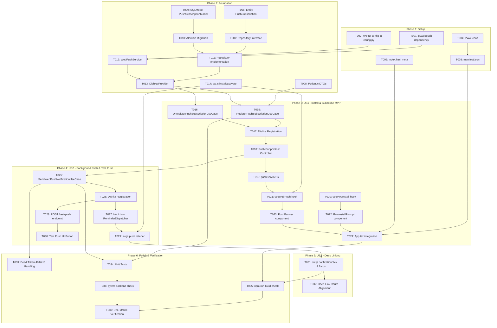

# Tasks: PWA & Web Push Notification System

**Input**: Design documents from `specs/022-pwa-web-push-notifications/`
- Spec: [spec.md](./spec.md)
- Plan: [plan.md](./plan.md)
- Data Model: [data-model.md](./data-model.md)
- Contracts: [push-api-contracts.md](./contracts/push-api-contracts.md)
- Quickstart: [quickstart.md](./quickstart.md)

---

## Format: `[TaskID] [P?] [Story?] Description with exact file path`
- **[P]**: Có thể chạy song song (khác tệp, không phụ thuộc vào task chưa hoàn thành)
- **[Story]**: Gắn nhãn User Story tương ứng (`[US1]`, `[US2]`, `[US3]`)
- *Lưu ý*: User Story 4 đã được loại khỏi phạm vi tính năng theo chỉ đạo.

---

## Phase 1: Setup & Environment Initialization (Cài đặt & Khởi tạo Môi trường)

- [X] T001 Cập nhật file cấu hình dependencies backend `backend/pyproject.toml` bổ sung thư viện `pywebpush>=2.0.0`
- [X] T002 [P] Bổ sung cấu hình biến môi trường VAPID (`VAPID_PUBLIC_KEY`, `VAPID_PRIVATE_KEY`, `VAPID_CLAIMS_SUB`) trong `backend/app/core/config.py`
- [X] T003 [P] Tạo tệp Web App Manifest `frontend/public/manifest.json` định nghĩa tên ứng dụng, màu sắc chủ đạo, chế độ `standalone` và bộ icon chuẩn PWA
- [X] T004 [P] Khởi tạo các assets biểu tượng PWA kích cỡ 192x192 và 512x512 trong thư mục `frontend/public/icons/`
- [X] T005 [P] Cập nhật `frontend/index.html` bổ sung thẻ `<link rel="manifest">`, `<meta name="theme-color">`, và các thẻ meta hỗ trợ iOS Safari Add to Home Screen

**Checkpoint**: Môi trường, cấu hình VAPID và các tệp manifest nền tảng PWA sẵn sàng.

---

## Phase 2: Foundational Infrastructure (Database, Domain Models & Service Worker)

- [X] T006 [P] Định nghĩa Domain Entity `PushSubscription` trong `backend/app/reminder/domain/entity.py`
- [X] T007 [P] Định nghĩa interface `PushSubscriptionRepository` trong `backend/app/reminder/domain/repository.py`
- [X] T008 [P] Định nghĩa Pydantic DTOs cho Web Push (`PushSubscriptionRequestDto`, `PushSubscriptionResponseDto`, `PushPublicKeyDto`, `TestPushResponseDto`) trong `backend/app/reminder/application/dtos.py`
- [X] T009 Định nghĩa SQLModel ORM `PushSubscriptionModel` (bảng `push_subscriptions`) với ràng buộc `unique endpoint` và khóa ngoại `users.id` trong `backend/app/reminder/infrastructure/model.py`
- [X] T010 Tạo migration Alembic cho bảng `push_subscriptions` trong thư mục `backend/alembic/versions/`
- [X] T011 Hiện thực `PushSubscriptionRepositoryImpl` (hỗ trợ `save_or_update`, `get_by_endpoint`, `get_active_by_user_id`, `deactivate_endpoint`) trong `backend/app/reminder/infrastructure/repository.py`
- [X] T012 Tạo service `WebPushService` bọc thư viện `pywebpush` với VAPID keys, mã hóa payload và xử lý lỗi kết nối trong `backend/app/reminder/infrastructure/web_push_service.py`
- [X] T013 Đăng ký `PushSubscriptionRepository` và `WebPushService` vào Dishka container trong `backend/app/reminder/providers.py`
- [X] T014 [P] Khởi tạo Service Worker cơ bản `frontend/public/sw.js` xử lý sự kiện `install` và `activate` (`skipWaiting`, `clients.claim`)

**Checkpoint**: Nền tảng cơ sở dữ liệu, Dishka DI và Service Worker cơ bản đã sẵn sàng hoạt động.

---

## Phase 3: User Story 1 - Cài đặt PWA & Đăng ký nhận Thông báo Đẩy (Priority: P1 - MVP) 🎯 Core Foundation

### Backend Use Cases & API
- [X] T015 [P] [US1] Xây dựng Use Case `RegisterPushSubscriptionUseCase` xử lý lưu hoặc tái kích hoạt subscription trong `backend/app/reminder/application/register_push_subscription_use_case.py`
- [X] T016 [P] [US1] Xây dựng Use Case `UnregisterPushSubscriptionUseCase` xử lý hủy kích hoạt endpoint khi đăng xuất trong `backend/app/reminder/application/unregister_push_subscription_use_case.py`
- [X] T017 [US1] Đăng ký `RegisterPushSubscriptionUseCase` và `UnregisterPushSubscriptionUseCase` vào Dishka container trong `backend/app/reminder/providers.py`
- [X] T018 [US1] Bổ sung các endpoints `GET /api/v1/notifications/push-public-key`, `POST /api/v1/notifications/push-subscriptions`, `DELETE /api/v1/notifications/push-subscriptions` vào `backend/app/reminder/controller.py`

### Frontend PWA Hooks & UI Components
- [X] T019 [P] [US1] Tạo service client `frontend/src/features/pwa/services/pushService.ts` gọi các API VAPID public key, đăng ký và hủy đăng ký subscription
- [X] T020 [P] [US1] Xây dựng custom hook `frontend/src/features/pwa/hooks/usePwaInstall.ts` bắt sự kiện `beforeinstallprompt` (Android), phát hiện standalone mode (iOS Safari)
- [X] T021 [P] [US1] Xây dựng custom hook `frontend/src/features/pwa/hooks/useWebPush.ts` đăng ký Service Worker, chuyển đổi khóa VAPID `Uint8Array`, gọi `pushManager.subscribe()` và lưu subscription lên máy chủ
- [X] T022 [P] [US1] Xây dựng UI component `frontend/src/features/pwa/components/PwaInstallPrompt.tsx` hiển thị banner/modal hướng dẫn cài đặt trực quan cho Android và iOS
- [X] T023 [P] [US1] Xây dựng UI component `frontend/src/features/pwa/components/PushBanner.tsx` hiển thị thanh thông báo đề xuất kích hoạt Web Push
- [X] T024 [US1] Tích hợp `PwaInstallPrompt` và `PushBanner` vào layout chính trong `frontend/src/App.tsx`

**Checkpoint MVP**: Người dùng cài đặt được PWA ra màn hình chính (Android & iOS Safari), cấp quyền thông báo và lưu token thiết bị thành công về cơ sở dữ liệu.

---

## Phase 4: User Story 2 - Tự động đẩy thông báo ra màn hình khóa khi có sự kiện (Priority: P1)

### Backend Dispatcher & Test Push
- [X] T025 [US2] Xây dựng Use Case `SendWebPushNotificationUseCase` (lấy danh sách thiết bị active của user, định dạng payload JSON theo schema, đẩy qua `WebPushService`) trong `backend/app/reminder/application/send_web_push_notification_use_case.py`
- [X] T026 [US2] Đăng ký `SendWebPushNotificationUseCase` vào Dishka container trong `backend/app/reminder/providers.py`
- [X] T027 [US2] Tích hợp gọi `SendWebPushNotificationUseCase` vào `ReminderDispatcher` trong `backend/app/reminder/application/reminder_dispatcher.py` để tự động đẩy Web Push đồng thời khi lưu thông báo in-app
- [X] T028 [US2] Thêm endpoint gửi thông báo thử nghiệm `POST /api/v1/notifications/test-push` vào `backend/app/reminder/controller.py`

### Service Worker & UI Push Testing
- [X] T029 [US2] Cập nhật `frontend/public/sw.js` bổ sung listener sự kiện `push`, giải mã JSON payload (title, body, icon, badge, tag, data) và gọi `self.registration.showNotification()`
- [X] T030 [P] [US2] Bổ sung nút "Gửi thông báo thử nghiệm tới thiết bị này" trong giao diện thông báo tại `frontend/src/features/notification/pages/NotificationManagementPage.tsx`

**Checkpoint**: Máy chủ tự động đẩy thông báo ra màn hình khóa khi có sự kiện (hoặc khi bấm test push) ngay cả khi ứng dụng đã đóng hoàn toàn.

---

## Phase 5: User Story 3 - Chạm vào thông báo để mở thẳng trang nội dung chi tiết (Priority: P2)

- [X] T031 [US3] Cập nhật `frontend/public/sw.js` bổ sung listener sự kiện `notificationclick`: đọc `event.notification.data.url`, tìm kiếm client window đang mở để `focus()` và `navigate()`, hoặc mở tab mới qua `clients.openWindow()`, đồng thời gọi `event.notification.close()`
- [X] T032 [US3] Rà soát và đảm bảo các đường dẫn điều hướng URL (như `/schedule/meetings/{id}`, `/homeworks/{id}`, `/dashboard/notifications`) trong payload Web Push tương thích đồng bộ với React Router trong `frontend/src/routes/`

**Checkpoint**: Nhấn vào thông báo trên điện thoại mở ứng dụng và điều hướng tức thì đến đúng trang dữ liệu tương ứng.

---

## Phase 6: Polish, Hardening & Verification

- [X] T033 [P] Xử lý dọn dẹp token hết hạn (Dead Token Handling): Tự động đánh dấu `is_active = False` hoặc xóa bản ghi khi nhận mã lỗi HTTP 404/410 Gone từ Google FCM/Apple APNs trong `backend/app/reminder/application/send_web_push_notification_use_case.py`
- [X] T034 [P] Viết unit tests kiểm tra `RegisterPushSubscriptionUseCase`, `UnregisterPushSubscriptionUseCase`, và `SendWebPushNotificationUseCase` trong `backend/tests/unit/test_push_subscription_use_cases.py`
- [X] T035 Chạy kiểm tra build frontend `npm run build` để xác thực không có lỗi TypeScript hoặc cú pháp trong các components PWA và Service Worker
- [X] T036 Chạy test suite backend `pytest backend/tests/` đảm bảo toàn bộ tests pass và không có regression
- [X] T037 Thực hiện kiểm thử thủ công E2E theo kịch bản [quickstart.md](./quickstart.md) trên thiết bị di động (Android Chrome & iOS Safari PWA)

---

## Dependencies & Execution Sequence

