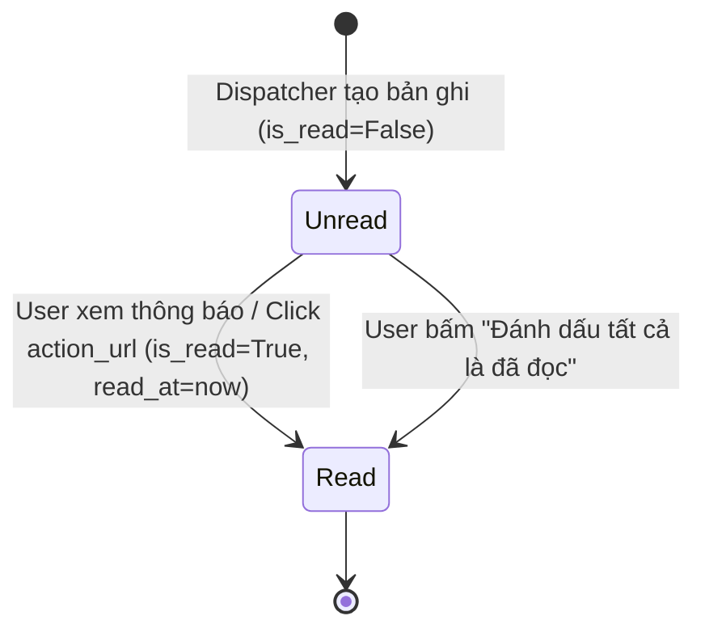
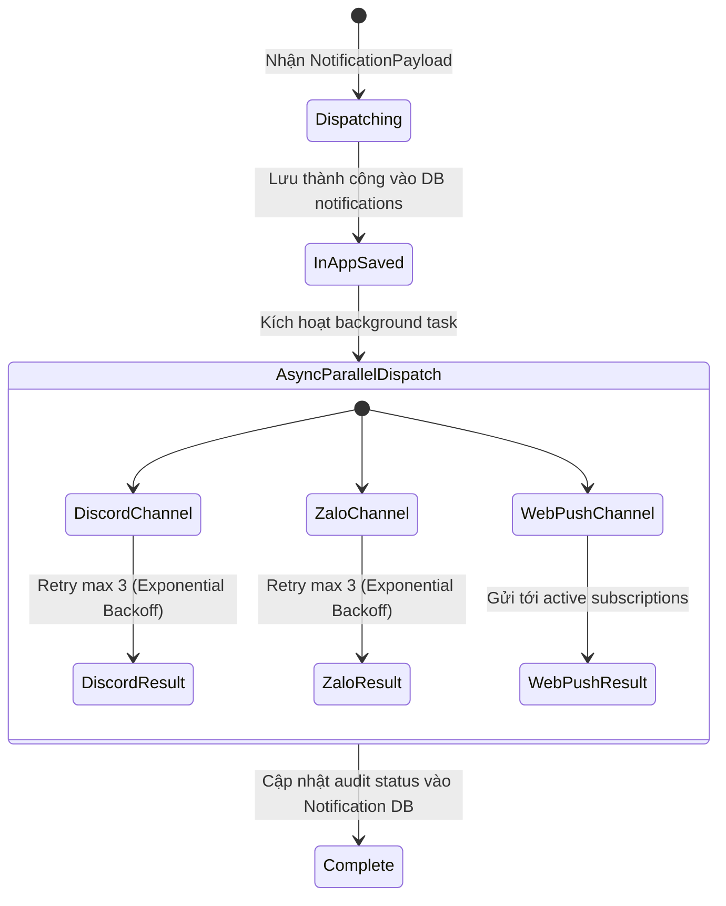

# Data Model: Unified Multi-Channel Notifications

**Feature**: `024-unified-multi-channel-notifications`
**Date**: 2026-10-22
**Status**: Ready for Implementation

## 1. Entity Definitions

### Notification (Domain Entity & SQLAlchemy Model)

Đại diện cho một thông báo đã gửi hoặc lưu trữ trong hệ thống, phục vụ hiển thị In-App và lưu vết kiểm toán đa kênh.

| Field | Type | Nullable | Default | Description |
|---|---|---|---|---|
| `id` | `Integer` | No | PK (Autoincrement) | Mã định danh duy nhất của thông báo |
| `user_id` | `Integer` | No | - | FK trỏ đến `users.id` (CASCADE delete) |
| `title` | `String(255)` | No | - | Tiêu đề thông báo |
| `content` | `Text` | No | - | Nội dung chi tiết |
| `category` | `String(50)` | No | "SYSTEM" | Phân loại nghiệp vụ (Enum) |
| `level` | `String(50)` | No | "INFO" | Mức độ cảnh báo (Enum) |
| `action_url` | `String(500)` | Yes | NULL | Đường dẫn điều hướng chi tiết |
| `image_asset` | `String(255)` | Yes | NULL | Tên file meme/asset trong `app/assets` |
| `is_read` | `Boolean` | No | False | Cờ đánh dấu đã đọc trên Web/Mini App |
| `read_at` | `DateTime` | Yes | NULL | Thời điểm người dùng đọc thông báo |
| `metadata_json` | `JSON` / `Text` | Yes | NULL | Dữ liệu ngữ cảnh linh hoạt (`invoice_id`, `points`, v.v.) |
| `task_type` | `String(50)` | Yes | NULL | Loại tác vụ nhắc việc (nếu là scheduled reminder) |
| `task_id` | `Integer` | Yes | NULL | ID tác vụ nhắc việc |
| `reminder_stage`| `String(50)` | Yes | NULL | Giai đoạn nhắc việc (24h, 12h, 2h, overdue, upcoming) |
| `discord_status`| `String(50)` | Yes | NULL | Trạng thái gửi Discord (SENT, DM_BLOCKED, FAILED, ...) |
| `zalo_status`   | `String(50)` | Yes | NULL | Trạng thái gửi Zalo Bot (SENT, NO_ID, FAILED, ...) |
| `web_push_status`| `String(50)`| Yes | NULL | Trạng thái gửi Web Push (SENT, NO_SUB, FAILED, ...) |
| `error_message` | `Text` | Yes | NULL | Thông tin lỗi chi tiết nếu có |
| `created_at` | `DateTime` | No | UTC+7 Now | Thời điểm tạo thông báo |

#### Indexes
- `idx_notif_user_unread`: `(user_id, is_read, created_at DESC)` -> Tối ưu hóa truy vấn danh sách thông báo chưa đọc và tính badge count.
- `idx_notif_user_created`: `(user_id, created_at DESC)` -> Tối ưu hóa phân trang lịch sử thông báo của người dùng.
- `idx_notif_dedup`: `(task_type, task_id, user_id, reminder_stage)` -> Tối ưu hóa kiểm tra chống trùng lặp nhắc việc định kỳ.

---

### NotificationPayload (Value Object / DTO)

Cấu trúc dữ liệu trao đổi thống nhất giữa các domain nghiệp vụ và `UnifiedNotificationDispatcher`.

```python
@dataclass(frozen=True)
class NotificationPayload:
    user_id: int
    title: str
    content: str
    category: NotificationCategory
    level: NotificationLevel = NotificationLevel.INFO
    image_asset: str | None = None
    image_url: str | None = None
    action_url: str | None = None
    fields: list[dict[str, Any]] | None = None
    color_hex: int | None = None
    metadata: dict[str, Any] | None = None
    # Hỗ trợ tùy biến gửi cho task nhắc nhở định kỳ (optional)
    task_type: TaskType | None = None
    task_id: int | None = None
    reminder_stage: ReminderStage | None = None
```

---

## 2. Enums & Value Sets

### NotificationCategory
- `HOMEWORK`: Bài tập về nhà (Giao bài mới, Chấm điểm)
- `MEETING`: Cuộc họp / Sinh hoạt (Tạo lịch, Điểm danh, Nhắc giờ họp)
- `DUTY`: Ca trực nhật
- `VIOLATION`: Kỷ luật & Vi phạm
- `BONUS_POINT`: Điểm rèn luyện / Khen thưởng
- `BILLING`: Tài chính, Tiền quỹ & Hóa đơn SePay
- `PERMISSION_REQUEST`: Đơn xin phép vắng/trễ
- `SYSTEM`: Thông báo hệ thống chung

### NotificationLevel
- `INFO`: Thông tin thông thường (Màu xanh dương / Default)
- `SUCCESS`: Thành công (Màu xanh lá - 0x2ECC71)
- `WARNING`: Cảnh báo (Màu cam - 0xE67E22)
- `CRITICAL`: Khẩn cấp / Vi phạm nặng (Màu đỏ - 0xE74C3C)

### ChannelType
- `IN_APP`: Database bảng `notifications`
- `DISCORD`: Discord DM / Room Embed
- `ZALO`: Zalo Bot Webhook / OA
- `WEB_PUSH`: Web Push VAPID RFC 8292

---

## 3. State Transitions

### Notification In-App Read Lifecycle



### Multi-Channel Dispatch Lifecycle


