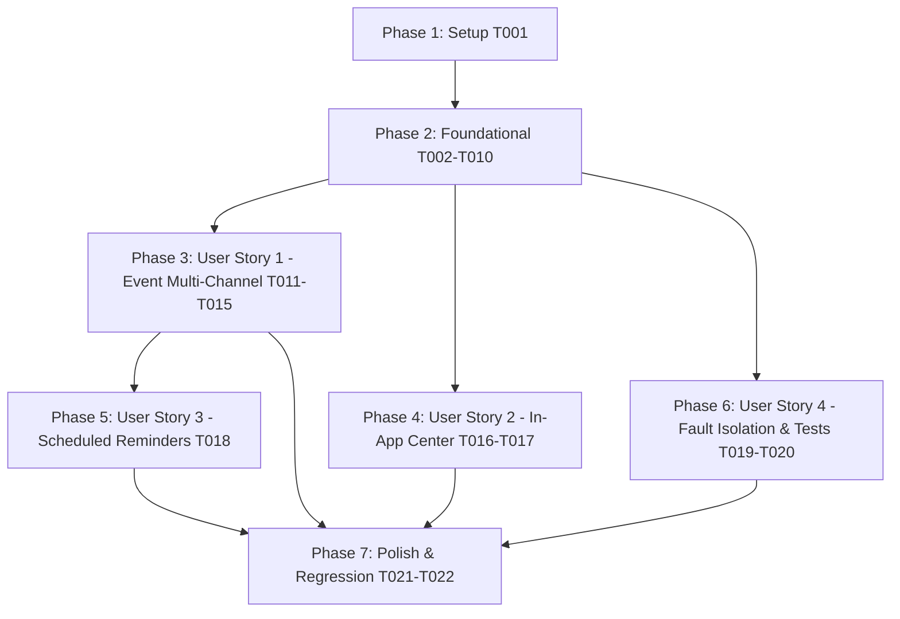

# Tasks: Unified Multi-Channel Notifications

**Input**: Design documents from `/specs/024-unified-multi-channel-notifications/`
**Prerequisites**: [plan.md](plan.md), [spec.md](spec.md), [research.md](research.md), [data-model.md](data-model.md), [contracts/notification-hub-api.md](contracts/notification-hub-api.md)

## Format: `[ID] [P?] [Story] Description`
- **[P]**: Có thể thực hiện song song (khác tệp, không phụ thuộc vào task đang dang dở)
- **[Story]**: Đánh dấu User Story thuộc về (US1, US2, US3, US4)

---

## Phase 1: Setup (Cấu trúc thư mục mới)

**Mục tiêu**: Chuẩn bị không gian mã nguồn mới cho các Adapter Channels và Cổng điều phối trung tâm.

- [X] T001 Tạo thư mục `backend/app/shared/infrastructure/notification/` và tệp `__init__.py`

---

## Phase 2: Foundational (Hạ tầng cốt lõi & Abstractions)

**Mục tiêu**: Xây dựng nền tảng Adapter Pattern, mở rộng DTO Payload, Entity Factory methods và Cổng điều phối trung tâm `UnifiedNotificationDispatcher`.

**⚠️ CRITICAL**: Các User Story phía sau phụ thuộc hoàn toàn vào giai đoạn này.

- [X] T002 Mở rộng `NotificationCategory` và `NotificationPayload` trong `backend/app/shared/infrastructure/notification_payload.py` để hỗ trợ đầy đủ các danh mục (`BILLING`, `HOMEWORK`, `VIOLATION`, `BONUS_POINT`, `MEETING`, `DUTY`, `PERMISSION_REQUEST`, `SYSTEM`), trường `metadata`, và các thuộc tính liên kết.
- [X] T003 Refactor Domain Entity `Notification` trong `backend/app/reminder/domain/entity.py`:
  - Thêm Factory method `Notification.create_event(...)` cho Domain Events (nhận `user_id`, `title`, `content`, `category`, `level`, `action_url`, `metadata_json`, `now`).
  - Tách biệt `create_deadline_reminder(...)` thuần túy cho luồng quét định kỳ, loại bỏ chuỗi `if-else` cồng kềnh.
- [X] T004 [P] Định nghĩa `NotificationChannel` protocol và `ChannelDeliveryResult` dataclass trong `backend/app/shared/infrastructure/notification/channel.py`.
- [X] T005 [P] Tạo `InAppNotificationChannel` trong `backend/app/shared/infrastructure/notification/in_app_channel.py` để lưu entity `Notification` vào database thông qua `NotificationRepository`.
- [X] T006 [P] Tạo `DiscordNotificationChannel` trong `backend/app/shared/infrastructure/notification/discord_channel.py` (tích hợp `DiscordService`, định dạng Rich Embed, hỗ trợ room chung và ảnh meme từ `app/assets` với cơ chế Retry 3 lần).
- [X] T007 [P] Tạo `ZaloNotificationChannel` trong `backend/app/shared/infrastructure/notification/zalo_channel.py` (tích hợp `ZaloBotClient`, gửi tin nhắn Zalo kèm link điều hướng và cơ chế Retry 3 lần).
- [X] T008 [P] Tạo `WebPushNotificationChannel` trong `backend/app/shared/infrastructure/notification/web_push_channel.py` (tích hợp `SendWebPushNotificationUseCase` để đẩy thông báo PWA RFC 8292).
- [X] T009 Xây dựng `UnifiedNotificationDispatcher` trong `backend/app/shared/infrastructure/notification/dispatcher.py` điều phối:
  - 1. Luôn lưu In-App (DB) trước tiên.
  - 2. Chạy ngầm (`asyncio.create_task`) phát tán song song các kênh ngoài (Discord, Zalo, Web Push) với Fault Isolation (`asyncio.gather(*tasks, return_exceptions=True)`).
  - 3. Cung cấp phương thức `dispatch_room` cho các thông báo quản trị chung.
- [X] T010 Đăng ký `InAppNotificationChannel`, `DiscordNotificationChannel`, `ZaloNotificationChannel`, `WebPushNotificationChannel` và `UnifiedNotificationDispatcher` vào Dishka container trong `backend/app/shared/providers.py`.

**Checkpoint**: Nền tảng Unified Notification Hub hoàn tất - sẵn sàng kết nối các Domain.

---

## Phase 3: User Story 1 - Phát thông báo đa kênh đồng bộ cho mọi biến động nghiệp vụ (Priority: P1) 🎯 MVP

**Mục tiêu**: Đảm bảo mọi sự kiện nghiệp vụ (Meeting, Homework, Violation, Bonus Point, Billing) đều phát thông báo đồng bộ qua cả 4 kênh (In-App DB, Discord, Zalo, Web Push).

**Independent Test**: Kích hoạt lần lượt các sự kiện `MeetingCreated`, `HomeworkAssigned`, `ViolationCreated`, `BonusPointCreated`, `InvoiceCreated` -> Xác nhận thông báo xuất hiện đầy đủ trong In-App DB và gửi đến Discord/Zalo của học viên.

- [X] T011 [US1] Cập nhật `MeetingNotificationHandler` trong `backend/app/meeting/application/event_handlers.py` và `backend/app/meeting/providers.py` để inject và sử dụng `UnifiedNotificationDispatcher` thay thế `NotificationService`.
- [X] T012 [P] [US1] Cập nhật `HomeworkNotificationHandler` trong `backend/app/homework/application/event_handlers.py` và `backend/app/homework/providers.py` để inject và sử dụng `UnifiedNotificationDispatcher`.
- [X] T013 [P] [US1] Cập nhật `ViolationNotificationHandler` trong `backend/app/violation/notification_handler.py` và `backend/app/violation/providers.py` để inject và sử dụng `UnifiedNotificationDispatcher`.
- [X] T014 [P] [US1] Cập nhật `BonusPointNotificationHandler` trong `backend/app/bonus_point/notification_handler.py` và `backend/app/bonus_point/providers.py` để inject và sử dụng `UnifiedNotificationDispatcher`.
- [X] T015 [P] [US1] Cập nhật `BillingNotificationHandler` trong `backend/app/billing/application/notification_handler.py` và `backend/app/billing/providers.py` để inject và sử dụng `UnifiedNotificationDispatcher`.

**Checkpoint**: User Story 1 hoàn thành - Toàn bộ các sự kiện nghiệp vụ đã tự động phát đa kênh và lưu In-App DB!

---

## Phase 4: User Story 2 - Quản lý và theo dõi danh sách thông báo In-App (Priority: P1)

**Mục tiêu**: Người dùng xem được lịch sử thông báo, huy hiệu badge đếm số lượng chưa đọc, và thao tác đánh dấu đã đọc trên Web Dashboard & Zalo Mini App.

**Independent Test**: Gọi API `/notifications/my` lấy danh sách thông báo -> Gọi `/notifications/unread-count` kiểm tra badge -> Gọi `/notifications/read-all` kiểm tra trạng thái cập nhật đã đọc.

- [X] T016 [US2] Kiểm tra và đảm bảo các API endpoints trong `backend/app/reminder/controller.py` (`/notifications/my`, `/notifications/unread-count`, `/notifications/{id}/read`, `/notifications/read-all`) đọc ghi chính xác từ `NotificationRepository`.
- [X] T017 [US2] Bổ sung trường `category`, `image_url`, `level` trong `NotificationDto` tại `backend/app/reminder/schemas.py` để đảm bảo Non-Null Contract cho Web Frontend và Zalo Mini App.

**Checkpoint**: User Story 2 hoàn thành - Trung tâm thông báo In-App hoạt động mượt mà với đầy đủ lịch sử!

---

## Phase 5: User Story 3 - Nhắc việc định kỳ đa kênh không bỏ sót (Priority: P2)

**Mục tiêu**: Nâng cấp hệ thống Scheduled Reminders (quét hạn chót nộp bài, ca trực nhật, đánh giá cuộc họp, cuộc họp sắp diễn ra) để phát tin đồng bộ qua cả Zalo Bot.

**Independent Test**: Chạy `POST /notifications/trigger` giả lập quét nhắc việc -> Xác minh học viên nhận được tin nhắc nhở trên cả Discord, Zalo Bot, Web Push và In-App DB.

- [X] T018 [US3] Tái cấu trúc `ReminderDispatcher` trong `backend/app/reminder/application/reminder_dispatcher.py` và `backend/app/reminder/providers.py` để ủy thác việc phát đa kênh cho `UnifiedNotificationDispatcher`, tự động mở rộng kênh Zalo Bot cho toàn bộ các Task Scanners.

**Checkpoint**: User Story 3 hoàn thành - Quét nhắc việc định kỳ đã phủ sóng toàn bộ các kênh!

---

## Phase 6: User Story 4 - Cách ly lỗi & Đảm bảo độ tin cậy khi gửi tin (Priority: P2)

**Mục tiêu**: Kiểm thử và đảm bảo tính ổn định cao của hệ thống: lỗi external channel không gây gián đoạn luồng nghiệp vụ.

**Independent Test**: Chạy test suite tự động với các kịch bản giả lập lỗi mạng / lỗi chặn DM.

- [X] T019 [US4] Viết Unit Tests trong `backend/tests/unit/test_unified_notification_dispatcher.py` kiểm tra:
  - Lưu In-App DB thành công ngay cả khi external channels gặp sự cố.
  - Cơ chế Fault Isolation khi 1 kênh ném Exception không làm ảnh hưởng các kênh khác.
  - Phân phối đồng thời đa kênh khi người dùng liên kết đủ tài khoản.
- [X] T020 [P] [US4] Viết Unit Tests trong `backend/tests/unit/test_notification_channels.py` kiểm tra logic Retry Exponential Backoff cho Discord và Zalo.

**Checkpoint**: User Story 4 hoàn thành - Hệ thống đạt độ tin cậy và tự hồi phục cao!

---

## Phase 7: Polish & Cross-Cutting Concerns

**Mục tiêu**: Dọn dẹp mã nguồn thừa, bảo đảm tuân thủ Hiến pháp hệ thống (Zero Redundant Backward Compatibility).

- [X] T021 Refactor `NotificationService` trong `backend/app/shared/infrastructure/notification_service.py` thành wrapper tương thích hoặc chuyển đổi toàn bộ call sites còn lại (như test scripts) sang `UnifiedNotificationDispatcher`.
- [X] T022 Chạy toàn bộ test suite dự án (`pytest backend/tests/unit/`) để xác nhận không phát sinh regression lỗi cũ.

---

## Dependencies & Story Completion Order

### Triển khai song song khả thi:
- Trong Phase 2: T004, T005, T006, T007, T008 có thể phát triển song song.
- Trong Phase 3 (US1): T011, T012, T013, T014, T015 có thể cập nhật song song ở các file handlers khác nhau.
- Trong Phase 6 (US4): T019 và T020 có thể viết test song song.
