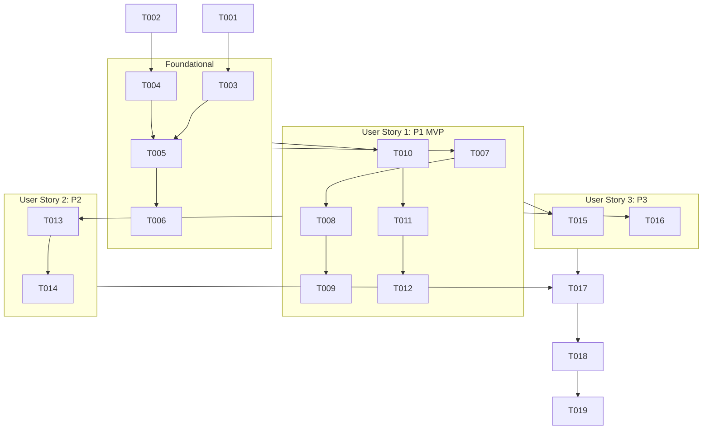

# Tasks: Cho phép người tạo buổi sinh hoạt không phải Admin thực hiện đánh giá buổi học và học viên

**Input**: Design documents from `specs/026-fix-creator-meeting-evaluation/`  
**Prerequisites**: [plan.md](./plan.md), [spec.md](./spec.md), [research.md](./research.md), [data-model.md](./data-model.md), [contracts/meeting-evaluation-contracts.md](./contracts/meeting-evaluation-contracts.md)  
**Organization**: Tasks are grouped by user story to enable independent implementation and testing of each story.  

---

## Phase 1: Setup & Environment Preparation

**Purpose**: Xác nhận cấu hình tính năng và đảm bảo môi trường phát triển sẵn sàng.

- [x] T001 Xác nhận cấu hình feature directory và spec path trong [.specify/feature.json](file:///Users/nguyenhuynh/Documents/dut-ai-manager/.specify/feature.json)
- [x] T002 [P] Kiểm tra tính toàn vẹn của test suite hiện tại trong [backend/tests/unit/test_meeting_evaluation.py](file:///Users/nguyenhuynh/Documents/dut-ai-manager/backend/tests/unit/test_meeting_evaluation.py)

---

## Phase 2: Foundational (Backend Data Integrity & DTO Contract)

**Purpose**: Hạ tầng dữ liệu cốt lõi lưu trữ và truyền định danh Người tạo cuộc họp (`created_by`), là tiền đề bắt buộc trước khi triển khai các User Story.

**⚠️ CRITICAL**: Phải hoàn thành Phase 2 để `meeting.created_by` được lưu và trả về chính xác trong response JSON.

- [x] T003 [P] Bổ sung trường `created_by: int | None = None` vào `MeetingResponse` và cập nhật hàm `from_domain()` trong [backend/app/meeting/schemas.py](file:///Users/nguyenhuynh/Documents/dut-ai-manager/backend/app/meeting/schemas.py)
- [x] T004 [P] Cập nhật `CreateMeetingUseCase.execute()` để nhận tham số `creator_id: int | None = None` và khởi tạo `Meeting(..., created_by=creator_id)` trong [backend/app/meeting/application/create_meeting_use_case.py](file:///Users/nguyenhuynh/Documents/dut-ai-manager/backend/app/meeting/application/create_meeting_use_case.py)
- [x] T005 Cập nhật endpoint `create_meeting` để lấy `current_user.id` và truyền vào `CreateMeetingUseCase.execute(..., creator_id=current_user.id)` trong [backend/app/meeting/controller.py](file:///Users/nguyenhuynh/Documents/dut-ai-manager/backend/app/meeting/controller.py)
- [x] T006 Cập nhật hàm `save()` của `MeetingRepository` để gán tường minh `orm.created_by = domain.created_by` khi lưu mới hoặc cập nhật trong [backend/app/meeting/infrastructure/repository.py](file:///Users/nguyenhuynh/Documents/dut-ai-manager/backend/app/meeting/infrastructure/repository.py)

**Checkpoint**: Dữ liệu `created_by` được lưu vào database và trả về đầy đủ qua API `MeetingResponse` / `MeetingDetailResponse`.

---

## Phase 3: User Story 1 - Người tạo buổi sinh hoạt đánh giá tổng thể và từng học viên (Priority: P1) 🎯 MVP

**Goal**: Người tạo buổi sinh hoạt không có vai trò Admin được nhận diện đúng vai trò Trainer trên giao diện (hiển thị đầy đủ các nút đánh giá) và có toàn quyền gửi đánh giá tổng thể buổi học cũng như chấm điểm từng học viên mà không bị từ chối quyền (403 Forbidden).

**Independent Test**:
Đăng nhập tài khoản Người tạo cuộc họp (không phải Admin). Truy cập buổi học đã kết thúc có bật đánh giá. Xác nhận nút "Trainer đánh giá buổi học" trên Header và nút "Đánh giá" từng học viên hiển thị đầy đủ, nhấn mở modal và gửi đánh giá thành công.

### Tests for User Story 1 ⚠️

- [x] T007 [P] [US1] Viết unit tests kiểm tra quyền đánh giá tổng thể và đánh giá học viên của người tạo buổi học (creator không phải admin) trong [backend/tests/unit/test_meeting_evaluation.py](file:///Users/nguyenhuynh/Documents/dut-ai-manager/backend/tests/unit/test_meeting_evaluation.py)

### Implementation for User Story 1

- [x] T008 [US1] Xây dựng dependency `check_meeting_evaluation_permission` kiểm tra quyền sở hữu cuộc họp (Admin HOẶC `meeting.created_by == current_user.id` HOẶC `meeting.trainer.id == current_user.id`) trong [backend/app/meeting/controller.py](file:///Users/nguyenhuynh/Documents/dut-ai-manager/backend/app/meeting/controller.py)
- [x] T009 [US1] Thay thế ràng buộc cứng `hasPermission(MeetingPermission.CREATE)` bằng dependency `check_meeting_evaluation_permission` tại hai endpoint `POST /{meeting_id}/evaluations/overall` và `POST /{meeting_id}/evaluations/trainer` trong [backend/app/meeting/controller.py](file:///Users/nguyenhuynh/Documents/dut-ai-manager/backend/app/meeting/controller.py)
- [x] T010 [P] [US1] Cập nhật logic `isTrainer` với ép kiểu an toàn `Number(meeting.created_by) === Number(currentUserId)` và hiển thị nút "Trainer đánh giá buổi học" trong [frontend/src/features/meeting/components/MeetingHeroHeader.tsx](file:///Users/nguyenhuynh/Documents/dut-ai-manager/frontend/src/features/meeting/components/MeetingHeroHeader.tsx)
- [x] T011 [P] [US1] Cập nhật logic `isTrainer` và truyền quyền thao tác xuống bảng thành viên trong [frontend/src/features/meeting/components/MeetingParticipantsTab.tsx](file:///Users/nguyenhuynh/Documents/dut-ai-manager/frontend/src/features/meeting/components/MeetingParticipantsTab.tsx)
- [x] T012 [P] [US1] Đảm bảo hiển thị nút "Đánh giá" và "Đã ĐG (X.X)" cho học viên trong bảng thành viên dựa trên `isTrainer` tại [frontend/src/features/meeting/components/ParticipantActionButtons.tsx](file:///Users/nguyenhuynh/Documents/dut-ai-manager/frontend/src/features/meeting/components/ParticipantActionButtons.tsx)

**Checkpoint**: User Story 1 hoàn tất độc lập — Người tạo meeting không phải Admin đã có thể nhìn thấy nút và đánh giá thành công trên Web Frontend.

---

## Phase 4: User Story 2 - Người tạo buổi sinh hoạt kích hoạt nhanh tính năng Đánh giá 2 chiều (Priority: P2)

**Goal**: Cho phép người tạo buổi sinh hoạt bật tính năng "Đánh giá 2 chiều" nhanh chóng trên Header nếu lúc tạo buổi chưa kịp bật.

**Independent Test**:
Đăng nhập tài khoản Người tạo cuộc họp (không phải Admin). Mở buổi học có `enable_evaluation: false`. Kiểm tra nút "Bật Đánh giá 2 chiều" hiển thị, nhấn kích hoạt và xác nhận buổi học chuyển sang trạng thái đã bật đánh giá.

### Implementation for User Story 2

- [x] T013 [US2] Xác nhận quyền cập nhật buổi học của người tạo meeting thông qua dependency `check_meeting_ownership` đối với endpoint `PUT /api/v1/meetings/{meeting_id}` trong [backend/app/meeting/controller.py](file:///Users/nguyenhuynh/Documents/dut-ai-manager/backend/app/meeting/controller.py)
- [x] T014 [US2] Hiển thị và xử lý nút "Bật Đánh giá 2 chiều" (`handleQuickEnableEvaluation`) cho người tạo buổi học (`isTrainer && !meeting.enable_evaluation`) trong [frontend/src/features/meeting/components/MeetingHeroHeader.tsx](file:///Users/nguyenhuynh/Documents/dut-ai-manager/frontend/src/features/meeting/components/MeetingHeroHeader.tsx)

**Checkpoint**: User Story 2 hoàn tất độc lập — Người tạo meeting chủ động bật đánh giá 2 chiều thành công.

---

## Phase 5: User Story 3 - Phân quyền an toàn, chống leo thang quyền hạn & Đồng bộ Mobile Zalo Mini App (Priority: P3)

**Goal**: Đảm bảo phân quyền an toàn, học viên thông thường không thể chấm điểm Trainer hoặc buổi học; đồng bộ trải nghiệm đánh giá của Trainer trên Zalo Mini App.

**Independent Test**:
1. Đăng nhập học viên thông thường, gửi request API đánh giá tổng thể và xác nhận nhận mã lỗi `403 Forbidden`.
2. Mở Zalo Mini App với tài khoản người tạo meeting, xác nhận tab đánh giá hiển thị đúng quyền Trainer.

### Tests & Implementation for User Story 3

- [x] T015 [P] [US3] Viết API integration test kiểm tra ngăn chặn học viên thường (không phải creator/trainer/admin) gửi đánh giá trong [backend/tests/api/test_meeting_api.py](file:///Users/nguyenhuynh/Documents/dut-ai-manager/backend/tests/api/test_meeting_api.py)
- [x] T016 [P] [US3] Cập nhật logic `isTrainer` với ép kiểu Number an toàn cho `created_by` và `trainer.id` tại [zalo-mini-app/dut-manager/src/pages/MeetingDetailPage.tsx](file:///Users/nguyenhuynh/Documents/dut-ai-manager/zalo-mini-app/dut-manager/src/pages/MeetingDetailPage.tsx)

**Checkpoint**: Toàn bộ 3 User Stories hoàn thiện và được bảo vệ bởi các bài test bảo mật.

---

## Phase 6: Polish, Verification & Quality Assurance

**Purpose**: Chạy toàn bộ kiểm thử tự động, build kiểm tra TypeScript và xác minh kịch bản quickstart.

- [x] T017 [P] Chạy toàn bộ test suite đánh giá meeting bằng `pytest backend/tests/unit/test_meeting_evaluation.py`
- [x] T018 [P] Kiểm tra build frontend sạch lỗi bằng `cd frontend && npm run build`
- [x] T019 Xác minh toàn bộ kịch bản kiểm thử theo hướng dẫn trong [specs/026-fix-creator-meeting-evaluation/quickstart.md](file:///Users/nguyenhuynh/Documents/dut-ai-manager/specs/026-fix-creator-meeting-evaluation/quickstart.md)

---

## Dependencies & Execution Order

---

## Parallel Execution Opportunities

- **Trong Phase 2**: `T003` (Schemas DTO) và `T004` (CreateMeetingUseCase) có thể thực hiện song song vì độc lập file.
- **Trong Phase 3 (US1)**: `T007` (Unit tests), `T010` (MeetingHeroHeader), `T011` (MeetingParticipantsTab) và `T012` (ParticipantActionButtons) có thể triển khai song song.
- **Trong Phase 5 (US3)**: `T015` (API Security test) và `T016` (Zalo Mini App) có thể thực hiện song song.
- **Trong Phase 6**: `T017` (Backend Pytest) và `T018` (Frontend Build) có thể chạy song song.

---

## Implementation Strategy & MVP Scope

- **MVP Scope**: Hoàn thành **Phase 2 (Foundational)** + **Phase 3 (User Story 1)**.
  - Khi hoàn thành MVP, người tạo cuộc họp không phải Admin đã có thể nhìn thấy nút đánh giá trên Web và thực hiện chấm điểm thành công cho buổi học cũng như các học viên tham gia.
- **Incremental Delivery**:
  - Giao đoạn 1: MVP (US1) - Phục hồi quyền và nút đánh giá cho Creator.
  - Giai đoạn 2: US2 - Cho phép bật nhanh đánh giá 2 chiều.
  - Giai đoạn 3: US3 & Polish - Chống leo thang quyền hạn, đồng bộ Zalo Mini App và xác minh toàn diện.
