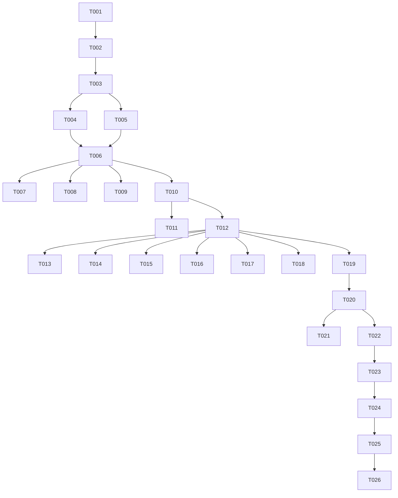

# Tasks: Chuẩn hóa Kiến trúc Thời gian Toàn diện (Enterprise UTC Datetime)

**Input**: Design documents from `/specs/028-enterprise-utc-datetime-refactor/`  
**Prerequisites**: [plan.md](file:///Users/nguyenhuynh/Documents/dut-ai-manager/specs/028-enterprise-utc-datetime-refactor/plan.md), [spec.md](file:///Users/nguyenhuynh/Documents/dut-ai-manager/specs/028-enterprise-utc-datetime-refactor/spec.md), [research.md](file:///Users/nguyenhuynh/Documents/dut-ai-manager/specs/028-enterprise-utc-datetime-refactor/research.md), [data-model.md](file:///Users/nguyenhuynh/Documents/dut-ai-manager/specs/028-enterprise-utc-datetime-refactor/data-model.md), [quickstart.md](file:///Users/nguyenhuynh/Documents/dut-ai-manager/specs/028-enterprise-utc-datetime-refactor/quickstart.md)

**Organization**: Tasks được phân chia theo từng User Story và giai đoạn kiến trúc để đảm bảo tính độc lập, có thể kiểm thử từng bước và không gây gián đoạn hệ thống.

## Format: `[ID] [P?] [Story] Description`
- **[P]**: Có thể chạy song song (khác file, không phụ thuộc)
- **[Story]**: Gắn với User Story tương ứng (US1, US2, US3, US4)

---

## Phase 1: Setup (Hạ tầng Shared Datetime)

**Purpose**: Thiết lập kiểu dữ liệu chuyển đổi thời gian thông minh và bộ test độc lập.

- [x] T001 Khởi tạo module `backend/app/shared/domain/datetime_types.py` chứa định nghĩa `UtcDateTime` và `IsoDateTime` với logic tự động phát hiện naive/aware string
- [x] T002 [P] Viết bộ unit test độc lập tại `backend/tests/unit/test_datetime_types.py` kiểm thử toàn bộ các dạng đầu vào (chuỗi ISO có `Z`, chuỗi ISO có `+07:00`, chuỗi naive không múi giờ, `datetime` object, `None`)

---

## Phase 2: Foundational (Khung Cơ sở Dữ liệu & Base Model)

**Purpose**: Cập nhật tầng Base ORM và tạo migration database trước khi refactor các domain.

**⚠️ CRITICAL**: Không bắt đầu refactor domain cho đến khi hoàn thành xong phase này.

- [x] T003 Cập nhật `SQLAlchemyTimestampMixin` trong `backend/app/shared/infrastructure/base_model.py` chuyển sang `DateTime(timezone=True)` và `default=lambda: datetime.now(timezone.utc)`
- [x] T004 [P] Tạo migration script Alembic tại `backend/alembic/versions/` chuyển đổi các cột thời gian của các bảng (`meetings`, `homeworks`, `homework_submissions`, `cleaning_duties`, `permission_requests`, `violations`, `notifications`) sang `TIMESTAMPTZ` kèm mệnh đề `USING column_name AT TIME ZONE 'Asia/Ho_Chi_Minh'`
- [x] T005 [P] Cập nhật tạm thời hàm `get_current_utc7_time` trong `backend/app/utils/datetime.py` thành alias an toàn để không làm gãy code hiện tại trong quá trình refactor từng domain

**Checkpoint**: Nền tảng DTO và ORM Model đã sẵn sàng.

---

## Phase 3: User Story 1 - Tự động chuẩn hóa thời gian đầu vào từ Client (Priority: P1) 🎯 MVP

**Goal**: Đảm bảo toàn bộ DTO tiếp nhận dữ liệu thời gian từ Web và Zalo Mini App tự động chuẩn hóa về UTC aware mà không cần sửa đổi Frontend.

**Independent Test**: Gửi payload chứa chuỗi naive không múi giờ (ví dụ `"2026-10-31T19:30:00"`), DTO parse thành công thành `2026-10-31 12:30:00+00:00`.

### Implementation for User Story 1
- [x] T006 [P] [US1] Áp dụng `UtcDateTime` cho `MeetingCreate`, `MeetingUpdate` trong `backend/app/meeting/schemas.py` và `backend/app/meeting/application/dtos.py`
- [x] T007 [P] [US1] Áp dụng `UtcDateTime` cho `HomeworkCreate`, `HomeworkUpdate` trong `backend/app/homework/application/dtos.py`
- [x] T008 [P] [US1] Áp dụng `UtcDateTime` cho Permission Request DTOs trong `backend/app/permission_request/application/dtos.py`
- [x] T009 [P] [US1] Áp dụng `UtcDateTime` cho Duty DTOs trong `backend/app/duty/application/dtos.py`
- [x] T010 [US1] Viết integration test tại `backend/tests/api/test_datetime_ingestion_api.py` kiểm tra API Meeting và Homework khi nhận payload naive string từ Frontend

**Checkpoint**: User Story 1 hoàn thành - Frontend gửi bất kỳ định dạng nào Backend cũng parse chuẩn về UTC.

---

## Phase 4: User Story 4 - Di chuyển an toàn dữ liệu lịch sử trong Database (Priority: P1)

**Goal**: Đảm bảo dữ liệu cũ trong database được chuyển sang `TIMESTAMPTZ` mà không bị lệch 7 tiếng.

**Independent Test**: Kiểm tra một bản ghi meeting cũ tạo lúc 19:30 giờ VN, sau migration giá trị lưu trữ trong DB là `12:30:00+00`.

### Implementation for User Story 4
- [x] T011 [US4] Kiểm thử chạy `alembic upgrade head` và `alembic downgrade -1` trên database test
- [x] T012 [US4] Viết test kiểm tra tính toàn vẹn dữ liệu thời gian sau migration trong `backend/tests/integration/test_db_timezone_migration.py`

**Checkpoint**: User Story 4 hoàn thành - Database đã sẵn sàng chạy kiểu `TIMESTAMPTZ`.

---

## Phase 5: User Story 2 - Loại bỏ hoàn toàn `get_current_utc7_time` trong Domain & Use Cases (Priority: P1)

**Goal**: Thay thế toàn bộ call-sites gọi `get_current_utc7_time()` sang `datetime.now(timezone.utc)`.

**Independent Test**: Toàn bộ unit/integration test của các domain chạy pass 100% với `datetime.now(timezone.utc)`.

### Implementation for User Story 2
- [x] T013 [P] [US2] Refactor Reminder domain: thay `get_current_utc7_time` bằng `datetime.now(timezone.utc)` trong `backend/app/reminder/application/scan_and_send_reminders_use_case.py` và `backend/app/reminder/infrastructure/repository.py`
- [x] T014 [P] [US2] Refactor Meeting domain: thay `get_current_utc7_time` trong `backend/app/meeting/application/checkin_use_case.py`, `submit_meeting_overall_evaluation_use_case.py`, `get_upcoming_meetings_with_seats_use_case.py`, `get_creator_meeting_evaluations_use_case.py`
- [x] T015 [P] [US2] Refactor Homework domain: thay `get_current_utc7_time` trong `backend/app/homework/domain/entity.py`, `backend/app/homework/infrastructure/model.py`, `backend/app/homework/application/create_homework_use_case.py`, `update_homework_use_case.py`, `submit_homework_use_case.py`
- [x] T016 [P] [US2] Refactor Duty domain: thay `get_current_utc7_time` trong `backend/app/duty/application/check_overdue_duties_use_case.py`, `submit_duty_evidence_use_case.py`, `review_duty_use_case.py`
- [x] T017 [P] [US2] Refactor Violation domain: thay `get_current_utc7_time` trong `backend/app/violation/permission_handler.py`, `backend/app/violation/application/event_handlers.py`, `backend/app/violation/infrastructure/repository.py`, `backend/app/violation/domain/entity.py`
- [x] T018 [P] [US2] Refactor Bonus Point & Billing domains: thay `get_current_utc7_time` trong `backend/app/bonus_point/application/calculate_activity_points_use_case.py`, `backend/app/billing/infrastructure/model.py`, `backend/app/expense/application/use_cases.py`, `backend/app/expense/infrastructure/model.py`
- [x] T019 [P] [US2] Refactor RBAC & User domains: thay `get_current_utc7_time` trong `backend/app/rbac/infrastructure/model.py`, `backend/app/user/infrastructure/monthly_stats_repository.py`
- [x] T020 [US2] Xóa bỏ định nghĩa hàm `get_current_utc7_time()` khỏi `backend/app/utils/datetime.py` và dọn dẹp toàn bộ import thừa

**Checkpoint**: User Story 2 hoàn thành - Không còn bất kỳ file nào trong hệ thống phụ thuộc vào `get_current_utc7_time()`.

---

## Phase 6: User Story 3 - Tự động hóa Audit Timestamps ở ORM Model (Priority: P2)

**Goal**: Loại bỏ việc gán thủ công `created_at` / `updated_at` trong các hàm `from_entity()` của Repository/Model.

**Independent Test**: Tạo một bản ghi mới qua repository, bản ghi tự động có `created_at` mang timestamp UTC hiện tại mà không cần truyền giá trị.

### Implementation for User Story 3
- [x] T021 [P] [US3] Dọn dẹp các lệnh gán thủ công `created_at = ... or get_current_utc7_time()` trong các Model (`backend/app/rbac/infrastructure/model.py`, `backend/app/billing/infrastructure/model.py`, `backend/app/expense/infrastructure/model.py`)
- [x] T022 [US3] Viết test kiểm tra tự động cập nhật audit timestamps trong `backend/tests/unit/test_timestamp_mixin.py`

**Checkpoint**: User Story 3 hoàn thành - ORM tự động hóa 100% việc quản lý audit timestamps.

---

## Phase 7: Polish, Linter Enforcement & Governance

**Purpose**: Đóng cổng an toàn vĩnh viễn, cập nhật Hiến pháp dự án và xác minh hồi quy.

- [x] T023 Kích hoạt rule `"DTZ"` (`flake8-datetimez`) trong cấu hình Ruff tại `backend/pyproject.toml`
- [x] T024 Chạy `uv run ruff check backend/` và sửa mọi cảnh báo datetime trên toàn backend
- [x] T025 Cập nhật Hiến pháp dự án `.specify/memory/constitution.md` Principle III từ v1.5.0 lên v1.6.0 phản ánh chuẩn Enterprise UTC
- [x] T026 Chạy toàn bộ test suite `uv run pytest` xác minh 100% test passes và không có hồi quy

---

## Dependencies & Execution Order

---

## Implementation Strategy

### MVP First (Phases 1, 2, 3)
1. Xây dựng type `UtcDateTime` và viết unit test.
2. Cập nhật `SQLAlchemyTimestampMixin`.
3. Áp dụng cho Meeting và Homework DTOs.
4. **Xác minh MVP**: Client gửi chuỗi naive, backend parse chuẩn xác sang UTC aware.

### Incremental Rollout (Phases 4, 5, 6, 7)
1. Chạy migration DB.
2. Refactor Use Cases domain theo domain theo thứ tự ưu tiên (Reminder $\rightarrow$ Meeting $\rightarrow$ Homework $\rightarrow$ Duty $\rightarrow$ Violation $\rightarrow$ Billing/RBAC).
3. Xóa sổ `get_current_utc7_time()`.
4. Bật Ruff rule `DTZ` để khóa chốt an toàn vĩnh viễn.
