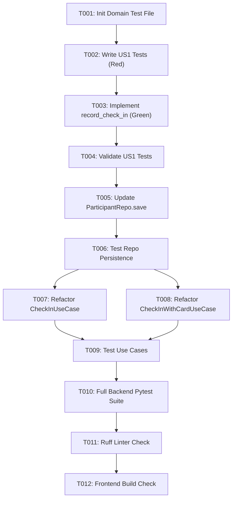

# Tasks: Unified Meeting Check-In Domain Entity Refactor

**Input**: Design documents from `/specs/029-meeting-checkin-domain-refactor/`  
**Prerequisites**: [plan.md](plan.md), [spec.md](spec.md), [research.md](research.md), [data-model.md](data-model.md)  
**Tests**: Đã bao gồm Unit Tests theo triết lý TDD (Test-Driven Development)  
**Organization**: Tasks được nhóm theo User Story để thực thi độc lập và kiểm thử từng bước.

## Format: `[ID] [P?] [Story] Description`

- **[P]**: Có thể chạy song song (các file độc lập, không phụ thuộc nhau)
- **[Story]**: Gắn với User Story tương ứng (`US1`, `US2`, `US3`)
- Đường dẫn file đầy đủ trong từng mô tả

---

## Phase 1: Setup & Foundational

**Mục tiêu**: Chuẩn bị cấu trúc kiểm thử cho Domain Entity của Meeting.

- [x] T001 Khởi tạo file test `backend/tests/unit/test_meeting_domain.py` phục vụ TDD cho Domain Entity `MeetingParticipant`

---

## Phase 2: User Story 1 - Domain-Centric Check-In Rules (Priority: P1) 🎯 MVP

**Mục tiêu**: Đóng gói toàn bộ quy tắc nghiệp vụ điểm danh vào `MeetingParticipant.record_check_in(...)`. Đảm bảo giải quyết triệt để lỗi mất mốc thời gian `check_in_at` khi học viên có đơn xin đi trễ (`LATE_EXCUSED`) hoặc đến trễ.

**Tiêu chí kiểm thử độc lập**: Chạy pytest `backend/tests/unit/test_meeting_domain.py` bao phủ tất cả các ca chuyển đổi trạng thái mà không cần database hay mock phức tạp.

### Tests for User Story 1 (TDD Red)
- [x] T002 [US1] Viết unit tests trong `backend/tests/unit/test_meeting_domain.py` kiểm tra các kịch bản:
  - Check-in đúng giờ (`check_in_time <= meeting_start_time`) $\rightarrow$ `status = JOINED`, `check_in_at = check_in_time`, `is_late = False`.
  - Check-in trễ không phép (`check_in_time > meeting_start_time`) $\rightarrow$ `status = LATE_UNEXCUSED`, `check_in_at = check_in_time`, `is_late = True`.
  - Check-in khi đã có đơn xin đi trễ (`status == LATE_EXCUSED`) $\rightarrow$ giữ nguyên `status = LATE_EXCUSED`, ghi nhận `check_in_at = check_in_time`, cập nhật `link_image`.
  - Check-in khi đã `COMPLETED` $\rightarrow$ trả về `success = False` và từ chối ghi nhận.
  - Check-in cập nhật lại ảnh khi đã `JOINED` $\rightarrow$ cho phép ghi nhận ảnh mới.

### Implementation for User Story 1 (TDD Green)
- [x] T003 [US1] Triển khai phương thức `record_check_in(self, check_in_time: datetime, meeting_start_time: datetime, image_url: str | None = None, client_event_id: str | None = None) -> tuple[bool, str, bool]` trong `backend/app/meeting/domain/entity.py`.
- [x] T004 [US1] Chạy `uv run --directory backend pytest tests/unit/test_meeting_domain.py` và xác nhận 100% tests của User Story 1 chuyển sang xanh (Green).

**Checkpoint**: User Story 1 hoàn thành độc lập, logic nghiệp vụ điểm danh đã được cô lập an toàn trong Domain Layer.

---

## Phase 3: User Story 3 - Repository Persistence Completeness (Priority: P1)

**Mục tiêu**: Đảm bảo `ParticipantRepository.save` lưu đầy đủ các trường của Domain Entity vào DB, đặc biệt là `client_event_id` để cơ chế chống trùng lặp hoạt động bền vững.

**Tiêu chí kiểm thử độc lập**: Chạy unit test kiểm tra hàm `save()` của `ParticipantRepository`.

### Implementation for User Story 3
- [x] T005 [US3] Cập nhật `ParticipantRepository.save` trong `backend/app/meeting/infrastructure/repository.py` để gán `orm.client_event_id = domain.client_event_id` và kiểm tra mapper ORM $\leftrightarrow$ Domain.
- [x] T006 [US3] Thêm unit test trong `backend/tests/unit/test_meeting_use_cases.py` xác nhận `ParticipantRepository.save` map đúng `client_event_id`, `check_in_at`, `status`, `link_image`.

**Checkpoint**: Repository đã đảm bảo tính toàn vẹn dữ liệu điểm danh.

---

## Phase 4: User Story 2 - Orchestration Refactoring in Use Cases (Priority: P1)

**Mục tiêu**: Tinh gọn các Use Case thành Orchestrator mỏng, ủy quyền quyết định trạng thái và thời gian cho Domain Entity. Sửa lỗi `time_window` lệch giờ khi gửi offline.

**Tiêu chí kiểm thử độc lập**: Toàn bộ unit tests cho các Use Case (`CheckInUseCase`, `CheckInWithCardUseCase`) pass với các mock tối thiểu.

### Implementation for User Story 2
- [x] T007 [US2] Refactor `backend/app/meeting/application/checkin_use_case.py`:
  - Dùng `check_in_dt` (UTC aware) để tính `window_start = check_in_dt - 30m` và `window_end = check_in_dt + 30m`.
  - Thay thế logic cũ bằng lời gọi `participant.record_check_in(check_in_time=check_in_dt, meeting_start_time=meeting.start_time, image_url=image_url, client_event_id=client_event_id)`.
  - Phát sự kiện `ParticipantCheckedIn` với `is_late` và `check_in_at` trả về từ Domain Entity.
- [x] T008 [US2] Refactor `backend/app/meeting/application/checkin_with_card_use_case.py`:
  - Thay thế logic cũ bằng lời gọi `participant.record_check_in(check_in_time=now, meeting_start_time=meeting.start_time)`.
  - Giữ nguyên luồng phát âm thanh TTS và phát sự kiện `ParticipantCheckedIn`.
- [x] T009 [US2] Bổ sung unit test cho `CheckInUseCase` và `CheckInWithCardUseCase` trong `backend/tests/unit/test_meeting_use_cases.py`.

**Checkpoint**: Cả 3 cơ chế check-in (Face AI, Card RFID, Web) đều chia sẻ chung một nguồn chân lý nghiệp vụ trong Domain Entity.

---

## Phase 5: Polish, Governance & Verification

**Mục tiêu**: Xác minh toàn diện chất lượng mã nguồn, đảm bảo tuân thủ hiến pháp dự án và không có bất kỳ regression nào.

- [x] T010 Chạy toàn bộ pytest suite `uv run --directory backend pytest tests/unit/` (đảm bảo > 152 tests passed).
- [x] T011 Chạy Ruff linter `uv run --directory backend ruff check app/meeting/ --select DTZ,E,F,I` đảm bảo 0 vi phạm quy tắc múi giờ và code style.
- [x] T012 Chạy build frontend `npm --prefix frontend run build` kiểm tra tính ổn định toàn hệ thống.

---

## Dependencies & Execution Order

