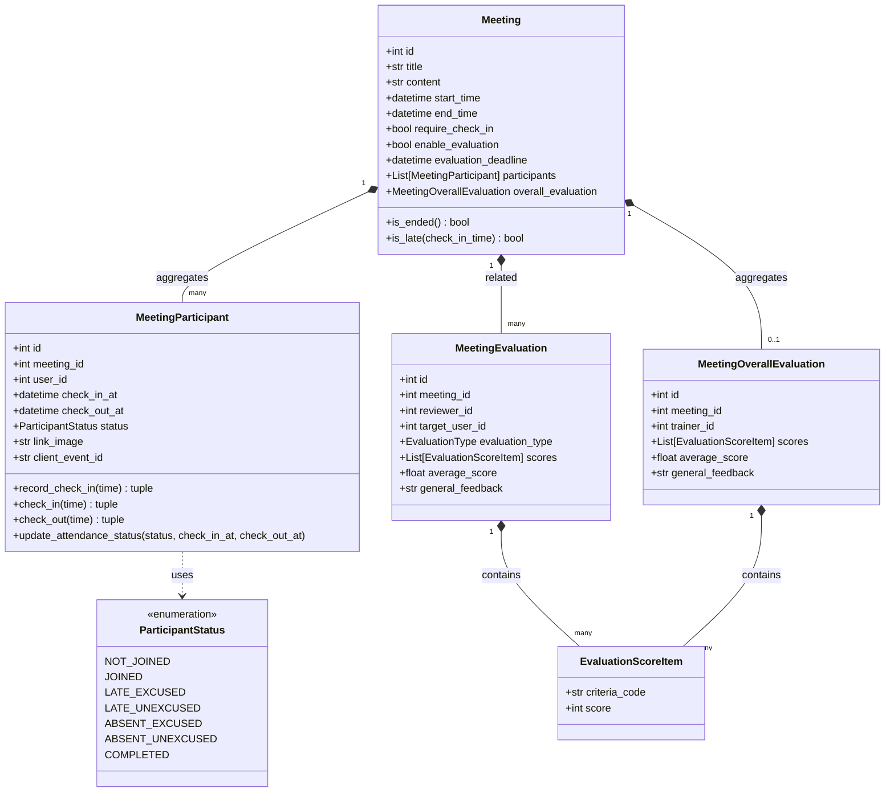

# Phase 1 Data Model: Modular Meeting Domain Structure

**Feature Branch**: `037-modular-meeting`  
**Date**: 2026-10-31  

---

## 1. Domain Entities & Value Objects Mapping

---

## 2. File Allocation Matrix

| Original Monolithic File | Target Modular File | Contained Classes & Types |
|---|---|---|
| `domain/entity.py` | `domain/evaluation.py` | `EvaluationCriteria`, `EvaluationScoreItem`, `MeetingOverallEvaluation`, `MeetingEvaluation` |
| `domain/entity.py` | `domain/participant.py` | `MeetingParticipant` |
| `domain/entity.py` | `domain/meeting.py` | `Meeting`, `UpcomingMeetingWithSeats` |
| `domain/entity.py` | `domain/entity.py` (barrel) | Re-exports all of the above + backward-compat imports |
| `schemas.py` | `schemas/meeting_schemas.py` | `MeetingCreate`, `MeetingUpdate`, `MeetingResponse`, `MeetingDetailResponse`, `MeetingListQuery`, `UpcomingMeetingWithSeatsResponse` |
| `schemas.py` | `schemas/participant_schemas.py` | `ParticipantResponse`, `UpdateParticipantStatusRequest`, `CheckInWithCardRequest`, `CheckInRequest`, `CheckInResponse`, `BatchCheckInRequest` |
| `schemas.py` | `schemas/evaluation_schemas.py` | `EvaluationScoreItemDto`, `MeetingOverallEvaluationCreate`, `MeetingOverallEvaluationResponse`, `MeetingEvaluationCreate`, `EvaluationResponse`, `EvaluationSummaryResponse`, `MyEvaluationResponse` |
| `schemas.py` | `schemas/__init__.py` | Re-exports all schemas via `__all__` |
| `infrastructure/repository.py` | `infrastructure/repositories/meeting_repository.py` | `MeetingRepository` |
| `infrastructure/repository.py` | `infrastructure/repositories/participant_repository.py` | `ParticipantRepository` |
| `infrastructure/repository.py` | `infrastructure/repositories/meeting_evaluation_repository.py` | `MeetingEvaluationRepository` |
| `infrastructure/repository.py` | `infrastructure/repositories/meeting_overall_evaluation_repository.py` | `MeetingOverallEvaluationRepository` |
| `infrastructure/repository.py` | `infrastructure/repository.py` & `infrastructure/repositories/__init__.py` | Re-exports all 4 repositories |
| `controller.py` | `controllers/meeting_controller.py` | CRUD endpoints: `/`, `/{meeting_id}`, `/upcoming-with-seats` |
| `controller.py` | `controllers/attendance_controller.py` | Attendance endpoints: `/check-in-with-card`, `/check-in`, `/checkout`, `/{id}/participants/{uid}/status`, `/{id}/batch-check-in` |
| `controller.py` | `controllers/evaluation_controller.py` | Evaluation endpoints: `/{id}/trainer-evaluations`, `/{id}/trainee-evaluations`, `/{id}/overall-evaluation`, `/{id}/evaluations/*` |
| `controller.py` | `controller.py` (root) | Composite `APIRouter(prefix="/meetings", tags=["meetings"])` mounting sub-routers |
