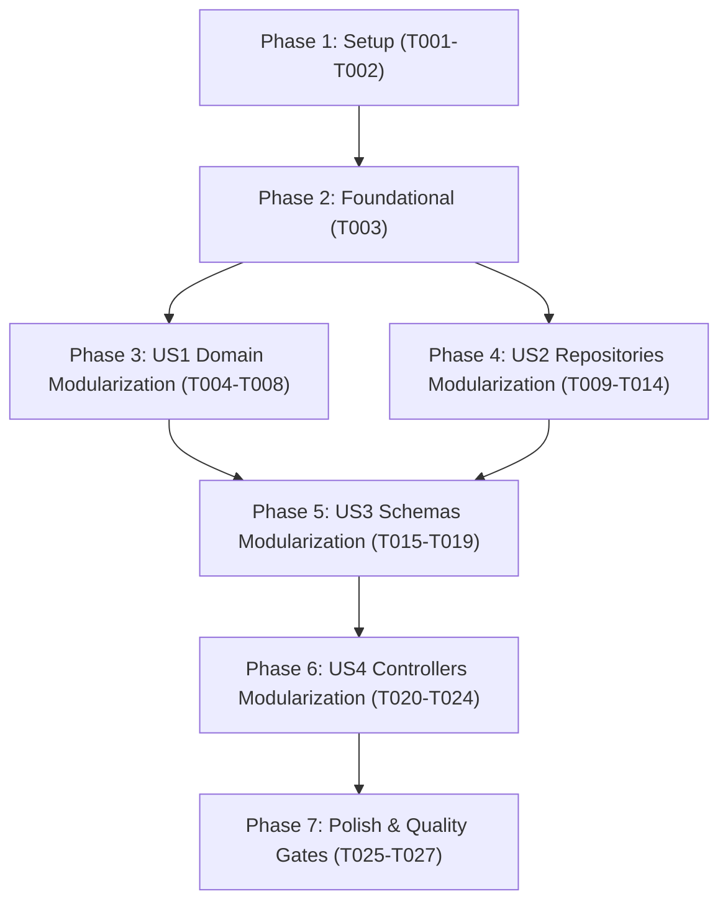

# Tasks: Modular Meeting Sub-modules Refactoring

**Input**: Design documents from `/specs/037-modular-meeting/`  
**Prerequisites**: `plan.md`, `spec.md`, `research.md`, `data-model.md`, `contracts/meeting-api.md`, `quickstart.md`  
**Feature Branch**: `037-modular-meeting`

---

## Format: `- [ ] [ID] [P?] [Story] Description with exact file path`

- **[P]**: Can run in parallel (different files, no blocking dependencies).
- **[Story]**: Mapped user story from `spec.md` (`[US1]`, `[US2]`, `[US3]`, `[US4]`).
- All tasks reference explicit file paths.

---

## Phase 1: Setup & Directory Structure

**Purpose**: Initialize directory structure for modular meeting sub-domains.

- [X] T001 Create target directories `backend/app/meeting/domain/`, `backend/app/meeting/schemas/`, `backend/app/meeting/controllers/`, and `backend/app/meeting/infrastructure/repositories/`
- [X] T002 [P] Initialize package init shims `backend/app/meeting/controllers/__init__.py` and `backend/app/meeting/infrastructure/repositories/__init__.py`

---

## Phase 2: Foundational (Value Objects & Baseline Types)

**Purpose**: Ensure foundational value objects and types are isolated so entities and schemas can import without cycles.

- [X] T003 Ensure all core enum and value objects (`ParticipantStatus`, `EvaluationType`, `EvaluationCriteria`) are accessible from `backend/app/meeting/domain/value_objects.py`

**Checkpoint**: Foundation ready — user story implementations can proceed independently.

---

## Phase 3: User Story 1 - Modular Domain Entities (Priority: P1) 🎯 MVP Part 1

**Goal**: Split monolithic `backend/app/meeting/domain/entity.py` (292 lines) into focused domain entity files while maintaining 100% backward compatibility via barrel re-exports.

**Independent Test**:
- Domain unit tests run with zero circular imports:
  `uv run --directory backend pytest tests/unit/test_meeting_domain.py`

### Implementation for User Story 1
- [X] T004 [P] [US1] Extract `EvaluationCriteria`, `EvaluationScoreItem`, `MeetingOverallEvaluation`, and `MeetingEvaluation` into `backend/app/meeting/domain/evaluation.py`
- [X] T005 [P] [US1] Extract `MeetingParticipant` and its attendance state machine methods (`record_check_in`, `update_attendance_status`, `check_out`) into `backend/app/meeting/domain/participant.py`
- [X] T006 [US1] Extract `Meeting` aggregate root and `UpcomingMeetingWithSeats` projection into `backend/app/meeting/domain/meeting.py` (depends on T004, T005)
- [X] T007 [US1] Implement backward-compatible barrel re-exports in `backend/app/meeting/domain/entity.py` and `backend/app/meeting/domain/__init__.py`
- [X] T008 [US1] Verify domain integrity by running `uv run --directory backend pytest tests/unit/test_meeting_domain.py`

**Checkpoint**: User Story 1 complete — domain layer is cleanly modularized with zero regressions.

---

## Phase 4: User Story 2 - Modular Repositories (Priority: P1) 🎯 MVP Part 2

**Goal**: Split monolithic `backend/app/meeting/infrastructure/repository.py` (828 lines) into dedicated repository files under `backend/app/meeting/infrastructure/repositories/` and wire cleanly with Dishka DI.

**Independent Test**:
- All use cases using repositories execute without errors:
  `uv run --directory backend pytest tests/unit/test_meeting_use_cases.py`

### Implementation for User Story 2
- [X] T009 [P] [US2] Extract `MeetingEvaluationRepository` (trainee & trainer evaluations) into `backend/app/meeting/infrastructure/repositories/meeting_evaluation_repository.py`
- [X] T010 [P] [US2] Extract `MeetingOverallEvaluationRepository` (overall meeting evaluation scores) into `backend/app/meeting/infrastructure/repositories/meeting_overall_evaluation_repository.py`
- [X] T011 [P] [US2] Extract `ParticipantRepository` (participant lookups, window queries, batch checkin, status updates) into `backend/app/meeting/infrastructure/repositories/participant_repository.py`
- [X] T012 [US2] Extract `MeetingRepository` (meeting CRUD, relations query, capacity monitor, upcoming seats) into `backend/app/meeting/infrastructure/repositories/meeting_repository.py`
- [X] T013 [US2] Implement barrel re-export in `backend/app/meeting/infrastructure/repositories/__init__.py` and maintain `backend/app/meeting/infrastructure/repository.py` as backward-compatible shim
- [X] T014 [US2] Verify Dishka DI wiring in `backend/app/meeting/providers.py` and run repository unit tests via `uv run --directory backend pytest tests/unit/test_meeting_use_cases.py`

**Checkpoint**: User Stories 1 & 2 complete — backend domain and data layers are fully modular.

---

## Phase 5: User Story 3 - Modular Schemas & DTO Contracts (Priority: P2)

**Goal**: Split monolithic `backend/app/meeting/schemas.py` (517 lines) into specialized schema sub-modules inside package `backend/app/meeting/schemas/` with zero breaking changes for existing callers.

**Independent Test**:
- Schema validations and serialization run cleanly:
  `uv run --directory backend pytest tests/unit/test_meeting_use_cases.py tests/api/test_change_meeting_api.py`

### Implementation for User Story 3
- [X] T015 [P] [US3] Extract evaluation schemas (`EvaluationScoreItemDto`, `MeetingOverallEvaluationCreate`, `MeetingOverallEvaluationResponse`, `MeetingEvaluationCreate`, `EvaluationResponse`, `EvaluationSummaryResponse`, `MyEvaluationResponse`) into `backend/app/meeting/schemas/evaluation_schemas.py`
- [X] T016 [P] [US3] Extract attendance schemas (`ParticipantResponse`, `UpdateParticipantStatusRequest`, `CheckInWithCardRequest`, `CheckInRequest`, `CheckInResponse`, `BatchCheckInRequest`) into `backend/app/meeting/schemas/participant_schemas.py`
- [X] T017 [P] [US3] Extract meeting lifecycle schemas (`MeetingCreate`, `MeetingUpdate`, `MeetingResponse`, `MeetingDetailResponse`, `MeetingListQuery`, `UpcomingMeetingWithSeatsResponse`) into `backend/app/meeting/schemas/meeting_schemas.py`
- [X] T018 [US3] Transform `backend/app/meeting/schemas.py` into `backend/app/meeting/schemas/__init__.py` with full `__all__` re-exports of all DTOs (depends on T015, T016, T017)
- [X] T019 [US3] Verify schema imports across backend use cases and controller dependencies

**Checkpoint**: User Stories 1, 2, and 3 complete — domain, infrastructure, and DTO contracts are fully partitioned.

---

## Phase 6: User Story 4 - Modular API Controllers & Routers (Priority: P2)

**Goal**: Split monolithic `backend/app/meeting/controller.py` (551 lines) into dedicated controllers in `backend/app/meeting/controllers/` and compose them into the root router under `/meetings`.

**Independent Test**:
- End-to-end API test suite executes successfully:
  `uv run --directory backend pytest tests/api/test_change_meeting_api.py`

### Implementation for User Story 4
- [X] T020 [P] [US4] Extract core meeting lifecycle routes (`POST /`, `GET /`, `GET /upcoming-with-seats`, `GET /{id}`, `PUT /{id}`, `DELETE /{id}`) into `backend/app/meeting/controllers/meeting_controller.py`
- [X] T021 [P] [US4] Extract attendance routes (`POST /check-in-with-card`, `POST /check-in`, `POST /checkout`, `PUT /{id}/participants/{uid}/status`, `POST /{id}/batch-check-in`) into `backend/app/meeting/controllers/attendance_controller.py`
- [X] T022 [P] [US4] Extract evaluation routes (`POST /{id}/trainer-evaluations`, `POST /{id}/trainee-evaluations`, `POST /{id}/overall-evaluation`, `GET /{id}/evaluations/*`) into `backend/app/meeting/controllers/evaluation_controller.py`
- [X] T023 [US4] Compose and mount sub-routers inside `backend/app/meeting/controller.py` under root prefix `/meetings` with tags `["meetings"]` (depends on T020, T021, T022)
- [X] T024 [US4] Verify full endpoint accessibility via `uv run --directory backend pytest tests/api/test_change_meeting_api.py`

**Checkpoint**: All 4 monolithic files are successfully decomposed into modular sub-modules with 100% contract preservation.

---

## Phase 7: Polish & Cross-Cutting Concerns

**Purpose**: Enforce linting rules, run comprehensive test suites, and validate frontend build.

- [X] T025 [P] Run static analysis and formatting check via `uv run --directory backend ruff check app/meeting/`
- [X] T026 Run full unit and integration test suite via `uv run --directory backend pytest tests/unit/ tests/api/test_change_meeting_api.py`
- [X] T027 [P] Validate frontend TypeScript compile and production build via `npm --prefix frontend run build`

---

## Dependencies & Execution Order

---

## Parallel Execution Opportunities

- **Within US1 (Domain)**: `T004` (evaluation.py) and `T005` (participant.py) can be created simultaneously in parallel.
- **Within US2 (Repositories)**: `T009`, `T010`, `T011` can be extracted in parallel.
- **Within US3 (Schemas)**: `T015`, `T016`, `T017` can be created simultaneously in parallel.
- **Within US4 (Controllers)**: `T020`, `T021`, `T022` can be developed in parallel.
- **Within Polish**: `T025` (Ruff linter) and `T027` (Frontend build) can run concurrently.

---

## Implementation Strategy & MVP Scope

- **MVP Phase (Phase 1–4)**: Complete Domain and Repositories modularization (US1 & US2). At this point, the entire business and data access foundation is decoupled.
- **Complete Phase (Phase 5–7)**: Complete Schemas and Controllers modularization (US3 & US4) followed by strict test and build verification.
