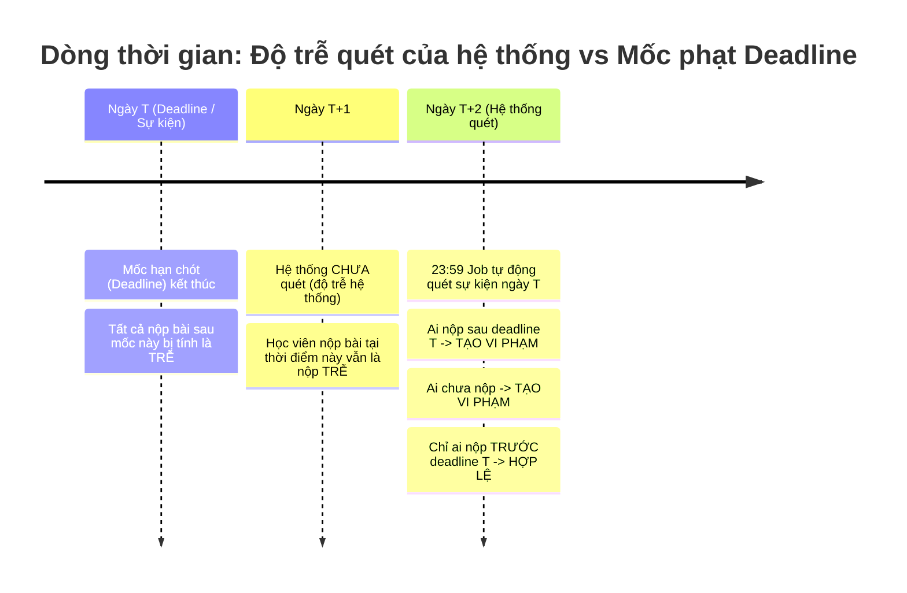

# Phase 1: Data Model & Temporal Flow (038-violation-delay)

## 1. Tác động Mô hình Dữ liệu (Database Schema Impact)

> **Không có thay đổi Schema cơ sở dữ liệu**  
> Không phát sinh bảng mới, không thêm/xóa/sửa bất kỳ cột nào trong database. Không cần tạo file migration Alembic.

Các thực thể hiện hữu được tái sử dụng nguyên vẹn:
- `HomeworkEntity`: `deadline: datetime` (UTC)
- `HomeworkSubmissionEntity`: `submitted_at: datetime` (UTC)
- `Meeting`: `date: date`, `start_time: datetime`, `end_time: datetime` (UTC)
- `Duty`: `duty_date: date`, `status: DutyStatus`
- `MeetingEvaluation`: `submitted_at: datetime`, `evaluation_type: EvaluationType`
- `Violation`: `user_id: int`, `reason: str`, `date: datetime`, `is_system: bool`

---

## 2. Dòng thời gian & Quy tắc Tính toán (Temporal Rules)

### Chi tiết các trường hợp:

1. **Homework Overdue**:
   - Mốc deadline ban đầu: $D$ (ví dụ: 23:59 ngày $T$).
   - Thời điểm job quét: 23:59 ngày $T+2$.
   - **Xác định vi phạm**:
     - Chưa nộp: **Tạo vi phạm**.
     - Nộp sau mốc $D$ (`submitted_at > D`): **Tạo vi phạm** (vì nộp trễ deadline, không được gia hạn).
     - Nộp trước hoặc đúng mốc $D$ (`submitted_at <= D`): **Hợp lệ, không phạt**.

2. **Meeting Attendance**:
   - Buổi họp diễn ra ngày $T$.
   - Thời điểm job quét: 23:59 ngày $T+2$.
   - **Xác định vi phạm**:
     - Không check-in và không có đơn xin vắng hợp lệ: **Tạo vi phạm vắng không phép**.
     - Check-in trễ và không có đơn xin trễ hợp lệ: **Tạo vi phạm trễ không phép**.

3. **Cleaning Duty**:
   - Ca trực nhật ngày $T$ (hạn nộp minh chứng 22:00 ngày $T$).
   - Thời điểm job quét: 23:59 ngày $T+2$.
   - **Xác định vi phạm**:
     - Chưa hoàn thành trước 22:00 ngày $T$: **Tạo vi phạm**, chuyển trạng thái sang `VIOLATED` (dù có nộp bù sau hạn).

4. **Meeting Evaluation**:
   - Buổi họp kết thúc lúc $E$.
   - Thời điểm job quét: Khi $now \ge E + 72\text{h}$.
   - **Xác định vi phạm**:
     - Chưa hoàn thành đánh giá: **Tạo vi phạm**.
