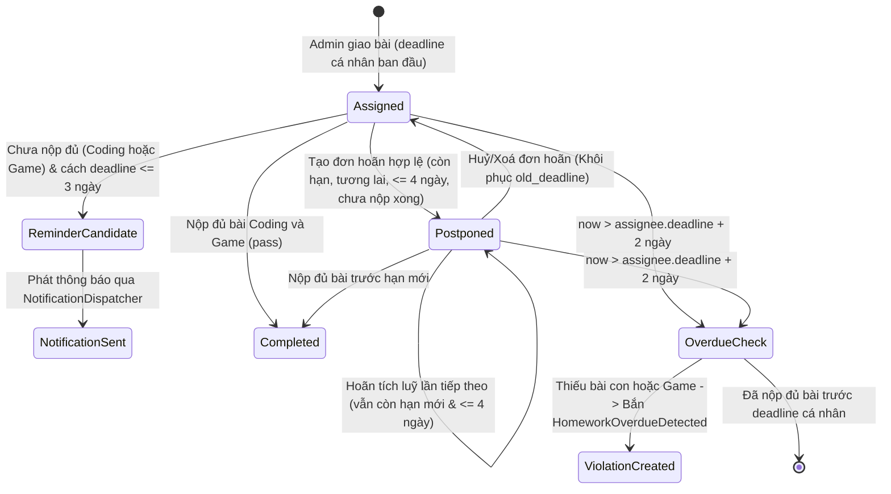

# Data Model & Business Rules: Homework Business Hardening

**Feature**: `040-homework-business-hardening`  
**Date**: 2026-10-31  
**Status**: Completed  

---

## 1. Entities & Value Objects Involved

### Homework (Domain Aggregate Root)
- **Path**: `backend/app/homework/domain/entity.py`
- **Fields**:
  - `id: int | None`
  - `title: str`
  - `link: str | None`
  - `slug: str`
  - `requires_coding: bool`
  - `requires_game: bool`
  - `created_at`, `updated_at`, `is_deleted`
- **Key Domain Methods**:
  - `evaluate_submissions(submissions: list[HomeworkSubmission], reference_time: datetime | None = None, deadline: datetime | None = None) -> SubmissionEvaluation`
  - `determine_coding_status(completed_count: int, total_required: int) -> str`
  - `index_submissions(submissions: list[HomeworkSubmission]) -> tuple[...]`

### HomeworkAssignee (Relationship Entity / ORM Model)
- **Path**: `backend/app/homework/infrastructure/model.py`
- **Fields**:
  - `id: int`
  - `homework_id: int`
  - `user_id: int`
  - `deadline: datetime (TIMESTAMPTZ)`: Single Source of Truth cho hạn nộp cá nhân của từng học viên.
  - `is_deleted: bool`

### HomeworkSubmission (Domain Entity)
- **Path**: `backend/app/homework/domain/entity.py`
- **Fields**:
  - `homework_id: int`
  - `user_id: int`
  - `submission_type: SubmissionType (CODING | GAME)`
  - `exercise_id: str | None`
  - `submitted_at: datetime`
  - `is_passed: bool`
  - `score: float | None`

### PostponePayload (Value Object)
- **Path**: `backend/app/permission_request/domain/payloads.py`
- **Fields**:
  - `category: Literal[RequestCategory.POSTPONE]`
  - `homework_id: int`
  - `start_time: UtcDateTime` (mốc thời gian gia hạn mới)
  - `old_deadline: UtcDateTime | None` (lưu vết để rollback nếu huỷ đơn)
  - `reason: str`

---

## 2. Business Rules & State Transition

---

## 3. Validation Invariants for PostponeStrategy

| Quy tắc | Điều kiện kiểm tra | Mã lỗi | Thông điệp lỗi |
|---|---|---|---|
| Hạn nộp mới ở tương lai | `extended_deadline > now_utc` | 400 | "Thời gian gia hạn mới phải ở tương lai" |
| Bài tập chưa quá hạn | `current_deadline > now_utc` | 400 | "Bài tập đã quá hạn, không thể tạo đơn xin hoãn" |
| Bài tập chưa nộp xong | `not hw.evaluate_submissions(subs).is_submitted` | 400 | "Bạn đã hoàn thành bài tập này, không thể xin hoãn" |
| Khoảng cách hoãn hợp lệ | `0 < extended_deadline - current_deadline <= 4 ngày` | 400 | "Thời gian xin hoãn không được vượt quá 4 ngày so với deadline hiện tại" |
| Phân công bài tập | `current_deadline is not None` | 400 | "Bạn không được phân công bài tập này" |
