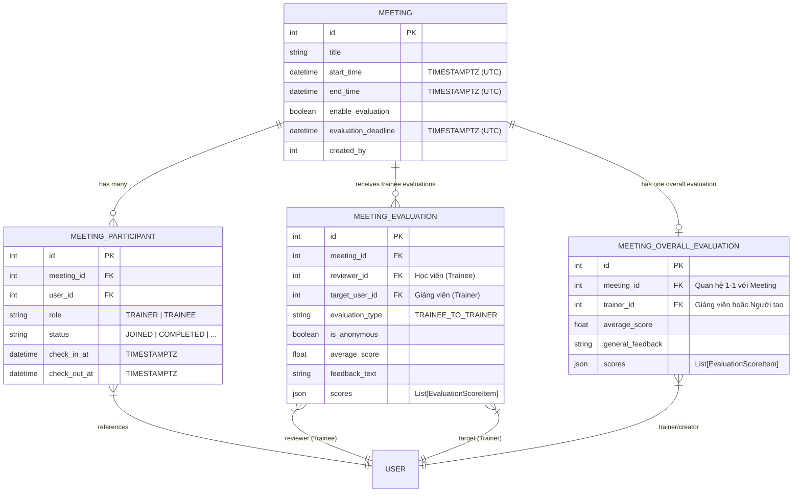

# Mô hình Dữ liệu: Tinh giản Đánh giá Meeting & Chuẩn hóa Kiến trúc

**Feature Branch**: `046-harden-meeting-evaluation`  
**Ngày thực hiện**: 2026-11-04  
**Trạng thái**: Hoàn thiện (Phase 1 Design)

---

## 1. Sơ đồ Thực thể (Entity Relationship Diagram)

---

## 2. Chi tiết Thực thể & Ràng buộc Bất biến (Domain Entities & Invariants)

### 2.1. Thực thể `Meeting` (Aggregate Root)
- **Vị trí**: `backend/app/meeting/domain/entity.py`
- **Các trường chính**:
  - `id`: `int` (Khóa chính)
  - `title`: `str`
  - `start_time`: `datetime` (UTC)
  - `end_time`: `datetime` (UTC)
  - `enable_evaluation`: `bool` (Mặc định `False`)
  - `evaluation_deadline`: `datetime | None` (UTC - Mốc thời gian hết hạn đánh giá)
  - `created_by`: `int | None`
  - `participants`: `list[MeetingParticipant]`
- **Domain Methods & Invariants**:
  - `trainers`: Trả về danh sách `MeetingParticipant` có `role == ParticipantRole.TRAINER`.
  - `trainees`: Trả về danh sách `MeetingParticipant` có `role == ParticipantRole.TRAINEE`.
  - `is_trainer(user_id: int) -> bool`: Kiểm tra xem một `user_id` có thuộc danh sách Trainers của buổi học không.
  - `is_evaluation_open(now: datetime) -> tuple[bool, str]`: Kiểm tra xem buổi học có đang mở cổng đánh giá không (đã kết thúc và `enable_evaluation == True`).

### 2.2. Thực thể `MeetingParticipant` (Entity)
- **Vị trí**: `backend/app/meeting/domain/participant.py`
- **Các trường chính**:
  - `user_id`: `int` (Khóa ngoại trỏ về User)
  - `meeting_id`: `int | None`
  - `role`: `ParticipantRole` (`TRAINER` hoặc `TRAINEE`)
  - `check_in_at`: `datetime | None` (UTC)
  - `check_out_at`: `datetime | None` (UTC)
  - `status`: `ParticipantStatus`
  - `link_image`: `str | None`
  - `client_event_id`: `str | None`
  - `user`: `UserRef | None` (Value Object snapshot: `id`, `name`, `avatar_url`)
- **Domain Methods**:
  - `record_check_in(...)`: Ghi nhận check-in hợp lệ theo chuẩn DDD.
  - `update_attendance_status(...)`: Cập nhật trạng thái điểm danh thủ công.
  - *Lưu ý*: Đảm bảo 0 dead code (`check_in()` đã được gỡ bỏ hoàn toàn).

### 2.3. Thực thể `MeetingEvaluation` (Entity)
- **Vị trí**: `backend/app/meeting/domain/entity.py`
- **Mục đích**: Lưu trữ phiếu đánh giá của **Học viên (Trainee)** dành cho **Giảng viên (Trainer)**.
- **Ràng buộc nghiệp vụ (Invariants)**:
  1. `reviewer_id != target_user_id`: Nghiêm cấm tuyệt đối hành vi tự đánh giá bản thân (Fail-fast với mã lỗi 400).
  2. `meeting.is_trainer(target_user_id) == True`: Người nhận đánh giá bắt buộc phải là Giảng viên của buổi học.
  3. `reviewer_id` phải là thành viên có trạng thái tham gia thực tế (`JOINED`, `LATE_EXCUSED`, `LATE_UNEXCUSED`, `COMPLETED`).
  4. `evaluation_type` luôn là `TRAINEE_TO_TRAINER`. *(Loại hình `TRAINER_TO_TRAINEE` bị ngừng áp dụng và loại bỏ)*.

### 2.4. Thực thể `MeetingOverallEvaluation` (Entity)
- **Vị trí**: `backend/app/meeting/domain/entity.py`
- **Mục đích**: Lưu trữ phiếu đánh giá tổng thể chất lượng của toàn bộ lớp học (Quan hệ 1 - 1 với `Meeting`).
- **Ràng buộc nghiệp vụ (Invariants)**:
  1. `trainer_id` bắt buộc phải là một Giảng viên thuộc buổi học (`meeting.is_trainer(trainer_id)`) hoặc Người tạo buổi học (`meeting.created_by == trainer_id`) hoặc có thẩm quyền Admin (Fail-fast với mã lỗi 403).
  2. Một buổi học chỉ có duy nhất 1 bản ghi tổng thể (hỗ trợ cập nhật điểm số nếu gửi lại).

---

## 3. Value Objects

### 3.1. `EvaluationScoreItem`
- `criteria_code`: `str` (Mã tiêu chí, ví dụ: `TRAINEE_TO_TRAINER_CONTENT`, `OVERALL_COMPREHENSION`, ...)
- `score`: `int` (Điểm số từ 1 đến 5)

### 3.2. `UserRef`
- `id`: `int`
- `name`: `str`
- `avatar_url`: `str | None`
- *Lưu ý*: Tuân thủ Điều X của Hiến pháp, không chứa alias hay trường phụ `user_id`.
