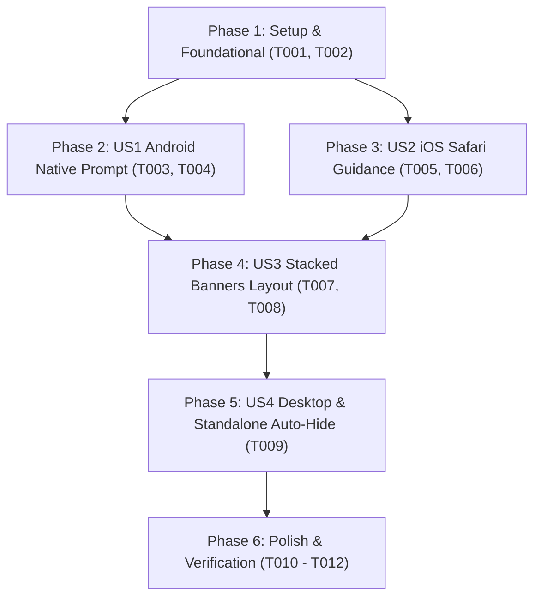

# Tasks: PWA Mobile Install Top Banner

**Input**: Design documents from [`specs/048-pwa-install-banner/`](./)
**Prerequisites**: [`plan.md`](./plan.md), [`spec.md`](./spec.md), [`research.md`](./research.md), [`data-model.md`](./data-model.md), [`contracts/`](./contracts/)
**Target Devices**: Universal Mobile Support (iPhone/iPad mọi thế hệ, Samsung Galaxy, Xiaomi/Redmi, OPPO, Vivo, Realme, Pixel...).
**Policy Constraints**: Chỉ hiển thị trên điện thoại di động (Mobile/Tablet), xếp tầng cùng lúc với thanh Bật thông báo đẩy, và duy nhất có lựa chọn tải về (không có nút "Để sau").

## Format: `- [ ] [TaskID] [P?] [Story?] Description with file path`

- **[P]**: Có thể chạy song song (khác file, không phụ thuộc task trước)
- **[Story]**: Gắn với User Story tương ứng (`[US1]`, `[US2]`, `[US3]`, `[US4]`)

---

## Phase 1: Setup & Foundational (Core Mobile PWA Hook & Modals)

**Purpose**: Nâng cấp module nhận diện thiết bị đa năng và thành phần modal hướng dẫn dùng chung trước khi xây dựng banner

- [x] T001 [P] Upgrade `usePwaInstall` hook in `frontend/src/features/pwa/hooks/usePwaInstall.ts` to support universal mobile detection (`isMobile` covering iPhone, iPad, Samsung, Xiaomi, Oppo, Vivo), device classification (`isIos`, `isAndroid`, `isInAppBrowser`), and install strategy (`native_prompt`, `ios_safari`, `android_manual`, `in_app_browser`)
- [x] T002 [P] Create visual step-by-step install instruction modal in `frontend/src/features/pwa/components/IosInstallModal.tsx` for iOS Safari (Share icon -> Add to Home Screen) and fallback in-app browser detection

**Checkpoint**: Nền tảng phát hiện thiết bị và modal hướng dẫn đã sẵn sàng để tích hợp vào giao diện banner.

---

## Phase 2: User Story 1 - Android / Chromium Mobile Native Prompt (Priority: P1) 🎯 MVP

**Goal**: Hiển thị thanh Top Banner trên cùng cho các dòng máy Android (Samsung, Xiaomi, Oppo, Vivo, Pixel) và kích hoạt hộp thoại cài đặt native `beforeinstallprompt`

**Independent Test**: Mở trình duyệt Chrome hoặc Samsung Internet trên điện thoại Android chưa cài app, thấy thanh banner ở trên cùng. Bấm "Cài đặt ngay", hộp thoại cài đặt native của trình duyệt lập tức xuất hiện. Cài xong, banner tự động biến mất.

### Implementation for User Story 1

- [x] T003 [P] [US1] Create slim top banner component `PwaInstallBanner` in `frontend/src/features/pwa/components/PwaInstallBanner.tsx` featuring app icon, message "Cài đặt DUT AI Manager về màn hình chính để mở nhanh và tiện lợi hơn.", and a single primary action button "Cài đặt ngay" (no dismiss or "Để sau" button)
- [x] T004 [US1] Wire `promptInstall` trigger from `usePwaInstall` to "Cài đặt ngay" button in `frontend/src/features/pwa/components/PwaInstallBanner.tsx` for Chromium browsers and handle automatic cleanup when `appinstalled` event fires

**Checkpoint**: User Story 1 hoàn thành - Người dùng các dòng máy Android có thể cài đặt app PWA ngay lập tức từ thanh banner trên cùng.

---

## Phase 3: User Story 2 - iOS Safari & In-App WebView Guidance (Priority: P1)

**Goal**: Hỗ trợ người dùng iPhone/iPad trên Safari và người dùng mở link trong Zalo/Messenger/Facebook WebView cài đặt ứng dụng qua modal hướng dẫn trực quan

**Independent Test**: Mở Safari trên iPhone chưa cài app, bấm "Cài đặt ngay" trên banner, modal hướng dẫn 2 bước trực quan (Chia sẻ -> Thêm vào MH chính) xuất hiện. Bấm "Đã hiểu", modal đóng lại, banner vẫn giữ nguyên vị trí.

### Implementation for User Story 2

- [x] T005 [US2] Integrate `IosInstallModal` into `frontend/src/features/pwa/components/PwaInstallBanner.tsx` so clicking "Cài đặt ngay" opens the guidance modal when `isIos` is true or native prompt is unavailable
- [x] T006 [US2] Add in-app browser detection callout in `frontend/src/features/pwa/components/IosInstallModal.tsx` instructing users opening from Zalo or Facebook Messenger to tap menu (•••) and select "Mở bằng trình duyệt Safari / Chrome"

**Checkpoint**: User Story 2 hoàn thành - Người dùng toàn bộ các dòng iPhone/iPad và người dùng mở từ Zalo/Messenger đều có hướng dẫn cài đặt chuẩn xác.

---

## Phase 4: User Story 3 - Xếp tầng Top Banners cùng Push Notification (Priority: P2)

**Goal**: Đặt thanh PWA Install Banner và thanh Push Notification Banner xếp tầng mượt mà ở vị trí trên cùng của ứng dụng

**Independent Test**: Đăng nhập tài khoản trên thiết bị di động mới (chưa cài app và chưa bật push), xác nhận cả 2 thanh banner xuất hiện xếp tầng gọn gàng, không che khuất thanh header hay nội dung bên dưới.

### Implementation for User Story 3

- [x] T007 [P] [US3] Re-export `PwaInstallBanner` in `frontend/src/features/pwa/components/index.ts`
- [x] T008 [US3] Update `frontend/src/App.tsx` to stack `<PwaInstallBanner />` at the top and `{isAuthenticated && <PushBanner />}` directly below it in a flex column container, and remove the legacy bottom floating `<PwaInstallPrompt />`

**Checkpoint**: User Story 3 hoàn thành - Cả 2 banner phối hợp xếp tầng hoàn hảo trên đầu trang di động.

---

## Phase 5: User Story 4 - Desktop & Standalone Mode Auto-Hide (Priority: P3)

**Goal**: Đảm bảo thanh banner tự động ẩn hoàn toàn trên máy tính (Desktop/Laptop) và khi ứng dụng đã được cài đặt mở từ màn hình chính

**Independent Test**: Mở trang web trên trình duyệt máy tính hoặc mở ứng dụng ở chế độ Standalone PWA, xác nhận thanh banner cài đặt PWA hoàn toàn không xuất hiện.

### Implementation for User Story 4

- [x] T009 [US4] Enforce strict visibility guards (`if (!isMobile || isInstalled) return null;`) in `frontend/src/features/pwa/components/PwaInstallBanner.tsx` to guarantee zero visibility on Desktop computers or active Standalone PWA mode

**Checkpoint**: User Story 4 hoàn thành - Banner chỉ hiển thị đúng ngữ cảnh trên điện thoại di động chưa cài đặt.

---

## Phase 6: Polish & Cross-Cutting Concerns

**Purpose**: Đảm bảo chất lượng giao diện, kiểm tra tương thích và hoàn thiện tài liệu

- [x] T010 [P] Optimize responsive typography and button padding in `frontend/src/features/pwa/components/PwaInstallBanner.tsx` for small mobile screens (320px - 360px viewport)
- [x] T011 [P] Run frontend typecheck and linter (`cd frontend && npm run lint` or build check) to ensure zero compilation or styling errors
- [x] T012 Validate end-to-end user journeys following scenarios in `specs/048-pwa-install-banner/quickstart.md`

---

## Dependencies & Execution Order

### Phase Dependencies

### User Story Dependencies

- **US1 (Android Prompt)**: Phụ thuộc Phase 1 (`usePwaInstall`). Có thể kiểm thử độc lập trên Android.
- **US2 (iOS Safari & In-App Guide)**: Phụ thuộc Phase 1 (`IosInstallModal`). Có thể kiểm thử độc lập trên iPhone/iPad.
- **US3 (Stacked Layout)**: Phụ thuộc US1 và US2 để tích hợp vào `App.tsx`.
- **US4 (Desktop/Standalone Auto-Hide)**: Phụ thuộc US1 và US3 để xác thực điều kiện ẩn.

### Parallel Opportunities

- `T001` (`usePwaInstall.ts`) và `T002` (`IosInstallModal.tsx`) có thể triển khai song song.
- `T003` (`PwaInstallBanner.tsx`) và `T007` (`index.ts`) có thể tạo song song.
- `T010` (CSS Responsive) và `T011` (Lint & Typecheck) có thể thực hiện song song trong Phase Polish.

---

## Implementation Strategy (MVP First)

1. **Bước 1**: Triển khai `usePwaInstall` và `IosInstallModal` (Phase 1).
2. **Bước 2**: Xây dựng `PwaInstallBanner` hỗ trợ Android Native Prompt (Phase 2 - MVP).
3. **Bước 3**: Bổ sung hỗ trợ iOS Safari và Zalo/Messenger In-App WebView (Phase 3).
4. **Bước 4**: Tích hợp xếp tầng vào `App.tsx` thay thế floating card cũ (Phase 4).
5. **Bước 5**: Kiểm tra điều kiện ẩn trên Desktop/Standalone và xác thực kiểm thử theo `quickstart.md` (Phase 5 & 6).
