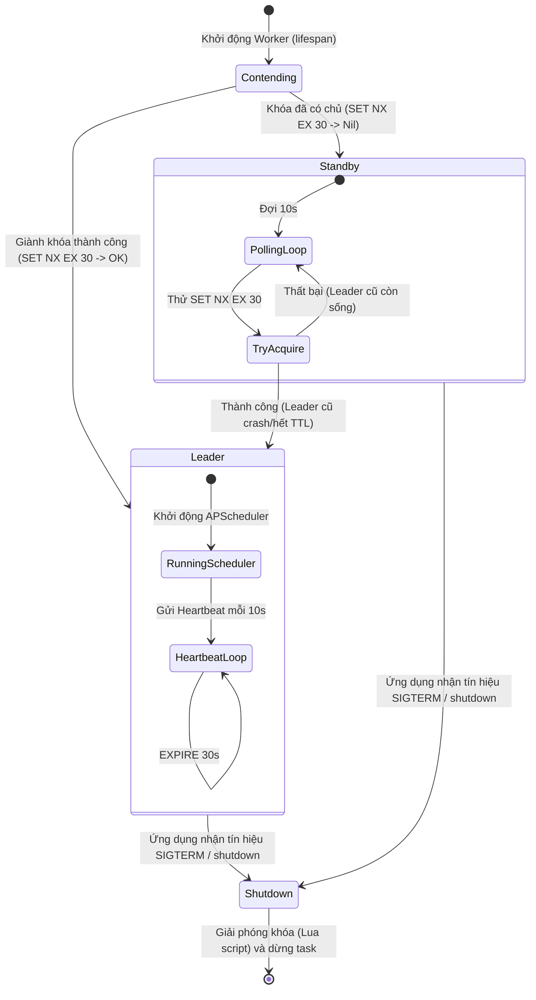

# Mô Hình Dữ Liệu & Trạng Thái: Điều Phối Tác Vụ Nền Đa Tiến Trình

**Feature**: `050-multi-worker-scheduler-lock`  
**Ngày**: 2026-11-05  
**Trạng thái**: Thiết kế chi tiết (Đã tinh gọn: loại bỏ DISABLED)

---

## 1. Khái Niệm Cốt Lõi (Core Entities & Value Objects)

Hệ thống điều phối tác vụ nền đa tiến trình hoạt động dựa trên các thực thể và đối tượng trạng thái sau:

### 1.1 `WorkerIdentity` (Giá trị định danh tiến trình)
Mỗi tiến trình Python worker khi khởi động sẽ tự sinh một định danh duy nhất trong vòng đời của nó:
- **`hostname`** (`str`): Tên máy chủ hoặc container ID nơi worker đang chạy (lấy qua `socket.gethostname()`).
- **`pid`** (`int`): Process ID của tiến trình Python đang thực thi (lấy qua `os.getpid()`).
- **`instance_id`** (`str`): Chuỗi ngẫu nhiên 8 ký tự hex (ví dụ: `uuid.uuid4().hex[:8]`).
- **Chuỗi định danh đầy đủ (`worker_id`)**: `f"{hostname}:{pid}:{instance_id}"`  
  *Ví dụ: `dut-ai-backend:42:a1b2c3d4`*

### 1.2 `LeaderRole` (Vai trò điều phối của Worker)
Enum biểu thị vai trò hiện tại của worker đối với hệ thống lập lịch:
- **`LEADER`**: Tiến trình đang giữ khóa độc quyền, chịu trách nhiệm chạy `APScheduler` và gửi heartbeat gia hạn khóa mỗi 10 giây.
- **`STANDBY`**: Tiến trình đang ở trạng thái dự phòng, chỉ phục vụ HTTP API và định kỳ thăm dò (10s) cơ hội tiếp quản khóa.

### 1.3 `SchedulerCoordinatorState` (Trạng thái nội tại của bộ điều phối)
Lưu trữ trạng thái bộ điều phối trong bộ nhớ của từng worker:
- **`worker_id`** (`str`): Định danh duy nhất của tiến trình hiện tại.
- **`role`** (`LeaderRole`): Vai trò hiện tại (`LEADER` hoặc `STANDBY`).
- **`is_running`** (`bool`): Cờ đánh dấu bộ điều phối đang hoạt động (chưa bị shutdown).
- **`heartbeat_task`** (`asyncio.Task | None`): Nhiệm vụ nền thực hiện gia hạn TTL cho Leader.
- **`standby_task`** (`asyncio.Task | None`): Nhiệm vụ nền thực hiện thăm dò giành khóa cho Standby.
- **`scheduler_instance`** (`AsyncIOScheduler | None`): Đối tượng lập lịch `APScheduler` (chỉ được kích hoạt khi `role == LEADER`).

---

## 2. Mô Hình Dữ Liệu Khóa Phân Tán Trên Redis (Redis Schema)

Bộ điều phối sử dụng Redis Key-Value Store:

### 2.1 Khóa Thủ Lĩnh (Leader Lock Key)
- **Key Pattern**: `dut_ai:scheduler:leader_lock`
- **Data Type**: String
- **Value**: `worker_id` (ví dụ: `dut-ai-backend:42:a1b2c3d4`)
- **TTL (Time-To-Live)**: 30 giây
- **Mục đích**: Đảm bảo tại một thời điểm chỉ có duy nhất 1 tiến trình giữ quyền sở hữu khóa.

### 2.2 Luồng Chuyển Đổi Trạng Thái (State Transition Diagram)

---

## 3. Các Ràng Buộc Hợp Lệ & Quy Tắc Toàn Vẹn (Validation & Invariants)

1. **Tính Bất Biến của Thủ Lĩnh (Leader Invariant)**: Tại bất kỳ thời điểm nào trên toàn cụm worker/container, chỉ có tối đa 1 instance `AsyncIOScheduler` được ở trạng thái `running = True`.
2. **Nguyên Tử Khi Giải Phóng (Safe Release Invariant)**: Một worker chỉ được phép xóa khóa `dut_ai:scheduler:leader_lock` nếu giá trị của khóa hiện tại trong Redis trùng khớp chính xác với `worker_id` của chính nó (sử dụng Lua Script).
3. **Chống Chồng Lấn Tác Vụ (Job Execution Invariant)**: Mọi job được thêm vào `AsyncIOScheduler` đều phải có:
   - `max_instances = 1`: Ngăn chặn job chạy trùng nếu lần thực thi trước chưa kết thúc.
   - `coalesce = True`: Tự động gộp các lần chạy bị bỏ lỡ (misfire) thành 1 lần duy nhất thay vì chạy dồn dập.
