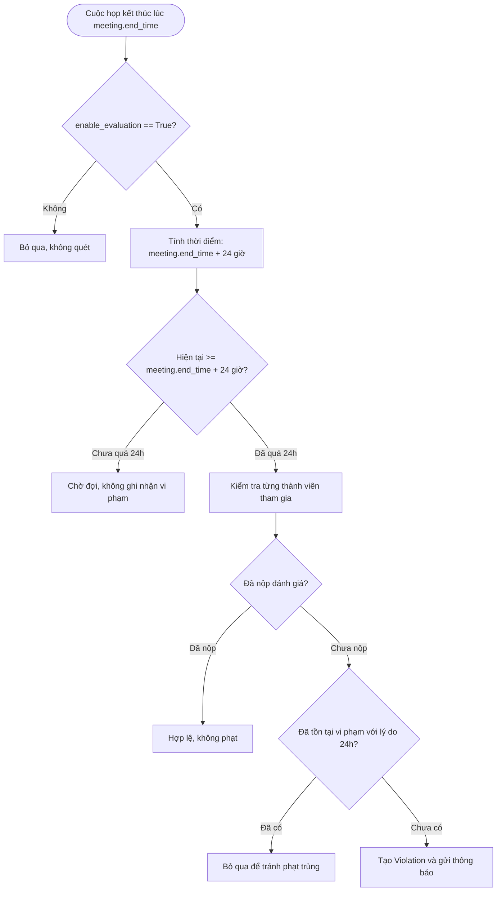

# Mô Hình Dữ Liệu & Hằng Số Nghiệp Vụ: Thời Hạn Đánh Giá Cuộc Họp

**Feature**: `051-meeting-evaluation-deadline-24h`  
**Ngày**: 2026-11-05

---

## 1. Hằng Số Miền Nghiệp Vụ (Domain Constants)

Nằm trong `backend/app/meeting/domain/constants.py`:

```python
# Deadline in hours after meeting end_time before unsubmitted evaluations trigger violations.
MEETING_EVALUATION_DEADLINE_HOURS: int = 24

# Scan window in days to look back for ended meetings when checking evaluations
MEETING_EVALUATION_SCAN_WINDOW_DAYS: int = 9
```

---

## 2. Cấu Trúc Bản Ghi Vi Phạm (Violation Entity Schema)

Khi phát hiện thành viên chưa đánh giá cuộc họp sau mốc 24 giờ, thực thể `Violation` được sinh ra tự động:

### 2.1 Vi phạm dành cho Học viên (Trainee to Trainer)
- **`user_id`**: ID của học viên tham gia cuộc họp (`status == JOINED` hoặc `LATE_EXCUSED`) nhưng chưa gửi đánh giá.
- **`reason`**: `"Chưa hoàn thành đánh giá Trainer cho buổi học '{meeting.title}' ({time_range}) trong vòng 24h"`
- **`date`**: Thời điểm ghi nhận vi phạm (`datetime.now(timezone.utc)`).
- **`is_system_generated`**: `True`

### 2.2 Vi phạm dành cho Giảng viên (Trainer Overall Evaluation)
- **`user_id`**: ID của Trainer phụ trách cuộc họp nếu cuộc họp chưa có đánh giá tổng thể (`overall_evaluation`).
- **`reason`**: `"Trainer chưa hoàn tất đánh giá tổng thể buổi học '{meeting.title}' ({time_range}) trong vòng 24h"`
- **`date`**: Thời điểm ghi nhận vi phạm (`datetime.now(timezone.utc)`).
- **`is_system_generated`**: `True`

---

## 3. Biểu Đồ Xác Định Vi Phạm (Evaluation Deadline Decision Flow)


