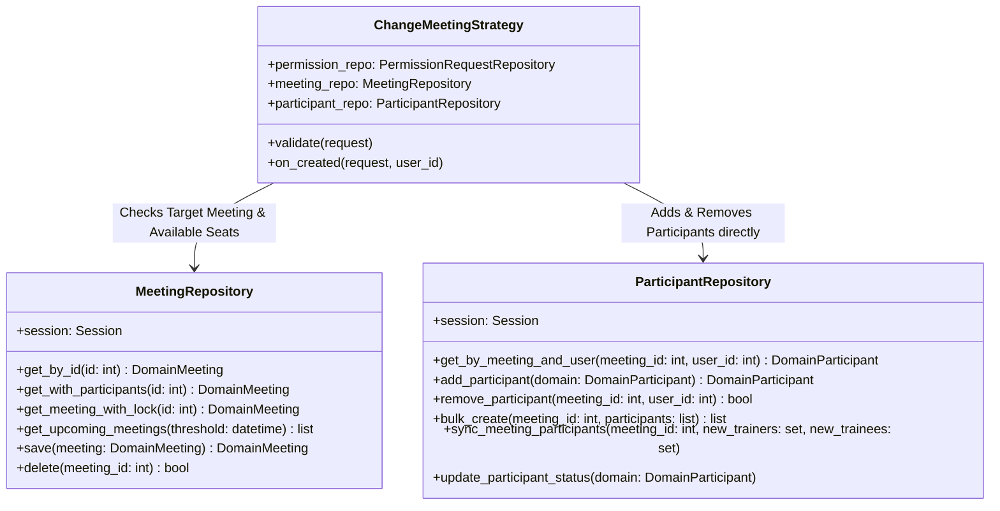

# Phase 1: Data Model & Repository Interface Specifications

## Feature: Tái cấu trúc phân tách Repository giữa Meeting và MeetingParticipant

---

### 1. Phân Tách Trách Nhiệm Tầng Repository



---

### 2. Chi Tiết Phương Thức Trên `ParticipantRepository`

#### 2.1. `remove_participant(meeting_id: int, user_id: int) -> bool`
- **Mục đích**: Xóa trực tiếp bản ghi người tham gia khỏi buổi sinh hoạt cụ thể.
- **Triển khai**:
  ```python
  stmt = select(ORMParticipant).where(
      ORMParticipant.meeting_id == meeting_id,
      ORMParticipant.user_id == user_id,
  )
  orm = self.session.scalars(stmt).first()
  if not orm:
      return False
  self.session.delete(orm)
  self.session.flush()
  return True
  ```

#### 2.2. `add_participant(domain: DomainParticipant) -> DomainParticipant`
- **Mục đích**: Thêm một học viên vào buổi họp đích (hoặc phục hồi nếu trước đó có record).
- **Triển khai**:
  ```python
  stmt = select(ORMParticipant).where(
      ORMParticipant.meeting_id == domain.meeting_id,
      ORMParticipant.user_id == domain.user_id,
  )
  orm = self.session.scalars(stmt).first()
  role_val = domain.role.value if isinstance(domain.role, ParticipantRole) else (domain.role or ParticipantRole.TRAINEE.value)
  if not orm:
      orm = ORMParticipant(
          meeting_id=domain.meeting_id,
          user_id=domain.user_id,
          role=role_val,
          status=domain.status,
      )
      self.session.add(orm)
  else:
      orm.role = role_val
      orm.status = domain.status
      orm.is_deleted = False
      self.session.add(orm)
  self.session.flush()
  return self._to_domain(orm)
  ```

#### 2.3. `bulk_create(meeting_id: int, participants: list[DomainParticipant]) -> list[DomainParticipant]`
- **Mục đích**: Tạo hàng loạt người tham gia khi tạo mới một buổi sinh hoạt (`CreateMeetingUseCase`).
- **Triển khai**: Duyệt `participants`, khởi tạo `ORMParticipant` với `meeting_id`, gọi `self.session.add_all()` và `self.session.flush()`.

#### 2.4. `sync_meeting_participants(meeting_id: int, new_trainers: set[int], new_trainees: set[int]) -> None`
- **Mục đích**: Phục vụ cho `UpdateMeetingUseCase`.
- **Triển khai**:
  1. Lấy toàn bộ `existing_participants` của `meeting_id`.
  2. Xóa các user không còn nằm trong `new_trainers | new_trainees`.
  3. Cập nhật role tương ứng: `TRAINER` cho `new_trainers`, `TRAINEE` cho `new_trainees`.
  4. Thêm mới các user chưa có trong danh sách.
  5. `session.flush()`.

---

### 3. Tinh Gọn `MeetingRepository.save()`

- **Bỏ hoàn toàn** khối `elif (not is_new and hasattr(domain, "participants") ...)` thực hiện diffing và `session.delete(old_p)`.
- `save()` chỉ cập nhật các thuộc tính bảng `meetings` và trả về `Meeting` domain.
