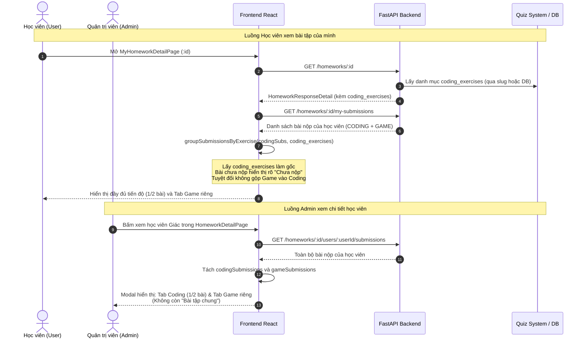

# Data Model: Chuẩn hóa nghiêm ngặt tiến độ bài tập con và tách biệt Game Quiz

**Feature**: `053-strict-homework-exercise-progress`  
**Date**: 2026-11-08  
**Status**: Completed

---

## 1. Backend Data Structures (FastAPI & Pydantic)

### 1.1. `HomeworkResponseDetail` DTO (Application Layer)
```python
class HomeworkResponseDetail(HomeworkResponse):
    """DTO chi tiết bài tập bao gồm danh sách assignee_ids và danh mục bài tập con."""

    assignee_ids: list[int] = Field(default_factory=list)
    coding_exercises: list[ExerciseSummaryDTO] = Field(default_factory=list)

    @classmethod
    def from_domain(
        cls,
        hw: Any,
        assignee_ids: list[int] | None = None,
        deadline: datetime | None = None,
        coding_exercises: list[ExerciseSummaryDTO] | None = None,
    ) -> "HomeworkResponseDetail":
        return cls(
            id=hw.id,
            title=hw.title,
            deadline=deadline,
            link=hw.link,
            slug=hw.slug,
            requires_coding=hw.requires_coding,
            requires_game=hw.requires_game,
            created_at=hw.created_at,
            updated_at=hw.updated_at,
            created_by=hw.created_by,
            assignee_ids=assignee_ids or [],
            coding_exercises=coding_exercises or [],
        )
```

### 1.2. `ExerciseSummaryDTO` (Application Layer)
```python
class ExerciseSummaryDTO(BaseModel):
    """Thông tin tóm tắt của một bài tập coding con."""
    exercise_id: str
    title: str
    order_index: int = 0
    completed_count: int = 0
    total_assigned: int = 0
    completion_rate: float = 0.0
```

---

## 2. Frontend Data Structures (TypeScript & Zod)

### 2.1. `homeworkSchema` (Types Layer)
```typescript
export const homeworkSchema = z.object({
  id: z.number(),
  title: z.string(),
  deadline: z.string(),
  link: z.string().nullable().optional(),
  slug: z.string().nullable().optional(),
  requires_coding: z.boolean().optional(),
  requires_game: z.boolean().optional(),
  assignee_ids: z.array(z.number()).optional(),
  coding_exercises: z.array(exerciseSummarySchema).optional(), // Bổ sung trường này
  created_at: z.string(),
  updated_at: z.string(),
  created_by: z.number().optional(),
  // ... các trường mở rộng khác
});
```

### 2.2. `NormalizedSubmission` & `ExerciseGroupSummary` (Utils Layer)
```typescript
export interface NormalizedSubmission {
  id: number;
  homeworkId: number;
  userId: number;
  submissionType: 'CODING' | 'GAME';
  exerciseId: string | null;
  exerciseTitle: string | null;
  score: number | null;
  attemptNumber: number;
  submittedAt: string;
  isPassed: boolean;
  source: 'WEBHOOK' | 'MANUAL_SYNC' | 'UNKNOWN';
  filename: string | null;
  correctCount: number | null;
  totalQuestions: number | null;
  rawDetails: Record<string, any>;
}

export interface ExerciseGroupSummary {
  exerciseId: string;
  exerciseTitle: string;
  submissions: NormalizedSubmission[];
  attemptCount: number;
  bestScore: number | null;
  latestSubmittedAt: string;
  isPassed: boolean;
}
```

---

## 3. Data Flow Diagram


