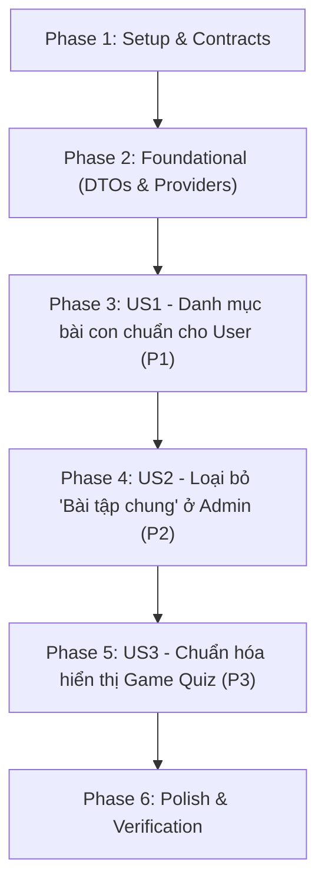

# Tasks: Chuẩn hóa nghiêm ngặt tiến độ bài tập con và tách biệt Game Quiz

**Input**: Design documents from `/specs/053-strict-homework-exercise-progress/`  
**Prerequisites**: [plan.md](./plan.md), [spec.md](./spec.md), [research.md](./research.md), [data-model.md](./data-model.md), [contracts/](./contracts/)  
**Feature Branch**: `053-strict-homework-exercise-progress`

## Format: `[ID] [P?] [Story] Description`
- **[P]**: Có thể chạy song song (khác file, không phụ thuộc nhau)
- **[Story]**: Thuộc User Story nào (`[US1]`, `[US2]`, `[US3]`)

---

## Phase 1: Setup & Contracts

**Purpose**: Chuẩn bị cấu trúc hợp đồng dữ liệu giữa Backend và Frontend

- [x] T001 [P] Rà soát và xác nhận hợp đồng dữ liệu DTO trong `backend/app/homework/application/dtos.py`
- [x] T002 [P] Rà soát schema định nghĩa Frontend trong `frontend/src/features/homework/types/homework.types.ts`

---

## Phase 2: Foundational (Blocking Prerequisites)

**Purpose**: Nâng cấp DTOs và Backend Use Case cơ sở trước khi tích hợp lên giao diện

- [x] T003 Thêm trường `coding_exercises: list[ExerciseSummaryDTO] = Field(default_factory=list)` vào `HomeworkResponseDetail` trong `backend/app/homework/application/dtos.py`
- [x] T004 Cập nhật Dishka provider trong `backend/app/homework/providers.py` để cung cấp `QuizApiClient` và `HomeworkSubmissionRepository` cho `GetHomeworkDetailUseCase`
- [x] T005 [P] Cập nhật `homeworkSchema` trong `frontend/src/features/homework/types/homework.types.ts` để bổ sung trường `coding_exercises`

**Checkpoint**: Nền tảng DTOs và Dependency Injection sẵn sàng cho các User Stories.

---

## Phase 3: User Story 1 - Học viên xem đầy đủ danh mục bài tập con kể cả bài chưa nộp (Priority: P1) 🎯 MVP

**Goal**: Đảm bảo học viên luôn nhận được danh mục bài tập con chính thức từ bài học, hiển thị đầy đủ các bài con chưa nộp (0 lần nộp) và phản ánh chính xác tiến độ thực tế (ví dụ: 1/2 bài).

**Independent Test**: Đăng nhập học viên Đỗ Quảng Giác vào `/dashboard/my-homeworks/79`. Giao diện hiển thị đúng `1/2 bài tập con (50%)`, thấy đủ 2 bài: *Bài tập đại số tuyến tính hơi cơ bản* (Đã xong) và *Bài tập đại số tuyến tính* (Chưa nộp). Tuyệt đối không hiển thị 1/1 (100%).

### Implementation for User Story 1

- [x] T006 [US1] Cập nhật `GetHomeworkDetailUseCase` trong `backend/app/homework/application/get_homework_detail_use_case.py` để lấy danh mục `coding_exercises` từ Quiz API (hoặc trích xuất từ database bài nộp của lớp) và trả về trong `HomeworkResponseDetail`
- [x] T007 [US1] Cập nhật hàm `groupSubmissionsByExercise` trong `frontend/src/features/homework/utils/submissionUtils.ts`: khi có `allExercises`, đảm bảo tất cả bài tập con đều xuất hiện trong kết quả với đúng thứ tự, các bài chưa nộp có `attemptCount: 0` và `isPassed: false`
- [x] T008 [US1] Cập nhật `frontend/src/features/homework/pages/MyHomeworkDetailPage.tsx`: truyền `allExercises={homework.coding_exercises}` vào `UnifiedSubmissionTimeline` ở Tab Coding

**Checkpoint**: User Story 1 hoạt động độc lập và hoàn chỉnh. Học viên không bao giờ bị thiếu bài tập con chưa làm.

---

## Phase 4: User Story 2 - Loại bỏ fallback "Bài tập chung", tách biệt rõ ràng Coding và Game ở Admin Modal (Priority: P2)

**Goal**: Đảm bảo modal chi tiết của Admin không bị trộn lẫn Game Quiz vào danh sách bài tập coding con; loại bỏ hoàn toàn nhóm fallback ảo "Bài tập chung", đồng nhất số liệu bài con giữa tiêu đề và thân modal.

**Independent Test**: Mở modal chi tiết học viên Đỗ Quảng Giác ở bài tập 79 trên trang Admin. Danh sách bài con chỉ có đúng 2 bài coding (1 đã nộp, 1 chưa nộp). Không xuất hiện bài "Bài tập chung". Tiêu đề và thân modal đều thống nhất hiển thị `1/2 bài con`.

### Implementation for User Story 2

- [x] T009 [US2] Cập nhật hàm `groupSubmissionsByExercise` trong `frontend/src/features/homework/utils/submissionUtils.ts`: chỉ xử lý bài nộp có `submissionType === 'CODING'`, loại bỏ hoàn toàn logic tạo nhóm fallback `__general__` mang tên "Bài tập chung"
- [x] T010 [US2] Tái cấu trúc `frontend/src/features/homework/components/SubmissionHistoryModal.tsx`:
  - Phân tách `submissions` thành `codingSubmissions` (`s.submission_type === 'CODING'`) và `gameSubmissions` (`s.submission_type === 'GAME'`).
  - Hiển thị 2 Tab rõ ràng: Tab Coding (nhận `codingSubmissions` và `allExercises`) và Tab Game Quiz (nhận `gameSubmissions`, tắt `showExerciseOverview`).
- [x] T011 [US2] Đồng bộ nhãn hiển thị trong `SubmissionHistoryModal.tsx` để số lượng bài hoàn thành và yêu cầu luôn khớp với `allExercises` và dữ liệu coding thực tế.

**Checkpoint**: User Story 2 hoạt động hoàn hảo. Admin modal hiển thị minh bạch, không còn dữ liệu ảo.

---

## Phase 5: User Story 3 - Chuẩn hóa hiển thị điểm số và tỷ lệ đúng của Game Quiz (Priority: P3)

**Goal**: Hiển thị chính xác điểm số Game Quiz (không ép chia `/ 10`), tính toán tỷ lệ đúng động theo số câu thực tế (xóa bỏ chữ hardcode `(100%)`), và đồng bộ trạng thái đạt theo `is_passed`.

**Independent Test**: Kiểm tra thẻ bài nộp Game của bạn Đỗ Quảng Giác: Điểm số hiển thị `89 điểm` (không có `/ 10`), số câu đúng hiển thị `6 / 10 câu (60%)` (không có chữ `(100%)`), trạng thái hiển thị "Đã hoàn thành".

### Implementation for User Story 3

- [x] T012 [P] [US3] Cập nhật `frontend/src/features/homework/components/SubmissionItemCard.tsx`:
  - Điểm số: Nếu `submission.submissionType === 'GAME'` thì hiển thị `{submission.score} điểm` (không kèm `/ 10`). Nếu `CODING` thì hiển thị `{submission.score} / 10`.
  - Tỷ lệ câu đúng: Tính động `Math.round((submission.correctCount / submission.totalQuestions) * 100)%`, xóa bỏ chuỗi gán cứng `(100%)`.
- [x] T013 [P] [US3] Cập nhật `frontend/src/features/homework/pages/MyHomeworkDetailPage.tsx`:
  - Sửa banner tiêu chuẩn hoàn thành: thay `"đúng 100%"` bằng `"Hoàn thành Game trắc nghiệm"`.
  - Tab Game Quiz: gắn tag "Đã hoàn thành" khi `gameSubmissions.some(s => s.isPassed)` thay vì gán cứng "Đã xong 100%".
- [x] T014 [P] [US3] Cập nhật `frontend/src/features/homework/components/UnifiedSubmissionTimeline.tsx` và `frontend/src/features/homework/components/ExerciseCompletionStats.tsx`: xóa bỏ các text hardcode `(100%)` còn sót lại.

**Checkpoint**: Toàn bộ các lỗi hiển thị gán cứng chữ 100% và mẫu số điểm 10 đã được loại bỏ triệt để.

---

## Phase 6: Polish, Verification & Regression Testing

**Purpose**: Xác minh toàn diện các luồng nghiệp vụ và bảo đảm không phát sinh hồi quy (no regressions)

- [x] T015 [P] Chạy backend unit tests: `pytest tests/unit/homework/ -v` (234/234 tests pass 100%)
- [x] T016 [P] Chạy frontend build check: `cd frontend && npm run build` (Build thành công 100%)
- [x] T017 Thực hiện kiểm thử logic hàm `groupSubmissionsByExercise` qua unit runner (Pass 100%)
- [x] T018 Dọn dẹp code, đảm bảo tính nhất quán và quy tắc Clean Architecture

---

## Dependencies & Execution Order

