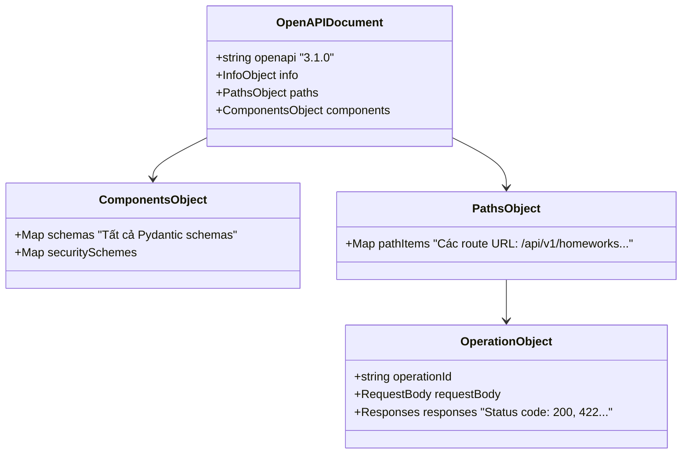

# Mô hình Dữ liệu: Đồng bộ hóa hợp đồng API và sinh Type tự động từ OpenAPI Backend

**Feature Branch**: `specs/054-openapi-type-generation`  
**Date**: 2026-11-08  
**Spec**: [spec.md](./spec.md)

---

## 1. Cấu trúc Thực thể OpenAPI (OpenAPI Specification Entities)

Hệ thống hoạt động dựa trên 3 thực thể dữ liệu chính từ bản đặc tả OpenAPI Specification 3.1 do FastAPI tạo ra:



---

## 2. Mô hình Kiểu dữ liệu Sinh tự động (Generated TypeScript Data Model)

Khi chạy lệnh `openapi-typescript`, công cụ phân tích `OpenAPIDocument` và xuất ra tệp `src/types/api.generated.d.ts` với cấu trúc kiểu:

```typescript
export interface paths {
    "/api/v1/homeworks": {
        get: {
            parameters: {
                query?: {
                    page?: number;
                    page_size?: number;
                    deleted?: boolean;
                };
            };
            responses: {
                200: {
                    content: {
                        "application/json": components["schemas"]["ApiResponse_list_app__homework__application__dtos__HomeworkResponse__"];
                    };
                };
            };
        };
        post: {
            requestBody: {
                content: {
                    "application/json": components["schemas"]["HomeworkCreate"];
                };
            };
            responses: {
                200: {
                    content: {
                        "application/json": components["schemas"]["ApiResponse_app__homework__application__dtos__HomeworkResponse_"];
                    };
                };
            };
        };
    };
    // ... các route khác
}

export interface components {
    schemas: {
        HomeworkResponse: {
            id: number;
            title: string;
            deadline: string;
            link?: string | null;
            slug?: string | null;
            requires_coding?: boolean;
            requires_game?: boolean;
            created_at: string;
            updated_at: string;
            created_by?: number | null;
        };
        HomeworkResponseDetail: {
            id: number;
            title: string;
            deadline: string;
            link?: string | null;
            slug?: string | null;
            requires_coding?: boolean;
            requires_game?: boolean;
            coding_exercises?: components["schemas"]["ExerciseSummary"][];
            created_at: string;
            updated_at: string;
            created_by?: number | null;
        };
        HomeworkCreate: {
            title: string;
            deadline: string;
            link?: string | null;
            slug?: string | null;
            requires_coding?: boolean;
            requires_game?: boolean;
            assignee_ids?: number[];
        };
        HomeworkUpdate: {
            title?: string | null;
            deadline?: string | null;
            link?: string | null;
            slug?: string | null;
            requires_coding?: boolean | null;
            requires_game?: boolean | null;
            assignee_ids?: number[] | null;
        };
        ExerciseSummary: {
            id?: string | null;
            exercise_id?: string | null;
            title: string;
            order_index?: number;
            completed_count?: number;
            total_assigned?: number;
            completion_rate?: number;
        };
        // ... các schema khác của toàn hệ thống
    };
}
```

---

## 3. Mô hình Ánh xạ DTO Pilot Module (Homework Domain)

Trong quá trình triển khai mẫu (Pilot), các interface viết tay của module Homework sẽ được chuẩn hóa thành các alias kiểu trỏ trực tiếp vào `Schema<T>`:

| Interface Cũ (Viết tay) | Kiểu Mới (Single Source of Truth) | Nguồn Pydantic DTO (Backend) |
|-------------------------|-----------------------------------|------------------------------|
| `interface Homework` | `export type Homework = Schema<"HomeworkResponse">;` | `HomeworkResponse` (`app/homework/application/dtos.py`) |
| `interface HomeworkDetail` | `export type HomeworkDetail = Schema<"HomeworkResponseDetail">;` | `HomeworkResponseDetail` (`app/homework/application/dtos.py`) |
| `interface HomeworkCreate` | `export type HomeworkCreate = Schema<"HomeworkCreate">;` | `HomeworkCreate` (`app/homework/application/dtos.py`) |
| `interface HomeworkUpdate` | `export type HomeworkUpdate = Schema<"HomeworkUpdate">;` | `HomeworkUpdate` (`app/homework/application/dtos.py`) |
| `interface ExerciseSummary` | `export type ExerciseSummary = Schema<"ExerciseSummary">;` | `ExerciseSummary` (`app/homework/application/dtos.py`) |
| `interface HomeworkReportResponse` | `export type HomeworkReportResponse = Schema<"HomeworkReportResponse">;` | `HomeworkReportResponse` (`app/homework/application/dtos.py`) |
| `interface HomeworkSubmissionStatus` | `export type HomeworkSubmissionStatus = Schema<"HomeworkSubmissionStatusResponse">;` | `HomeworkSubmissionStatusResponse` (`app/homework/application/dtos.py`) |
