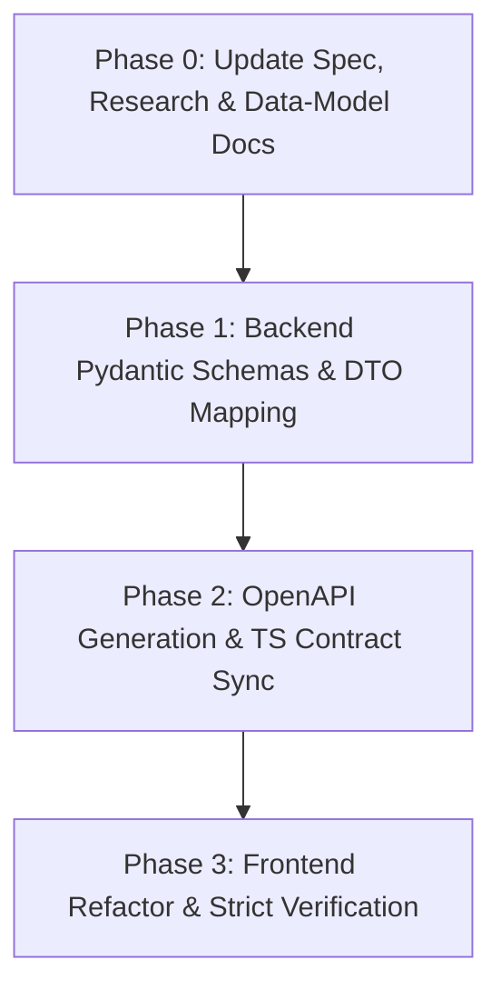

# Implementation Plan: Chuẩn hóa Schema và Metadata cho Homework Submission (Coding & Game) - Clean & Strict

**Branch**: `056-standardize-submission-metadata` | **Spec**: [spec.md](./spec.md)  
**Created**: 2026-11-08  
**Approach**: **Cách 1 - Clean & Strict**: Xóa hẳn `details: dict[str, Any]` thô, thay thế bằng Discriminated / Typed Details `CodingSubmissionDetails | GameSubmissionDetails`.

---

## 1. Technical Context

Hệ thống quản lý bài tập hiện theo dõi 2 luồng nộp bài chính từ Quiz:
- **Coding**: Học viên nộp code cho từng bài tập con (`exercise_id`), metadata chứa `original_filename`, `status`, `submission_id`, `score_details`, `source`.
- **Game**: Học viên hoàn thành phiên trắc nghiệm game, metadata chứa `session_id`, `final_score`, `gold`, `total_questions`, `correct_count`, `attempt_count`, `source`.

**Quyết định kiến trúc dứt khoát:**
- **Loại bỏ hoàn toàn** `details: dict[str, Any]` khỏi DTO phản hồi `HomeworkSubmissionDetailResponse`.
- Định nghĩa 2 Pydantic schema strongly-typed: `CodingSubmissionDetails` và `GameSubmissionDetails`.
- `details` trong DTO phản hồi sẽ có kiểu cụ thể: `CodingSubmissionDetails | GameSubmissionDetails`.
- Đồng bộ hóa sang OpenAPI để sinh ra TypeScript Tagged Union, giúp Frontend có type-safety 100% dựa trên `submission_type`.
- Xóa bỏ toàn bộ fallback soup trong `submissionUtils.ts` trên Frontend.

---

## 2. Constitution Check

- [x] **Principle I (Clean Architecture & Practical DDD Boundaries)**: Logic phân loại metadata nằm ở `domain/` và `application/dtos.py`, ORM mapping tại `infrastructure/model.py`.
- [x] **Principle II (Dishka DI)**: Giữ nguyên DI container cho `GetUserHomeworkSubmissionsUseCase`.
- [x] **Principle III (Enterprise UTC)**: `submitted_at` và `created_at` tiếp tục tuân thủ `timezone.utc`.
- [x] **Principle V & XVI (Single Source of Truth API Contracts & Strict Type Synchronization)**: Xóa bỏ `dict[str, Any]` vô danh, áp dụng Pydantic DTO làm SSOT với contract rõ ràng, tự động đồng bộ sang React qua `npm run generate:api`.

---

## 3. Implementation Phases



### Phase 0: Cập nhật Design Artifacts (Tài liệu thiết kế)
- Cập nhật `spec.md`, `research.md`, `data-model.md` loại bỏ hoàn toàn `details: dict[str, Any]` vô danh.
- Định nghĩa hợp đồng schema Discriminated Union cho `HomeworkSubmissionDetailResponse`.

### Phase 1: Triển khai Backend (Pydantic & Use Cases)
- Trong `backend/app/homework/application/dtos.py`:
  - Định nghĩa `CodingSubmissionDetails` với các trường: `submission_id`, `original_filename`, `status`, `score_details`, `source`.
  - Định nghĩa `GameSubmissionDetails` với các trường: `session_id`, `final_score`, `gold`, `total_questions`, `correct_count`, `attempt_count`, `source`.
  - Cập nhật `HomeworkSubmissionDetailResponse`:
    ```python
    details: CodingSubmissionDetails | GameSubmissionDetails
    ```
  - Thêm `@model_validator(mode="before")` để tự động parse dict từ DB thành đúng model `CodingSubmissionDetails` (nếu `submission_type == "CODING"`) hoặc `GameSubmissionDetails` (nếu `submission_type == "GAME"`).
- Cập nhật `backend/app/homework/application/get_user_homework_submissions_use_case.py` nếu cần.
- Đảm bảo các use case ghi nhận Webhook và Sync lưu dữ liệu nhất quán vào DB.

### Phase 2: Đồng bộ OpenAPI sang Frontend
- Chạy lệnh xuất OpenAPI schema từ Backend ra `frontend/openapi.json`.
- Chạy `cd frontend && npm run generate:api` để cập nhật `api.generated.d.ts`.
- Xác nhận OpenAPI sinh ra type:
  ```typescript
  details: components["schemas"]["CodingSubmissionDetails"] | components["schemas"]["GameSubmissionDetails"];
  ```

### Phase 3: Tái cấu trúc Frontend (Clean & Strict)
- Trong `frontend/src/features/homework/utils/submissionUtils.ts`:
  - Cập nhật `normalizeSubmission` để đọc trực tiếp các trường strongly-typed từ `raw.details` tùy theo `raw.submission_type`.
  - Xóa bỏ các fallback `details.final_score ?? details.score` hoặc `raw.details || raw.metadata`.
- Kiểm tra toàn diện với:
  - `cd frontend && npx tsc -b` (yêu cầu 0 lỗi).
  - `cd frontend && npm run build` (đóng gói production thành công).
