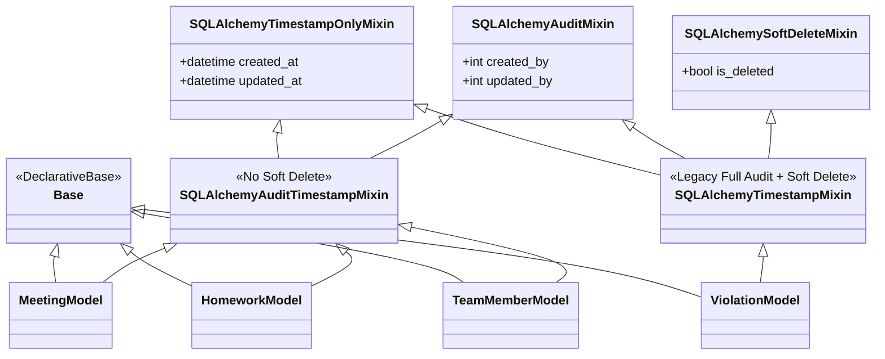

# Data Model: Lược bỏ is_deleted trên các Model không cần thiết

## 1. Cấu trúc Mixin Cơ sở (SQLAlchemy Infrastructure)

---

## 2. Danh sách Phân loại Model & Bảng

### 2.1. Nhóm Hard-Delete (Không có `is_deleted`)
- **`Meeting`** (`meetings`): Kế thừa `SQLAlchemyAuditTimestampMixin, Base`.
- **`MeetingParticipant`** (`meeting_participants`): Kế thừa `SQLAlchemyAuditTimestampMixin, Base`.
- **`HomeworkModel`** (`homeworks`): Kế thừa `SQLAlchemyAuditTimestampMixin, Base`.
- **`HomeworkAssigneeModel`** (`homework_assignees`): Kế thừa `SQLAlchemyTimestampOnlyMixin, Base`.
- **`TeamMemberModel`** (`team_members`): Kế thừa `SQLAlchemyAuditTimestampMixin, Base`.
- **`TeamModel`** (`teams`): Kế thừa `SQLAlchemyAuditTimestampMixin, Base`.
- **`NotificationModel`** (`notifications`): Kế thừa `SQLAlchemyTimestampOnlyMixin, Base`.
- **`PushSubscriptionModel`** (`push_subscriptions`): Kế thừa `SQLAlchemyTimestampOnlyMixin, Base`.
- **`CleaningDutyModel`** (`cleaning_duties`): Kế thừa `SQLAlchemyAuditTimestampMixin, Base`.
- **`InvoiceItemModel`** (`invoice_items`): Kế thừa `SQLAlchemyTimestampOnlyMixin, Base`.
- **`MonthlyUserStatsModel`** (`monthly_user_stats`): Kế thừa `SQLAlchemyTimestampOnlyMixin, Base`.
- **`RoleModel`, `PermissionModel`, `UserRoleModel`**: Kế thừa `SQLAlchemyTimestampOnlyMixin, Base`.

### 2.2. Nhóm Soft-Delete (Giữ lại `is_deleted`)
- **`UserModel`** (`users`): Vô hiệu hóa tài khoản.
- **`ViolationModel`** (`violations`): Lưu vết kỷ luật.
- **`InvoiceModel`, `OutgoingInvoiceModel`** (`invoices`, `outgoing_invoices`): Kế toán tài chính.
- **`PermissionRequest`** (`permission_requests`): Lưu vết đơn xin phép.
- **`BonusPointModel`** (`bonus_points`): Lưu vết điểm thưởng.
- **`RoleApiKeyModel`, `RolePermissionModel`**: Thu hồi key / quyền động.
