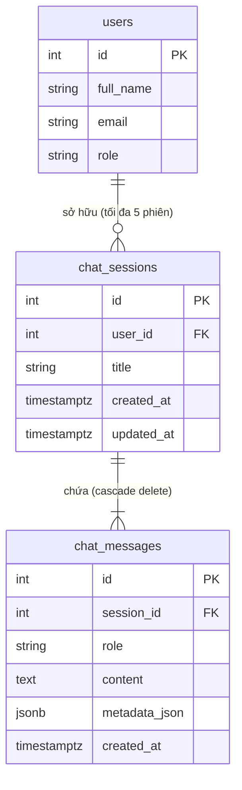

# Data Model: Chatbot Trợ Lý Giải Đáp Vi Phạm & Vận Hành

**Feature**: `062-violation-faq-chatbot`  
**Date**: 2026-11-12  
**Status**: Draft  

---

## 1. Domain Entities & Value Objects (Pydantic / Clean Domain)

### Value Object: `MessageRole`
Enum định danh vai trò người phát ngôn trong tin nhắn:
```python
from enum import StrEnum

class MessageRole(StrEnum):
    USER = "user"
    ASSISTANT = "assistant"
    SYSTEM = "system"
```

### Value Object: `ChatMessageMetadata`
Chứa thông tin bổ trợ như các trích dẫn quy chế hoặc công cụ đã gọi (tuân thủ nguyên tắc XVII: Strongly-Typed Storage & Zero Raw Dictionary Columns):
```python
from pydantic import BaseModel, Field

class ToolCallRecord(BaseModel):
    tool_name: str
    arguments: dict[str, str | int | float | bool] = Field(default_factory=dict)
    execution_status: str = "success"

class ChatMessageMetadata(BaseModel):
    model_name: str = "ggml-org/gemma-4-e4b-it-GGUF:Q4_0"
    tools_invoked: list[ToolCallRecord] = Field(default_factory=list)
    citations: list[str] = Field(default_factory=list)
```

### Domain Entity: `ChatMessage`
```python
from datetime import UTC, datetime
from pydantic import BaseModel, Field
from app.shared.domain.base_entity import BaseEntity

class ChatMessage(BaseEntity):
    session_id: int
    role: MessageRole
    content: str
    metadata_info: ChatMessageMetadata = Field(default_factory=ChatMessageMetadata)
    created_at: datetime = Field(default_factory=lambda: datetime.now(UTC))
```

### Domain Entity: `ChatSession`
```python
from datetime import UTC, datetime
from pydantic import BaseModel, Field
from app.shared.domain.base_entity import BaseEntity

class ChatSession(BaseEntity):
    user_id: int
    title: str = "Cuộc trò chuyện mới"
    created_at: datetime = Field(default_factory=lambda: datetime.now(UTC))
    updated_at: datetime = Field(default_factory=lambda: datetime.now(UTC))
    messages: list[ChatMessage] = Field(default_factory=list)

    def update_title_from_first_message(self, first_user_message: str) -> None:
        """Tự động đặt tiêu đề ngắn gọn dựa trên câu hỏi đầu tiên."""
        clean = first_user_message.strip()
        self.title = clean[:50] + ("..." if len(clean) > 50 else "")
        self.updated_at = datetime.now(UTC)
```

---

## 2. Quy tắc Miền: Giới hạn Tối đa 5 Phiên (FIFO Pruning Rule)

Theo nguyên tắc nghiệp vụ của hệ thống:
1. Mỗi thành viên chỉ sở hữu **tối đa 5 phiên trò chuyện** hoạt động cùng lúc.
2. Khi thành viên bắt đầu tạo phiên thứ 6:
   - Hệ thống truy vấn các phiên hiện có của `user_id`, sắp xếp theo `updated_at ASC`.
   - Phiên cũ nhất (và toàn bộ tin nhắn thuộc phiên đó) sẽ bị xóa vĩnh viễn khỏi hệ thống (`cascade="all, delete-orphan"`).
   - Phiên mới được tạo và lưu vào hệ thống, đảm bảo tổng số phiên luôn $\le 5$.

---

## 3. SQLAlchemy ORM Models (Infrastructure Layer)

Áp dụng chuẩn lưu trữ theo Constitution: **Timezone-aware UTC** (`DateTime(timezone=True)`), Type Decorator strongly-typed cho metadata, liên kết khóa ngoại rõ ràng.

### Bảng `chat_sessions`
```python
from datetime import UTC, datetime
from sqlalchemy import DateTime, ForeignKey, Integer, String
from sqlalchemy.orm import Mapped, mapped_column, relationship
from app.core.database import Base

class ChatSessionModel(Base):
    __tablename__ = "chat_sessions"

    id: Mapped[int] = mapped_column(Integer, primary_key=True, autoincrement=True)
    user_id: Mapped[int] = mapped_column(Integer, ForeignKey("users.id", ondelete="CASCADE"), index=True, nullable=False)
    title: Mapped[str] = mapped_column(String(255), default="Cuộc trò chuyện mới", nullable=False)
    created_at: Mapped[datetime] = mapped_column(DateTime(timezone=True), default=lambda: datetime.now(UTC), nullable=False)
    updated_at: Mapped[datetime] = mapped_column(DateTime(timezone=True), default=lambda: datetime.now(UTC), onupdate=lambda: datetime.now(UTC), nullable=False, index=True)

    # Relationships
    messages: Mapped[list["ChatMessageModel"]] = relationship(
        "ChatMessageModel",
        back_populates="session",
        cascade="all, delete-orphan",
        order_by="ChatMessageModel.created_at.asc()"
    )
```

### Bảng `chat_messages`
```python
from datetime import UTC, datetime
from sqlalchemy import DateTime, ForeignKey, Integer, String, Text
from sqlalchemy.orm import Mapped, mapped_column, relationship
from app.core.database import Base
from app.shared.infrastructure.sqlalchemy_types import PydanticType

class ChatMessageModel(Base):
    __tablename__ = "chat_messages"

    id: Mapped[int] = mapped_column(Integer, primary_key=True, autoincrement=True)
    session_id: Mapped[int] = mapped_column(Integer, ForeignKey("chat_sessions.id", ondelete="CASCADE"), index=True, nullable=False)
    role: Mapped[str] = mapped_column(String(32), nullable=False)  # "user" | "assistant" | "system"
    content: Mapped[str] = mapped_column(Text, nullable=False)
    
    # Metadata strongly typed via PydanticType
    metadata_json: Mapped[ChatMessageMetadata] = mapped_column(
        PydanticType(ChatMessageMetadata),
        default=ChatMessageMetadata,
        nullable=False
    )
    created_at: Mapped[datetime] = mapped_column(DateTime(timezone=True), default=lambda: datetime.now(UTC), nullable=False, index=True)

    # Relationships
    session: Mapped["ChatSessionModel"] = relationship("ChatSessionModel", back_populates="messages")
```

---

## 4. Sơ đồ Quan hệ Thực thể (Entity Relationship Diagram)


