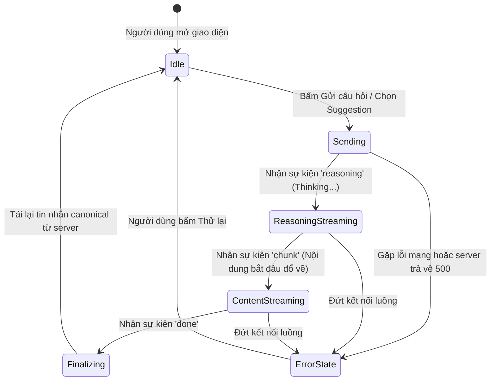

# Data Model & Component State Architecture: Tái Thiết Giao Diện Trợ Lý Ảo

**Feature Branch**: `063-rebuild-assistant-ui`  
**Date**: 2026-11-12  
**Status**: Completed  

---

## 1. Mô Hình Thực Thể Tầng Trình Diễn (Frontend Presentation Entities)

Các thực thể dữ liệu được sử dụng trực tiếp trong tầng giao diện người dùng, ánh xạ tương thích 100% với DTO trả về từ API backend (`frontend/src/types/api.generated.d.ts`).

### 1.1. `ChatMessageItem` (Lượt tin nhắn hoàn chỉnh)
Đại diện cho một lượt tin nhắn hiển thị trong danh sách hội thoại.

| Trường | Kiểu dữ liệu | Bắt buộc | Mô tả |
|:-------|:-------------|:---------|:------|
| `id` | `number` | Có | Định danh tin nhắn (hoặc timestamp tạm thời khi đang gửi) |
| `session_id` | `number` | Có | Định danh phiên trò chuyện |
| `role` | `'user' \| 'assistant' \| 'system'` | Có | Vai trò của người gửi tin nhắn |
| `content` | `string` | Có | Nội dung văn bản hiển thị (định dạng Markdown) |
| `created_at` | `string` | Có | Thời điểm gửi tin nhắn theo chuẩn ISO 8601 UTC |
| `metadata_info` | `ChatMessageMetadata \| null` | Không | Siêu dữ liệu mở rộng kèm theo tin nhắn |

### 1.2. `ChatMessageMetadata` (Siêu dữ liệu thông minh)
Chứa các thông tin bổ trợ do mô hình AI tạo ra trong quá trình sinh phản hồi.

| Trường | Kiểu dữ liệu | Bắt buộc | Mô tả |
|:-------|:-------------|:---------|:------|
| `model_name` | `string` | Không | Tên mô hình AI phục vụ (ví dụ: `gemma-4-e4b-it`) |
| `reasoning_content` | `string` | Không | Toàn bộ chuỗi suy luận tư duy (Chain of Thought) |
| `tools_invoked` | `ToolCallRecord[]` | Không | Danh sách các công cụ hệ thống đã được kích hoạt |
| `usage` | `Record<string, number>` | Không | Thống kê số lượng token tiêu thụ |

### 1.3. `ToolCallRecord` (Nhật ký thực thi công cụ)
Lưu lại chi tiết từng bước gọi công cụ của trợ lý.

| Trường | Kiểu dữ liệu | Bắt buộc | Mô tả |
|:-------|:-------------|:---------|:------|
| `tool_name` | `string` | Có | Tên kỹ thuật của công cụ (ví dụ: `inspect_entity_records`) |
| `execution_status` | `'success' \| 'failed' \| 'running'` | Có | Trạng thái thực thi công cụ |
| `arguments` | `Record<string, any>` | Không | Các tham số đầu vào truyền cho công cụ |
| `result` | `Record<string, any>` | Không | Kết quả trả về sau khi công cụ chạy xong |

### 1.4. `ChatSessionGroup` (Cấu trúc nhóm phiên trò chuyện)
Mô hình cấu trúc nhóm các phiên hội thoại trên thanh bên (Sidebar).

| Trường | Kiểu dữ liệu | Mô tả |
|:-------|:-------------|:------|
| `groupLabel` | `'Hôm nay' \| 'Hôm qua' \| '7 ngày trước' \| 'Cũ hơn'` | Nhãn hiển thị nhóm thời gian |
| `sessions` | `ChatSessionDto[]` | Danh sách các phiên trò chuyện thuộc nhóm đó |

---

## 2. Mô Hình Trạng Thái Giao Diện (Component UI State)

Mô tả các trạng thái nội bộ của các thành phần giao diện chính.

### 2.1. Trạng Thái Trang Tổng Thể (`ChatbotPage` & `useChatbot`)

```typescript
interface ChatbotUIState {
  // Trạng thái phiên
  sessionId: number | null;
  activeSessionTitle: string;
  
  // Trạng thái tin nhắn
  messages: ChatMessageItem[];
  
  // Trạng thái nhập liệu
  input: string;
  
  // Trạng thái Streaming
  isStreaming: boolean;
  streamingText: string;
  streamingReasoning: string;
  
  // Trạng thái gợi ý câu hỏi
  quickPrompts: QuickPromptItem[];
  
  // Trạng thái thanh bên
  isSidebarOpen: boolean; // Toggle ẩn/hiện trên desktop & mobile
  
  // Trạng thái modal xóa phiên
  deletingSessionId: number | null;
  isDeleteDialogOpen: boolean;
}
```

### 2.2. Vòng Đời Trạng Thái Lượt Chat Streaming (Streaming State Transitions)



---

## 3. Quy Chuẩn Ánh Xạ Component (Component Decomposition)

Tuân thủ nghiêm ngặt **Hiến pháp Nguyên tắc VIII (Frontend Component Modularity)**:
Mỗi thành phần giao diện là một tệp độc lập, có trách nhiệm duy nhất (Single Responsibility) và được tái xuất qua `components/index.ts`.

| Tên Component | Vị trí tệp | Vai trò & Trách nhiệm |
|:--------------|:-----------|:----------------------|
| `ChatbotPage` | `pages/ChatbotPage.tsx` | Component điều phối cấp cao (Orchestrator). Quản lý hook trạng thái, không trực tiếp render markup phức tạp. |
| `ChatSessionSidebar` | `components/ChatSessionSidebar.tsx` | Thanh bên danh sách phiên trò chuyện, phân nhóm theo ngày, hỗ trợ thu gọn/mở rộng. |
| `DeleteSessionDialog` | `components/DeleteSessionDialog.tsx` | Hộp thoại xác nhận xóa phiên chat dùng shadcn `Dialog`. |
| `ChatWindow` | `components/ChatWindow.tsx` | Khung điều phối trung tâm chứa viewport tin nhắn và thanh nhập liệu. |
| `ChatHeader` | `components/ChatHeader.tsx` | Thanh tiêu đề trên cùng: hiển thị avatar AI, tên trợ lý, nút mở sidebar và nút tạo chat mới. |
| `Chat` | `components/ai-elements/Chat.tsx` | Vùng hiển thị danh sách tin nhắn tích hợp `MessageScroller` tự động bám đáy. |
| `MessageItem` | `components/ai-elements/Message.tsx` | Lượt tin nhắn (User Bubble hoặc Assistant Response với Markdown). |
| `PromptInput` | `components/ai-elements/PromptInput.tsx` | Khung nhập liệu tự dãn nở, nút gửi chuyển spinner khi streaming. |
| `Reasoning` | `components/ai-elements/Reasoning.tsx` | Khối Accordion Trace hiển thị quá trình suy luận (Thinking -> Thought). |
| `ToolTrace` | `components/ai-elements/ToolTrace.tsx` | Khối Trace hiển thị chi tiết các lần gọi công cụ nghiệp vụ. |
| `Suggestion` | `components/ai-elements/Suggestion.tsx` | Danh sách thẻ gợi ý câu hỏi nhanh dạng viên thuốc (pill cards). |
| `MarkdownRenderer` | `components/ai-elements/MarkdownRenderer.tsx` | Bộ phân tích Markdown tùy biến gắn kèm component `CodeBlock` có cú pháp highlight và nút Copy. |
