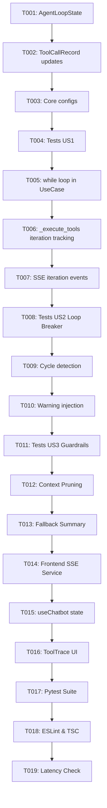

# Tasks: 064-agent-loop-architecture

**Input**: Design documents from `/specs/064-agent-loop-architecture/` (`spec.md`, `plan.md`, `research.md`, `data-model.md`)  
**Prerequisites**: `plan.md`, `spec.md`, `research.md`, `data-model.md`  
**Tests**: Unit tests with pytest in `backend/tests/unit/test_chatbot.py`  

## Format: `[ID] [P?] [Story] Description`
- **[P]**: Can run in parallel (different files, no dependencies)
- **[Story]**: User Story designation (Foundational, US1, US2, US3, Polish)

---

## Phase 1: Setup & Foundational Prerequisites

**Purpose**: Core state objects, loop limits, and loop signature tracking shared across all stories.

- [x] T001 [Foundational] Define `AgentLoopState` dataclass with `iteration`, `max_iterations`, `call_signatures`, and `add_call_signature()` in `backend/app/chatbot/domain/value_objects.py`.
- [x] T002 [Foundational] Add `iteration_index` and `duplicate_skipped` status support to `ToolCallRecord` in `backend/app/chatbot/domain/value_objects.py`.
- [x] T003 [P] [Foundational] Add loop-specific configurations (e.g. `CHATBOT_MAX_ITERATIONS: int = 5`, `CHATBOT_LOOP_TIMEOUT_SECONDS: int = 45`) in `backend/app/core/config.py`.

**Checkpoint**: Foundational loop state models ready and type-checked.

---

## Phase 2: User Story 1 - Multi-step Tool Chaining & ReAct Loop (Priority: P1) 🎯 MVP

**Goal**: Cho phép LLM thực hiện chuỗi công cụ nhiều bước (`Tool A -> Tool B -> Final Answer`) trong 1 phiên chat duy nhất mà không bị ngắt cưỡng bức ở vòng đầu tiên.

**Independent Test**: Khi người dùng hỏi một câu yêu cầu tra cứu liên hoàn (ví dụ bài tập chưa nộp kèm trạng thái đơn xin phép hoặc đối soát danh sách vắng), LLM tự động thực hiện 2+ vòng tool và đưa ra câu trả lời đầy đủ.

### Tests for User Story 1
- [x] T004 [US1] Viết unit test `test_agent_loop_multi_step_tool_chaining` trong `backend/tests/unit/test_chatbot.py` mô phỏng LLM gọi 2 lượt tool liên tiếp trước khi hoàn tất phản hồi.

### Implementation for User Story 1
- [x] T005 [US1] Tái cấu trúc hàm `execute` trong `backend/app/chatbot/application/send_chat_message_use_case.py` thành cấu trúc `while iteration < max_iterations`:
  - Cho phép truyền danh sách `tools` trong mọi lượt lặp thay vì đặt `None` ở lượt thứ 2.
  - Ngắt vòng lặp khi LLM không sinh thêm tool call (`pending_tools` rỗng) và tích lũy phản hồi `content`.
- [x] T006 [US1] Cập nhật phương thức `_execute_tools` trong `backend/app/chatbot/application/send_chat_message_use_case.py` để ghi nhận `iteration_index` vào từng `ToolCallRecord` và append cả `assistant` tool-call lẫn `tool` response vào `llm_messages`.
- [x] T007 [US1] Bổ sung phát event SSE `iteration_step` và `tool_call_start` / `tool_call_end` trong `backend/app/chatbot/application/send_chat_message_use_case.py`.

**Checkpoint**: User Story 1 hoàn thành - Agent Loop có thể chạy chuỗi công cụ nhiều bước độc lập.

---

## Phase 3: User Story 2 - Infinite Loop Detection & Cycle Breaker (Priority: P2)

**Goal**: Phát hiện và chặn đứng trường hợp LLM bị kẹt trong vòng lặp vô tận (gọi lại chính tool đó với tham số y hệt), nhắc nhở LLM tổng hợp câu trả lời dựa trên dữ liệu đã có.

**Independent Test**: Kiểm thử với kịch bản giả lập LLM cố gắng gọi lại tool `admin_get_unsubmitted_homeworks` lần thứ 2 với tham số cũ, hệ thống chặn thực thi và trả về thông điệp cảnh báo trong ngữ cảnh.

### Tests for User Story 2
- [x] T008 [US2] Viết unit test `test_agent_loop_duplicate_tool_call_prevention` trong `backend/tests/unit/test_chatbot.py` xác minh tool bị chặn khi gọi trùng lặp chữ ký `(tool_name, arguments)`.

### Implementation for User Story 2
- [x] T009 [US2] Tích hợp cơ chế kiểm tra `state.add_call_signature(tool_name, args)` trước khi chạy `self.tool_registry.execute_tool(...)` trong `backend/app/chatbot/application/send_chat_message_use_case.py`.
- [x] T010 [US2] Nếu phát hiện trùng lặp, bỏ qua lượt gọi thực tế, trả về kết quả giả định: `{"warning": "Công cụ này đã được gọi với tham số tương tự. Hãy sử dụng thông tin đã có để tổng hợp câu trả lời cho người dùng."}` vào danh sách `llm_messages`.

**Checkpoint**: User Story 2 hoàn thành - Hệ thống miễn nhiễm với lỗi lặp vô tận.

---

## Phase 4: User Story 3 - High-Capacity Context Guard & Max Iteration Limit (Priority: P3)

**Goal**: Tận dụng tối đa cửa sổ ngữ cảnh lớn (**66,816 tokens**), giữ nguyên 100% dữ liệu chi tiết của các công cụ và **chỉ kích hoạt Context Pruning khi thực sự có nguy cơ tràn context** (ước tính vượt ngưỡng an toàn ~50,000 tokens / ~200,000 ký tự), đồng thời ngắt an toàn khi chạm `max_iterations = 5`.

**Independent Test**: Khi context vẫn dưới ngưỡng an toàn (thực tế hầu hết các câu hỏi chỉ tốn 2,000 - 15,000 tokens), dữ liệu các bảng không bao giờ bị cắt tỉa; khi giả lập chèn dữ liệu vượt ngưỡng trần 50,000 tokens, bộ prune mới chủ động nén các payload cũ.

### Tests for User Story 3
- [x] T011 [US3] Viết unit test `test_agent_loop_context_pruning_only_on_threshold_overflow` trong `backend/tests/unit/test_chatbot.py` đảm bảo không prune khi context < ngưỡng an toàn, và chỉ nén khi vượt ngưỡng an toàn.

### Implementation for User Story 3
- [x] T012 [US3] Thêm hàm `_prune_context_history_if_needed(llm_messages: list[dict[str, Any]], max_token_threshold: int = 50_000)` trong `backend/app/chatbot/application/send_chat_message_use_case.py`. Cơ chế chỉ quét và nén các `tool` message cũ nhất khi tổng dung lượng ước tính vượt ngưỡng `max_token_threshold`.
- [x] T013 [US3] Thêm xử lý fallback khi `iteration >= max_iterations`: tự động ép buộc một lượt gọi LLM cuối cùng với `tools=None` kèm prompt yêu cầu tóm tắt dữ liệu hiện có để trả lời người dùng.

**Checkpoint**: User Story 3 hoàn thành - Bảo vệ tài nguyên và độ ổn định của hệ thống.

---

## Phase 5: User Story 4 - Real-time Tool Trace & Frontend Sync (Priority: P4)

**Goal**: Hiển thị sống động từng bước suy luận, tool bắt đầu/kết thúc trên giao diện người dùng shadcn AI Elements (`ToolTrace` và `Reasoning`).

**Independent Test**: Mở trình duyệt tại `http://localhost:5173/dashboard/assistant`, đặt câu hỏi liên hoàn và quan sát thấy từng tool xuất hiện mượt mà trong khi AI đang xử lý.

### Implementation for User Story 4
- [x] T014 [P] [US4] Cập nhật `chatbotService.streamChat` trong `frontend/src/features/chatbot/services/chatbot.service.ts` để đón nhận các sự kiện `tool_call_start`, `tool_call_end`, và `iteration_step`.
- [x] T015 [US4] Bổ sung state `activeTools` và `currentIteration` trong hook `frontend/src/features/chatbot/hooks/useChatbot.ts`.
- [x] T016 [US4] Hiển thị trạng thái các tool đang chạy thời gian thực trong `frontend/src/features/chatbot/components/ai-elements/Message.tsx` (dưới dạng `ToolTrace` accordion loading).

**Checkpoint**: Giao diện người dùng phản ánh trực quan 100% các vòng lặp của Agent Loop.

---

## Phase 6: Polish & Cross-Cutting Concerns

- [x] T017 [P] Chạy toàn bộ test suite chatbot: `cd backend && poetry run pytest tests/unit/test_chatbot.py`.
- [x] T018 [P] Chạy lint & typecheck frontend: `cd frontend && npx eslint src/features/chatbot && npx tsc -b`.
- [x] T019 Kiểm tra log thực tế và đo lường latency của chuỗi Agent Loop trên môi trường dev.

---

## Dependencies & Execution Order

