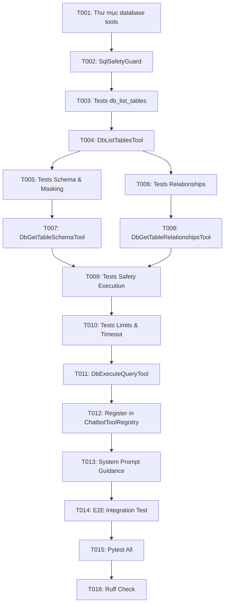

# Tasks: 065-dynamic-database-agent

**Input**: Design documents from `/specs/065-dynamic-database-agent/` (`spec.md`, `plan.md`, `research.md`, `data-model.md`)  
**Prerequisites**: `plan.md`, `spec.md`, `research.md`, `data-model.md`  
**Tests**: Pytest in `backend/tests/unit/test_database_tools.py`  

## Format: `[ID] [P?] [Story] Description`
- **[P]**: Can run in parallel (different files, no dependencies)
- **[Story]**: User Story designation (Foundational, US1, US2, US3, US4, Polish)

---

## Phase 1: Setup & Foundational Prerequisites

**Purpose**: Core database tooling folder structure, SQL safety parser, and sensitive column masks.

- [x] T001 [Foundational] Create database tools directory `backend/app/chatbot/infrastructure/tools/database/` with `__init__.py`.
- [x] T002 [Foundational] Implement `SqlSafetyGuard` utility in `backend/app/chatbot/infrastructure/tools/database/guard.py` enforcing:
  - Regex & keyword analysis permitting ONLY `SELECT` or `WITH ... SELECT`.
  - Blocking 100% of mutation keywords: `INSERT`, `UPDATE`, `DELETE`, `DROP`, `ALTER`, `TRUNCATE`, `GRANT`, `REVOKE`, `CREATE`, `REPLACE`, `EXEC`.
  - Automatic `LIMIT 50` injection if missing.
  - Identification and filtering of `SENSITIVE_COLUMNS` (`hashed_password`, `token`, `refresh_token`, `api_key`, `secret`, `zalo_bind_code`).

**Checkpoint**: Core SQL safety validator ready and unit-testable.

---

## Phase 2: User Story 1 - Table Overview Discovery (`db_list_tables`) (Priority: P1)

**Goal**: Cho phép AI Agent tra cứu danh sách toàn bộ các bảng trong database kèm mô tả tóm tắt nghiệp vụ để định hướng tra cứu.

**Independent Test**: Gọi tool `db_list_tables` trả về JSON danh sách các bảng (`users`, `violations`, `meetings`, `homeworks`...) kèm mô tả, không chứa bảng kỹ thuật `alembic_version`.

### Tests for User Story 1
- [x] T003 [P] [US1] Viết unit test `test_db_list_tables_tool` trong `backend/tests/unit/test_database_tools.py`.

### Implementation for User Story 1
- [x] T004 [US1] Cài đặt `DbListTablesTool` trong `backend/app/chatbot/infrastructure/tools/database/list_tables.py` kế thừa `BaseChatbotTool`:
  - Dùng `sqlalchemy.inspect(session.bind).get_table_names()`.
  - Ánh xạ với `TABLE_DESCRIPTIONS` nghiệp vụ.
  - Phân quyền: Cấp cho Admin/Mentor (`ViolationPermission.READ`).

**Checkpoint**: US1 hoàn thành - AI có thể định vị danh sách bảng nghiệp vụ.

---

## Phase 3: User Story 2 - Deep Table Schema & Relationship Discovery (Priority: P2) 🎯 MVP

**Goal**: Cung cấp 2 công cụ giúp AI soi chi tiết cột của 1 bảng (`db_get_table_schema`) và phân tích Foreign Keys / `join_hint` giữa các bảng (`db_get_table_relationships`).

**Independent Test**:
- Gọi `db_get_table_schema("users")` trả về các cột hợp lệ, không chứa `hashed_password`.
- Gọi `db_get_table_relationships(["users", "violations"])` trả về liên kết `violations.user_id -> users.id` kèm cú pháp `JOIN users ON users.id = violations.user_id`.

### Tests for User Story 2
- [x] T005 [P] [US2] Viết unit test `test_db_get_table_schema_masks_sensitive_columns` trong `backend/tests/unit/test_database_tools.py`.
- [x] T006 [P] [US2] Viết unit test `test_db_get_table_relationships_returns_join_hints` trong `backend/tests/unit/test_database_tools.py`.

### Implementation for User Story 2
- [x] T007 [P] [US2] Cài đặt `DbGetTableSchemaTool` trong `backend/app/chatbot/infrastructure/tools/database/get_table_schema.py`:
  - Dùng `sqlalchemy.inspect(session.bind).get_columns(table_name)`.
  - Tự động bỏ qua các cột trong `SENSITIVE_COLUMNS`.
  - Trả về `columns`, `primary_key`, `nullable`.
- [x] T008 [P] [US2] Cài đặt `DbGetTableRelationshipsTool` trong `backend/app/chatbot/infrastructure/tools/database/get_table_relationships.py`:
  - Dùng `sqlalchemy.inspect(session.bind).get_foreign_keys(table_name)`.
  - Quét qua danh sách các bảng đầu vào, trích xuất nguồn $\rightarrow$ đích.
  - Sinh chuỗi `join_hint` sẵn sàng sử dụng.

**Checkpoint**: US2 hoàn thành - AI nắm rõ cấu trúc cột an toàn và cách JOIN chính xác.

---

## Phase 4: User Story 3 - Safe Read-Only SQL Execution (`db_execute_query`) (Priority: P3)

**Goal**: Thực thi câu lệnh `SELECT` an toàn do AI sinh ra trên cơ sở dữ liệu PostgreSQL và trả về kết quả JSON.

**Independent Test**:
- Chạy `SELECT id, name FROM users LIMIT 2` $\rightarrow$ Trả về dữ liệu thành công.
- Chạy `DROP TABLE users` hoặc `DELETE FROM violations` $\rightarrow$ Ném lỗi `SecurityViolationError` và chặn đứng.

### Tests for User Story 3
- [x] T009 [P] [US3] Viết unit test `test_db_execute_query_blocks_mutations` trong `backend/tests/unit/test_database_tools.py`.
- [x] T010 [P] [US3] Viết unit test `test_db_execute_query_enforces_limit_and_timeout` trong `backend/tests/unit/test_database_tools.py`.

### Implementation for User Story 3
- [x] T011 [US3] Cài đặt `DbExecuteQueryTool` trong `backend/app/chatbot/infrastructure/tools/database/execute_query.py`:
  - Validate câu lệnh qua `SqlSafetyGuard`.
  - Thực thi qua `session.execute(text(validated_sql))` với statement timeout 5s.
  - Định dạng kết quả dạng danh sách dictionary JSON kèm `row_count` và tên `columns`.

**Checkpoint**: US3 hoàn thành - Agent có khả năng chạy câu truy vấn SQL an toàn 100%.

---

## Phase 5: User Story 4 - Tool Registration & System Prompt Optimization (Priority: P4)

**Goal**: Tích hợp cả 4 công cụ vào `ChatbotToolRegistry` và tối ưu `SYSTEM_PROMPT` để Agent Loop tự động thực hiện chuỗi Progressive Discovery.

**Independent Test**: Đặt câu hỏi trong unit test: *"Liệt kê vi phạm của Nguyễn Lê Vy"*, Agent tự động gọi `db_list_tables` $\rightarrow$ `db_get_table_relationships` $\rightarrow$ `db_execute_query` và trả về kết quả 10 vi phạm.

### Implementation for User Story 4
- [x] T012 [US4] Đăng ký 4 công cụ (`DbListTablesTool`, `DbGetTableSchemaTool`, `DbGetTableRelationshipsTool`, `DbExecuteQueryTool`) vào `ChatbotToolRegistry` trong `backend/app/chatbot/infrastructure/tools/registry.py`.
- [x] T013 [US4] Cập nhật `SYSTEM_PROMPT` trong `backend/app/chatbot/application/send_chat_message_use_case.py` hướng dẫn Agent quy trình 3 bước:
  1. Nếu cần dữ liệu đối soát/thống kê linh hoạt: gọi `db_list_tables` để xác định các bảng liên quan.
  2. Gọi `db_get_table_schema` hoặc `db_get_table_relationships` để lấy tên cột và cú pháp `JOIN`.
  3. Viết câu lệnh `SELECT` tối ưu và chạy qua `db_execute_query`.

**Checkpoint**: US4 hoàn thành - Hệ thống tích hợp toàn diện.

---

## Phase 6: Polish & Cross-Cutting Concerns

- [x] T014 [P] Viết unit test tích hợp hoàn chỉnh `test_agent_dynamic_database_query_e2e` trong `backend/tests/unit/test_chatbot.py`.
- [x] T015 [P] Chạy toàn bộ test suite: `cd backend && poetry run pytest tests/unit/test_chatbot.py tests/unit/test_database_tools.py`.
- [x] T016 Kiểm tra linting & type-safety backend: `cd backend && poetry run ruff check .`.

---

## Dependencies & Execution Order

