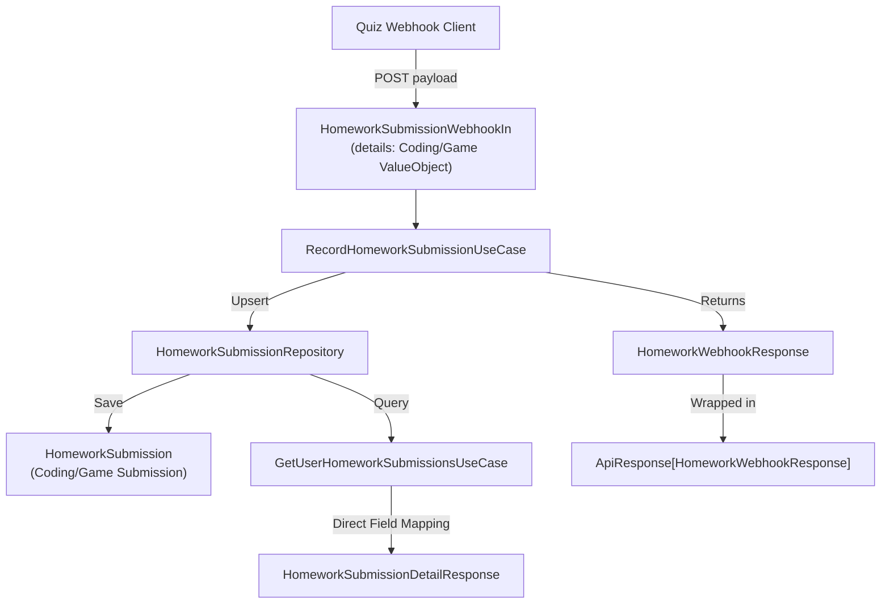

# Data Model: Homework Constitution Hardening

**Feature**: `070-homework-constitution-hardening`  
**Date**: 2026-11-16  
**Status**: Completed  

---

## 1. Overview
Tài liệu định nghĩa mô hình dữ liệu, DTOs và Value Objects sau khi đã chuẩn hóa theo các Nguyên tắc XIII, XIV, XVI, XVII của Hiến pháp hệ thống.

---

## 2. Value Objects & DTOs

### 2.1 `HomeworkSubmissionWebhookIn` (Inbound Webhook DTO)
Nhận payload từ Quiz Webhook khi có sự kiện nộp bài coding hoặc kết thúc game quiz.

```python
class HomeworkSubmissionWebhookIn(BaseModel):
    lesson_slug: str
    user_id: int
    type: SubmissionType
    submitted_at: UtcDateTime
    is_passed: bool = True

    # Chi tiết bài tập con (dành cho CODING)
    exercise_id: str | None = None
    exercise_title: str | None = None
    submission_id: str | None = None
    attempt_number: int = 1
    score: float | None = None
    original_filename: str | None = None

    # Strictly typed Value Object — cấm raw dict[str, Any]
    details: CodingSubmissionDetails | GameSubmissionDetails | None = None

    model_config = ConfigDict(from_attributes=True)
```

**Validation Rules**:
- `type`: Enum `SubmissionType.CODING` hoặc `SubmissionType.GAME`. Tự động uppercase và chuyển đổi từ chuỗi.
- `details`: Nếu payload gửi lên là `dict`, `model_validator(mode="before")` sẽ kiểm tra trường `type` và khởi tạo thành instance của `CodingSubmissionDetails` hoặc `GameSubmissionDetails`.
- `submitted_at`: Chuẩn hóa bắt buộc sang UTC timezone-aware qua `UtcDateTime`.

---

### 2.2 `HomeworkWebhookResponse` (Outbound Webhook DTO)
Thay thế `ApiResponse[dict[str, Any]]` bằng schema tường minh phục vụ API contract.

```python
class HomeworkWebhookResponse(BaseModel):
    status: str  # "recorded" | "updated" | "ignored"
    message: str | None = None
    reason: str | None = None
    submission_id: int | None = None
    homework_id: int | None = None
    user_id: int | None = None
    exercise_id: str | None = None

    model_config = ConfigDict(from_attributes=True)
```

**Status States**:
- `recorded`: Bản ghi bài nộp mới được ghi nhận thành công vào cơ sở dữ liệu.
- `updated`: Đã có bài nộp tương ứng, cập nhật lại trạng thái/điểm số mới nhất (Idempotent update).
- `ignored`: Bỏ qua do người dùng vãng lai (`user_id >= 1,000,000`) hoặc không tìm thấy bài tập tương ứng với `lesson_slug`.

---

### 2.3 `HomeworkSubmissionDetailResponse` (Audit Trail Read DTO)
DTO đại diện cho một bản ghi lịch sử nộp bài trả về cho học viên hoặc giảng viên.

```python
class HomeworkSubmissionDetailResponse(BaseModel):
    id: int
    homework_id: int
    user_id: int
    submission_type: SubmissionType
    exercise_id: str | None = None
    exercise_title: str | None = None
    score: float | None = None
    attempt_number: int = 1
    submitted_at: datetime | None = None
    is_passed: bool = True
    details: CodingSubmissionDetails | GameSubmissionDetails
    created_at: datetime | None = None

    model_config = ConfigDict(from_attributes=True)
```

**Attribute Mapping Contract**:
- Tất cả các trường được ánh xạ trực tiếp từ thuộc tính đã khai báo của `HomeworkSubmission` domain entity (`s.exercise_id`, `s.exercise_title`, `s.score`, `s.attempt_number`, `s.created_at`). Cấm sử dụng `getattr(s, ...)` phòng thủ.

---

## 3. Relationships & Data Flow


