# Data Model & Architecture Ports: Homework Clean Architecture

**Feature**: `071-architecture-redesign`  
**Date**: 2026-11-16  
**Status**: Completed  

---

## 1. Overview
Tài liệu định nghĩa các Cổng giao tiếp dữ liệu (Repository Ports) và Cấu trúc dữ liệu giả lập (In-Memory Fake Storage) phục vụ phân tách kiến trúc Hexagonal / Clean Architecture.

---

## 2. Ports Hierarchy & Interfaces

```mermaid
classDiagram
    class HomeworkRepositoryPort {
        <<interface>>
        +get_all(deleted) list[Homework]
        +get_paged(page, page_size, deleted) tuple[list[Homework], int]
        +get_by_id(homework_id) Homework
        +get_by_slug(slug) Homework
        +create(homework) Homework
        +update(homework) Homework
        +save(homework) Homework
        +delete(homework_id) bool
    }

    class HomeworkSubmissionRepositoryPort {
        <<interface>>
        +add_submission(submission) HomeworkSubmission
        +update_submission(submission, ...) HomeworkSubmission
        +get_submissions_by_user(homework_id, user_id) list[HomeworkSubmission]
        +get_submissions_by_homework(homework_id) list[HomeworkSubmission]
        +find_submission_match(homework_id, user_id, type, ...) HomeworkSubmission
        +get_submitted_exercise_ids(homework_id, user_id) set[str]
    }

    class HomeworkAssigneeRepositoryPort {
        <<interface>>
        +sync_assignees(homework_id, assignee_ids, default_deadline, force_override) void
        +assign_users(homework_id, user_ids, deadline, force_override) void
        +get_user_deadline(homework_id, user_id) datetime
        +get_assigned_user_ids(homework_id) set[int]
        +get_by_deadline_date(target_date) list[DueHomeworkAssignment]
        +get_assignees_with_user_info(homework_id) list[AssigneeUserInfo]
        +get_assigned_homework_ids(user_id) list[int]
    }

    class HomeworkRepository {
        +session: Session
    }
    class InMemoryHomeworkRepository {
        -storage: dict[int, Homework]
    }

    HomeworkRepositoryPort <|.. HomeworkRepository : implements (SQLAlchemy)
    HomeworkRepositoryPort <|.. InMemoryHomeworkRepository : implements (In-Memory)

    class HomeworkSubmissionRepository {
        +session: Session
    }
    class InMemoryHomeworkSubmissionRepository {
        -submissions: list[HomeworkSubmission]
    }

    HomeworkSubmissionRepositoryPort <|.. HomeworkSubmissionRepository : implements (SQLAlchemy)
    HomeworkSubmissionRepositoryPort <|.. InMemoryHomeworkSubmissionRepository : implements (In-Memory)

    class HomeworkAssigneeRepository {
        +session: Session
    }
    class InMemoryHomeworkAssigneeRepository {
        -assignees: dict[tuple[int, int], datetime]
    }

    HomeworkAssigneeRepositoryPort <|.. HomeworkAssigneeRepository : implements (SQLAlchemy)
    HomeworkAssigneeRepositoryPort <|.. InMemoryHomeworkAssigneeRepository : implements (In-Memory)
```

---

## 3. In-Memory Fake Storage Schema

### 3.1 `InMemoryHomeworkRepository`
- **Internal Storage**: `dict[int, HomeworkEntity]`
- **Auto-Increment ID Sequence**: `int` (bắt đầu từ 1)
- **Slug Index**: `dict[str, int]` tra cứu nhanh theo slug

### 3.2 `InMemoryHomeworkSubmissionRepository`
- **Internal Storage**: `list[HomeworkSubmission]`
- **Auto-Increment ID Sequence**: `int` (bắt đầu từ 1)
- **Query Logic**:
  - `get_submissions_by_user(hw_id, user_id)`: lọc `[s for s in storage if s.homework_id == hw_id and s.user_id == user_id]`
  - `find_submission_match(...)`: tìm kiếm bản ghi trùng khớp theo `homework_id`, `user_id`, `submission_type`, `exercise_id`, `submitted_at`.

### 3.3 `InMemoryHomeworkAssigneeRepository`
- **Internal Storage**: `dict[tuple[int, int], datetime]` (Key: `(homework_id, user_id)`, Value: `deadline`)
- **User Info Mocking Provider**: Cho phép nạp trước mock danh sách `AssigneeUserInfo(user_id, name, avatar_url)` phục vụ truy vấn hiển thị.
- **Max Deadline Rule**: Thực thi quy tắc cập nhật deadline tương đương 100% với phiên bản SQLAlchemy.
