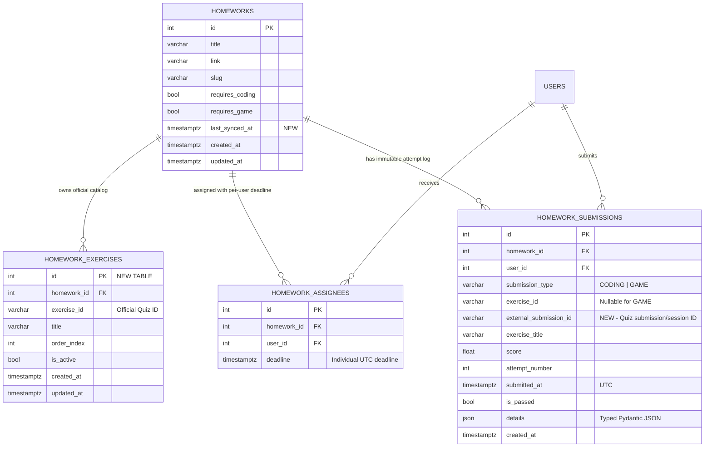
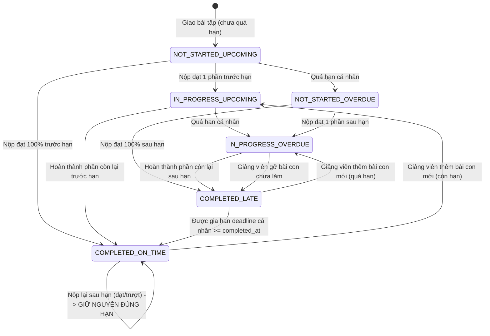

# Mô Hình Dữ Liệu (Phase 1): Xây Dựng Lại Hệ Thống Theo Dõi Trạng Thái Hoàn Thành Bài Tập

**Feature**: `073-rebuild-homework-tracking` | **Date**: 2026-11-18

---

## 1. Sơ Đồ Thực Thể Và Quan Hệ (ER Overview)



---

## 2. Chi Tiết Bảng Cơ Sở Dữ Liệu & Migration

### 2.1. Bảng Mới: `homework_exercises`

Lưu trữ danh mục bài tập con lập trình bắt buộc chính thức thuộc sở hữu của từng `Homework`.

| Cột | Kiểu dữ liệu | Ràng buộc | Mô tả |
|---|---|---|---|
| `id` | `INTEGER` | PK, autoincrement | Khóa chính nội bộ |
| `homework_id` | `INTEGER` | FK -> `homeworks.id` (`ON DELETE CASCADE`), NOT NULL | Bài tập cha |
| `exercise_id` | `VARCHAR(64)` | NOT NULL | Mã định danh chính thức của bài con từ Quiz API |
| `title` | `VARCHAR(255)` | NOT NULL | Tiêu đề bài tập con |
| `order_index` | `INTEGER` | NOT NULL, default `0` | Thứ tự hiển thị trên đề bài |
| `is_active` | `BOOLEAN` | NOT NULL, default `true` | `true` = đang thuộc đề bài hiện hành; `false` = đã bị gỡ khỏi đề trên Quiz |
| `created_at` | `TIMESTAMPTZ` | NOT NULL, default `now(UTC)` | Thời điểm tạo |
| `updated_at` | `TIMESTAMPTZ` | NOT NULL, default `now(UTC)` | Thời điểm cập nhật gần nhất |

**Indexes & Constraints**:
- `UNIQUE (homework_id, exercise_id)` (`uq_hw_exercises_hw_ex`)
- `INDEX ix_hw_exercises_hw_active (homework_id, is_active)`

### 2.2. Cập Nhật Bảng `homeworks`

| Cột mới | Kiểu dữ liệu | Ràng buộc | Mô tả |
|---|---|---|---|
| `last_synced_at` | `TIMESTAMPTZ` | NULL | Mốc thời gian gần nhất bài tập được đồng bộ danh mục & bài nộp từ Quiz API |

### 2.3. Cập Nhật Bảng `homework_submissions`

| Cột mới | Kiểu dữ liệu | Ràng buộc | Mô tả |
|---|---|---|---|
| `external_submission_id` | `VARCHAR(128)` | NULL | Định danh duy nhất của lượt nộp trên hệ thống Quiz (`submission_id` cho Coding, `session_id` cho Game) |

**Index mới (PostgreSQL Partial Unique Index)**:
- `uq_hw_sub_external_id`: `UNIQUE (homework_id, user_id, submission_type, external_submission_id) WHERE external_submission_id IS NOT NULL`

**Alembic Revision ID**: `044_hw_exercises_and_sub_id` (27 ký tự ≤ giới hạn 32 ký tự theo Constitution).

---

## 3. Domain Entities & Value Objects (`backend/app/homework/domain/`)

### 3.1. Enums Trạng Thái 2 Chiều (`value_objects.py`)

```text
CompletionStatus (StrEnum):
  - NOT_STARTED  : Chưa hoàn thành bất kỳ hạng mục yêu cầu nào
  - IN_PROGRESS  : Đã hoàn thành một phần (≥1 bài con Coding hoặc xong 1/2 hạng mục Coding/Game) nhưng chưa đủ 100%
  - COMPLETED    : Đã hoàn thành đủ 100% tất cả các hạng mục yêu cầu (không phân biệt nộp đúng hạn hay nộp trễ)

TimelinessStatus (StrEnum):
  - ON_TIME   : completion_status == COMPLETED và mọi hạng mục có first_passed_at <= deadline (hoặc deadline is None)
  - LATE      : completion_status == COMPLETED và có ít nhất 1 hạng mục có first_passed_at > deadline
  - UPCOMING  : completion_status != COMPLETED và (deadline is None hoặc now <= deadline)
  - OVERDUE   : completion_status != COMPLETED và deadline is not None và now > deadline
```

### 3.2. `HomeworkExercise` (`entity.py`)

```text
HomeworkExercise (BaseGenericEntity[int]):
  - homework_id: int
  - exercise_id: str
  - title: str
  - order_index: int = 0
  - is_active: bool = True
```

### 3.3. `ExerciseEvaluation` (`value_objects.py`)

Kết quả đánh giá của 1 bài tập con lập trình bắt buộc đối với 1 học viên:

```text
ExerciseEvaluation (BaseModel, frozen=True):
  - exercise_id: str
  - title: str
  - order_index: int
  - is_submitted: bool              # Có ít nhất 1 lượt nộp cho exercise_id này
  - is_passed: bool                 # Có ít nhất 1 lượt nộp đạt (is_passed == True)
  - first_passed_at: datetime | None # Mốc đạt sớm nhất (UTC) dùng để xét đúng hạn
  - latest_submitted_at: datetime | None
  - best_score: float | None
  - attempt_count: int
  - is_late: bool                   # Nếu is_passed: first_passed_at > deadline; nếu chưa passed: deadline < now
```

### 3.4. `SubmissionEvaluation` (`value_objects.py`)

Kết quả đánh giá SSOT duy nhất trả về từ `Homework.evaluate_submissions()`:

```text
SubmissionEvaluation (BaseModel):
  - completion_status: CompletionStatus
  - timeliness_status: TimelinessStatus
  - is_submitted: bool                    # == (completion_status == COMPLETED)
  - is_completed_on_time: bool            # == (COMPLETED and ON_TIME) — dùng cho CheckOverdueHomeworkUseCase
  - is_late: bool                         # == (timeliness_status == LATE)
  - is_overdue: bool                      # == (timeliness_status == OVERDUE)
  - completed_at: datetime | None         # Thời điểm chạm mốc hoàn thành 100% đầu tiên (max of first_passed_at)
  - coding_submitted: bool
  - coding_is_late: bool
  - coding_status: str                    # "COMPLETED" | "PARTIALLY_SUBMITTED" | "NOT_SUBMITTED"
  - total_coding_required: int
  - total_coding_completed: int
  - coding_exercises: list[ExerciseEvaluation]
  - game_submitted: bool
  - game_is_late: bool
  - game_first_passed_at: datetime | None
  - game_best_score: float | None
  - uncompleted_items: list[str]
```

### 3.5. Cập Nhật `Homework` Aggregate Root (`entity.py`)

- Thêm thuộc tính: `last_synced_at: datetime | None = None`
- Chữ ký mới của `evaluate_submissions(...)`:
  ```text
  evaluate_submissions(
      submissions: list[HomeworkSubmission],
      required_exercises: list[HomeworkExercise],
      deadline: datetime | None = None,
      reference_time: datetime | None = None,
  ) -> SubmissionEvaluation
  ```
- **Luật nghiệp vụ bất biến (Invariants)**:
  1. Nếu cả `requires_coding == False` và `requires_game == False` (dữ liệu legacy): mặc định chuẩn hóa `has_coding = True`.
  2. Chỉ các `HomeworkExercise` có `is_active == True` mới được đưa vào `active_exercises` để tính `total_coding_required`.
  3. **Coding**:
     - Nếu `has_coding == True` và `active_exercises` không rỗng:
       - Với từng `ex` trong `active_exercises` (sắp theo `order_index, exercise_id`):
         - Lọc các `s` có `s.is_coding and s.exercise_id == ex.exercise_id`.
         - `passed = [s for s in ex_subs if s.is_passed]`.
         - `first_passed_at = min(ensure_utc(s.submitted_at) for s in passed)` nếu `passed` không rỗng.
         - `ex_is_late = (first_passed_at > dl)` nếu đã passed và có deadline; ngược lại `(now > dl)` nếu chưa passed và có deadline.
       - `total_coding_required = len(active_exercises)`, `total_coding_completed = count(ex.is_passed)`.
       - `coding_submitted = (total_coding_completed >= total_coding_required)`.
       - `coding_is_late = any(ex.is_late for ex in coding_evals if ex.is_passed)` (khi đã `coding_submitted`).
       - `coding_first_completed_at = max(ex.first_passed_at for ex in coding_evals)` nếu `coding_submitted`.
     - Nếu `has_coding == True` nhưng `active_exercises` rỗng (bài tập chưa đồng bộ được bài con):
       - Xét tất cả `s` có `s.is_coding and s.is_passed`.
       - Nếu có ≥ 1 lượt đạt -> `coding_submitted = True`, `total_coding_required = 1`, `total_coding_completed = 1`, `coding_first_completed_at = min(ensure_utc(s.submitted_at))`.
       - Ngược lại -> `coding_submitted = False`, `total_coding_required = 1`, `total_coding_completed = 0`.
     - Nếu `has_coding == False` -> `coding_submitted = True`, `coding_status = "COMPLETED"`, `coding_is_late = False`.
  4. **Game**:
     - Nếu `has_game == True`:
       - Lọc `passed_game = [s for s in submissions if s.is_game and s.is_passed]`.
       - Nếu có ≥ 1 -> `game_submitted = True`, `game_first_passed_at = min(ensure_utc(s.submitted_at) for s in passed_game)`, `game_is_late = (game_first_passed_at > dl)` nếu có deadline.
     - Nếu `has_game == False` -> `game_submitted = True`, `game_is_late = False`.
  5. **Tổng hợp 2 chiều**:
     - `all_completed = (not has_coding or coding_submitted) and (not has_game or game_submitted)`.
     - Nếu `all_completed`:
       - `completion_status = COMPLETED`.
       - `completed_at = max(các mốc hoàn thành của phần bắt buộc)`.
       - `is_any_late = (has_coding and coding_is_late) or (has_game and game_is_late)`.
       - `timeliness_status = LATE if is_any_late else ON_TIME`.
     - Nếu chưa `all_completed`:
       - `has_any_progress = (has_coding and total_coding_completed > 0) or (has_game and game_submitted)`.
       - `completion_status = IN_PROGRESS if has_any_progress else NOT_STARTED`.
       - `completed_at = None`.
       - `timeliness_status = OVERDUE if (dl is not None and now > dl) else UPCOMING`.

### 3.6. Cập Nhật `HomeworkSubmission` (`entity.py`)

- Thêm thuộc tính: `external_submission_id: str | None = None` (điền từ `submission_id` của Coding hoặc `session_id` của Game trong factory methods `create_coding` / `create_game` và ORM `to_entity` / `from_entity`).

---

## 4. State Transitions (Chuyển Đổi Trạng Thái)



---

## 5. Domain Ports (`backend/app/homework/domain/ports/`)

### Port mới: `HomeworkExerciseRepositoryPort`
- `get_active_by_homework(homework_id: int) -> list[HomeworkExercise]`
- `get_active_by_homework_ids(homework_ids: list[int]) -> dict[int, list[HomeworkExercise]]`
- `sync_exercises(homework_id: int, exercises: list[HomeworkExercise]) -> list[HomeworkExercise]` (upsert các bài con hiện hành theo `exercise_id`, đặt `is_active = False` cho các bài con cũ không còn trong danh sách mới)

### Cập nhật `HomeworkSubmissionRepositoryPort`
- **Xóa** `get_required_exercise_ids_map()` (loại bỏ vĩnh viễn nguồn suy diễn sai lệch).
- Cập nhật `find_submission_match(...)`: tìm theo `external_submission_id` trước, fallback khớp chính xác `(homework_id, user_id, submission_type, exercise_id, submitted_at)` khi thiếu `external_submission_id`. **Cấm** match chỉ bằng `(homework_id, user_id, exercise_id)`.
- Đảm bảo `get_user_submissions_for_homeworks(...)` trả về kiểu nhất quán `list[HomeworkSubmission]` giữa SQLAlchemy Repo và InMemory Repo.
